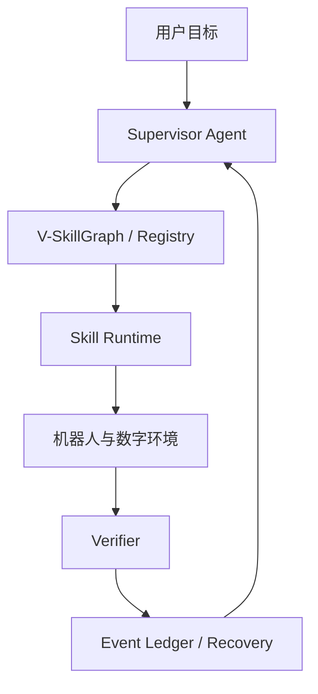

# 架构说明

## 组件关系

## 责任边界

### Supervisor Agent

- 接收目标和结构化任务状态；
- 生成 L2/L3 Skill 调用；
- 根据结果选择继续、恢复、回滚或求助；
- 不直接访问 ROS 控制器或厂商 SDK。

### Skill Runtime

- 校验前置条件；
- 锁定手臂、相机、键盘和沙箱等资源；
- 执行有限时域 Skill；
- 调用独立 Verifier；
- 记录请求、证据、结果和失败码。

### Verifier

- 接收 Skill 的状态声明和原始证据；
- 使用规则、状态估计器、视觉模型或数字 Oracle 验证；
- 只向状态快照写入已验证事实；
- 学习式 Verifier 必须保持相同接口。

### Recovery Manager

- 将结构化失败码映射到局部恢复 Skill；
- 失败码无法处理时交回高层 Agent 重规划；
- 恢复次数由场景配置限制，避免无限循环。

### Graph Supervisor

- 从 JSON 加载并验证无环 SkillGraph；
- 只执行依赖已完成的就绪节点；
- 每个节点成功后保存 SQLite 检查点；
- 优先复用历史成功恢复记录，否则使用默认失败码路由；
- 支持中断后在新进程中恢复任务。

## 适配层

`interfaces.py` 定义四类端口：

- `RobotAdapter`：未来接 ROS 2 Action 或 Unitree SDK；
- `PerceptionAdapter`：未来接屏幕 OCR、键盘/椅子检测；
- `CodeAgentAdapter`：未来接 Codex 沙箱；
- `TestRunnerAdapter`：未来接独立测试执行器。

核心运行时不依赖具体机器人、模型或通信中间件，因此仿真、真机和离线回放可以共用同一套 Skill 契约。

## 状态写入原则

1. Runtime 把 `StateSnapshot` 副本交给控制器；
2. 控制器返回“状态声明 + 证据”，不能直接修改正式状态；
3. 原子观测必须来自配置的可信证据源；
4. 派生状态如 `terminal_ready` 必须由显式规则或学习式 Verifier 计算；
5. 未验证状态不能成为后续 Skill 的前置条件；
6. 所有状态变更必须能够追溯到调用和证据。
