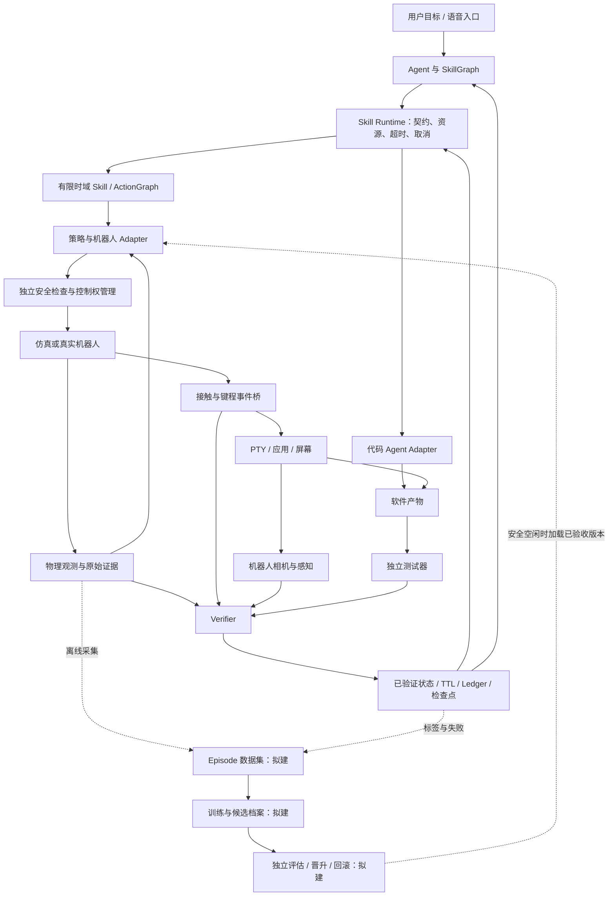

# 统一系统架构

本文定义整个项目共同遵守的边界与代码归属。能力状态以[子项目登记](WORKSTREAMS.md)为准；[学习设计](research/learning/LEARNING_SYSTEM_ARCHITECTURE.md)和[RSI 设计](research/rsi/RSI_INTEGRATION_PLAN.md)是本架构内的专项扩展，未实现部分不能当成当前调用链。

## 1. 一套核心，两类循环，多种后端

在线循环负责执行与恢复；离线循环负责训练、评估和候选晋升。Dex3/Dex5、站姿/坐姿、Isaac 5.1/6.0.1 是不同实验配置与后端，不分别拥有一套高层 Agent、状态语义或完成标准。

图中的统一控制权管理、完整训练与发布链仍是目标设计。现有进程内资源锁和阶段守卫不能等价于跨进程、跨策略的硬件安全保证。

## 2. 层与代码归属

以下为逻辑分层，保留现有导入路径，不为整理文档批量移动运行代码。

| 边界 | 现有模块（相对 `src/vskill_os/`） | 职责与限制 |
|---|---|---|
| 契约与事实 | `domain.py`、`contracts.py`、`registry.py`、`config.py` | 版本、资源、失败码、Evidence、StateSnapshot；核心使用标准库 |
| 任务编排 | `graph.py`、`graph_executor.py`、`orchestrator.py`、`voice/` | 目标与就绪节点；只调用 L2/L3 技能，不访问电机 |
| 执行基础设施 | `runtime.py`、`ledger.py`、`recovery.py`、`ipc.py` | 超时、取消、资源锁、状态有效期、日志与恢复；worker 协议不等于真实后端 |
| 有限时域技能 | `skills/`、`action_graph/`、`typing.py`、`chair/skill.py` | 从目标组织动作和交接；图 schema 拒绝关节命令 |
| 控制领域 | `control/`、`robot/` | 阶段守卫、速度约束、坐下/坐姿命令与硬件身份；实际关节输出只进入低层适配边界 |
| 独立验证 | `verifier.py`、`action_graph/runtime.py` 中的 Verifier、`chair/verification.py`、`simulation/` 中各实验验证器、`tools/verify_*.py` | 读取证据判定结果；奖励、控制器和生成代码不能自行授予成功 |
| 可选实现 | `adapters/isaac/`、`adapters/virtual_computer.py`、`adapters/local_code_agent.py`、`adapters/chair_*.py` | Isaac、Torch、PTY/Pygame、模型及外部进程；通过 `interfaces.py` 或专项 worker 契约接入 |
| 轻量模拟与实验模型 | `simulation/`、`chair/model.py`、`chair/training.py`、`chair/runner.py` | 环境模型、资产清单、桥接和研究协议；替身成绩标注为替身 |
| 装配与入口 | `cli.py`、`demo.py`、各实验 CLI、`Makefile` | 选择 Registry、适配器和配置；允许组装具体实现，不放公共业务规则 |

`simulation/` 当前混有环境、数据模型和独立验证器，是待逐步收敛的历史目录；不能仅凭路径名推断其证据等级。`chair/` 是一个研究子域，已有训练协议可复用，但不是所有技能的通用学习系统。

依赖原则：具体实现依赖契约；核心不反向导入 Isaac/Torch/厂商 SDK。组合具体实现的职责留在入口，避免核心通过条件导入感知每一种实验路线。

## 3. 一次技能调用的状态与证据路径

1. Agent 提交版本化技能名、目标和超时；Registry 解析契约。
2. Runtime 处理 TTL/依赖失效，检查前置条件与资源；控制器读取状态副本。
3. 控制器通过 Adapter 执行有限时域动作，返回声明、失败码和原始证据。
4. Verifier 检查可信来源、局部后置条件和下一技能就绪性，Runtime 据此提交事实。
5. Ledger 保存调用与证据，GraphSupervisor 成功后保存检查点；失败进入有界恢复。

**当前实现缺口：** `runtime.py` 在等待资源锁前检查前置条件并复制状态。排队期间状态可能过期或被撤销；“锁内重检、执行中撤销、跨 worker 控制权”属于后续硬化任务，见路线图 G1，不能在接口存在时宣称已经保证。

原子观测必须来自配置的可信源；派生状态必须有显式规则。椅子移动会使工作姿态和键盘标定失效，文件变化应使旧软件测试结论失效；具体新增依赖需在任务内实现并测试，不能由文档自动生效。

## 4. 任务图、动作图与策略的区别

| 对象 | 表达什么 | 不能做什么 |
|---|---|---|
| SkillGraph | 导航、坐下、输入、观察、测试之间的依赖 | 不能携带关节轨迹 |
| ActionGraph | 单个技能内的键号、执行者、接触、保持、释放与屏幕门禁 | 不能绕过 Runtime 资源与独立验证 |
| Policy Adapter | 观测到低层动作的映射、模型加载与控制频率 | 不能提交已验证任务事实 |
| Safety / 控制权 | 限幅、限速、支撑与停止；控制者交接 | 不能受 Agent/奖励函数关闭 |

历史触键路径采用笛卡尔预定位和 DLS/IK，算法留在 Isaac Adapter。无 IK 路线应新增执行策略，复用目标和证据语义，不把旧笛卡尔节点偷偷解释成 IK。学习动作空间、数据排除规则和策略 manifest 详见[学习专项设计](research/learning/LEARNING_SYSTEM_ARCHITECTURE.md)。

## 5. 后端与实验配置边界

| 路线 | 手型 / 姿态 | 运行环境 | 共享内容 | 隔离内容 |
|---|---|---|---|---|
| D3-5 | 双 Dex3 / 固定基座 | Isaac 5.1 + Lab 2.3.2 | 技能语义、事件与验证约束 | 历史资产、DLS 与诊断报告 |
| D5 | 双 Dex5 / 受支撑或自由坐姿 | Isaac 5.1 + Lab 2.3.2 | 核心、键盘桥、软件端口 | 耦合、安装近似、坐下控制、IK 基线 |
| D3-6 | 双 Dex3 / 固定站姿双食指 | 独立工作树，Isaac 6.0.1 | 拟复用核心接口与证据字段 | Python/Isaac 环境、启动守卫、站姿场景 |
| LEARN | 严格无 IK 的指定手型/姿态 | 后端在实验配置中锁定 | 同一技能契约与独立验收 | 数据来源、动作维度、权重、观测 schema |
| REAL | 实际确认的 G1 机型与手型 | 未来 ROS 2 / DDS Adapter | 同一契约和 Verifier 语义 | 时钟、传感器、安全控制与硬件身份 |

控制方式必须显式记录：受支撑、自由根、IK、冻结学习策略、直接关节学习策略均是不同条件。Isaac 6 的分支结果不触发整个项目默认升级。

## 6. 软件闭环与学习闭环

物理链是“接触/键程 → 事件 → PTY → 屏幕纹理 → 机器人相机”。直接读取 PTY 可作为诊断 Oracle，但不能替代机器人读屏。Runtime 直接调用代码 Agent 是软件协作路径，不能作为实体输入证据；两条路径都需对固定软件产物运行独立测试。

现有 `LocalCodexAdapter` / `LocalTestRunnerAdapter` 是适配实现，完整隔离与真实修复循环仍待验收。`artifacts/` 中的工作目录不等于安全沙箱。

学习系统只产出候选策略和评估材料；RSI 扩展在同一条训练链上增加失败驱动采样、档案、晋升与回滚。两者共用 `learning/` 数据层，已有版本化 `EpisodeRecord`、离线契约评估和具名动作 schema；动作映射位于可选 Adapter，完整策略包及晋升尚待扩展。底层框架留在可选 Adapter，独立评估器不复用训练奖励的成功布尔值，也不直接写入 Runtime 已验证状态。

当前[验证反馈驱动技能学习](../verification-feedback-skill-learning/README.md)在该架构内增加“证据历史 → 输入/验证/恢复决策”的研究策略。其输出仍是有时限的技能请求，低层直接关节策略位于 Adapter；模型信念与已验证状态分开，实际文本真值只用于监督/独立评估，新屏幕观察必须遵守统一验证预算。已实现离线证据契约和固定工位单键物理 reset/step：关节接口只供低层适配器使用，原始记录交给独立评估器，不写入 Runtime 已验证事实。按请求反馈、批环境与真实终端/机器人相机复验也已交付；VF-02-T01 已补充归一化动作、具名掩码与停止恢复映射，T02 已在可选 Torch/Isaac Adapter 中完成单键 PPO 诊断。训练在线计数与独立成功判定分离；冻结权重在原单环境执行，复核器从原始物理记录重算输入和动作，再调用物理 Verifier。候选尚未注册为 Runtime 技能。见[单键 PPO 说明](../verification-feedback-skill-learning/02_joint_ppo_baseline/SINGLE_KEY_PPO.md)。

## 7. 渐进迁移边界

| 顺序 | 具体工作 | 完成后仍保留什么 |
|---|---|---|
| G0 本轮 | 统一入口、状态、代码归属和工作树登记 | 原实验文档、旧运行命令与历史快照 |
| G1 | 完成锁内重检与撤销语义；统一运行证据引用、控制方式和后端声明 | 历史报告原文，不伪造缺失来源 |
| G2 | 提取经对照测试的资产/键盘桥/桌面端口，逐项适配站姿分支 | 5.1 / 6.0.1 各自入口、失败样例与报告 |
| L0–L2 | 扩展已有 `learning/` 离线证据层，通过可选适配器添加环境与学习执行器 | 旧 IK 复现入口，明确标注为基线 |
| I0 | 添加候选档案、独立晋升与回滚 | 独立 Runtime、Verifier 与安全规则 |

未交付的目标模块只有代码与验收一起到位才可标注为实现；已有离线证据层不能替代物理环境或学习执行器。旧基础架构说明保留在[历史快照](archive/2026-09-25/ARCHITECTURE.md)。
