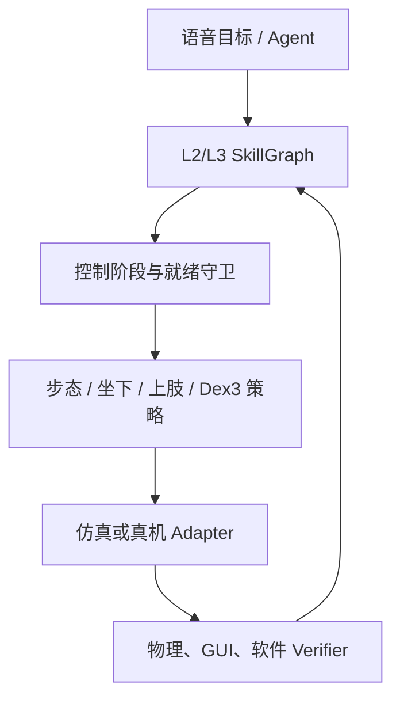

# 分阶段运控、坐下与实体打字

## 控制主线

Agent 只决定有限时域 Skill；安全层决定控制模式能否切换；策略只在获授权的身体区域和阶段内工作。



代码入口：

- `vskill_os.control.phases`：不可跳级的控制状态机；
- `vskill_os.control.commands`：低维根速度意图与风险控制权分配；
- `vskill_os.control.sitting`：接触守卫驱动的坐下子阶段；
- `vskill_os.control.seated_locomotion`：无动力轮椅坐姿移动的限幅、守卫与可验证指标；
- `vskill_os.typing`：键盘几何、Dex3 指派、组合键与错字修复；
- `vskill_os.skills.simulation`：以上控制状态与现有 SkillGraph 的完整集成。

## 全身控制阶段

| 阶段 | 控制器插槽 | 主要输入 | 必须满足的交接条件 |
|---|---|---|---|
| `stand_ready` | 站立保持 | IMU、关节、足底接触 | 安全状态、策略兼容性已确认 |
| `locomotion` | G1 velocity policy | `{vx, vy, yaw_rate}`、本体状态 | 到站位姿、双脚稳定、速度在安全范围 |
| `station_alignment` | 几何足步/视觉伺服 | 椅子/桌子相对位姿 | 骨盆和双脚落入坐下入口域 |
| `sit_transition` | 运动模仿 + 接触策略 | 参考动作、座椅、足/臀接触 | 负载转移完成，无滑动/冲击超限 |
| `seated_stabilization` | 坐姿稳定器 | IMU、座椅压力、足底、躯干速度 | 骨盆和躯干速度持续低于阈值 |
| `seated_locomotion` | passive-chair velocity policy | `{vx, vy, yaw_rate}`、本体状态 | 接触/倾角安全，产生非零进度，停止后重新稳定 |
| `upper_body_operation` | 上肢 IK/WBC + 残差 | 末端目标、视线、躯干扰动 | 屏幕可见、双手可达 |
| `keyboard_calibration` | 手眼标定与视觉伺服 | 键盘角点、键帽、腕部相机 | 键位姿态和可达性已验证 |
| `typing` | Dex3 指尖控制 | 键位目标、接触、键盘事件、OCR | 当前键已触发、指尖释放、姿态仍稳定 |
| `recovery` | 局部恢复 Skill | 失败码和证据 | 恢复后重新通过原阶段入口守卫 |
| `safe_stop` | 独立安全控制器 | 急停/越限信号 | 只能由外部复位离开 |

## 步态接口

现有/后续的 Unitree RL Lab ONNX 速度策略保持低维命令接口：

```text
Agent 的导航目标
→ 导航 Skill
→ 限幅后的 {vx, vy, yaw_rate}
→ G1 locomotion executor
```

核心层只负责命令维度、数值范围和控制阶段校验。避障、定位和普通防跌倒由导航、步态策略与独立 Safety Supervisor 负责，不引入额外地形风险模型。

优先参考：

- [Unitree RL Lab](https://github.com/unitreerobotics/unitree_rl_lab)：G1 29DOF velocity/mimic 基线；
- [Unitree MuJoCo](https://github.com/unitreerobotics/unitree_mujoco)：低成本 sim-to-sim 与 SDK2 控制回归；
- [BeyondMimic](https://github.com/HybridRobotics/whole_body_tracking) 及其 [C++ ONNX 部署器](https://github.com/HybridRobotics/motion_tracking_controller)：全身 motion prior 与产物元数据参考。
- [GR00T Whole-Body Control](https://github.com/NVlabs/GR00T-WholeBodyControl)：G1 decoupled WBC、遥操作与数据导出参考；接入前仍需按实际手部质量、机型和温升做独立验证。

## 坐下的六段闭环

`StagedSitController` 不直接生成关节角，而是为每段选择控制器插槽和守卫：

1. `reverse_alignment`：几何/视觉伺服将骨盆、双脚对准椅子；
2. `controlled_descent`：模仿策略跟踪平滑参考，双脚保持接触；
3. `contact_confirmation`：臀部接触置信度不足时禁止负载转移；
4. `load_transfer`：任务残差策略抑制滑动和冲击；
5. `stabilization`：骨盆线速度和躯干角速度进入阈值；
6. `work_pose`：在稳定约束内优化屏幕视野和双手键盘可达性。

推荐实现不是重新从零训练“坐下”，而是：

```text
WBC-AGILE / 重定向动作 motion prior
+ 椅子与桌面条件化 residual policy
+ 接触/稳定 Verifier
+ Agent 可调用的恢复 Skill
```

[WBC-AGILE](https://github.com/nvidia-isaac/WBC-AGILE) 已公开 G1 sit-down/stand-up、velocity-height、teleoperation 等任务，适合作为 sit policy adapter 的第一选择；[VideoMimic](https://arxiv.org/abs/2505.03729) 可参考场景条件化视频模仿；[HoST](https://github.com/InternRobotics/HoST) 用作跌倒后站起恢复，而不是工作坐姿控制器。

## 无动力轮椅上的坐姿移动

[Stay Seated](https://arxiv.org/abs/2608.28090) 展示了 G1 通过间歇足—地接触推动
机器人—座椅系统，在骨盆没有刚性固定到座椅的情况下跟踪
`{vx, vy, yaw_rate}`。本项目把这一能力放在坐下和键盘标定之间：

```text
work_pose_ready
→ reposition_while_seated({vx, vy, yaw_rate}, duration)
→ seated_locomotion
→ seated_stabilization
→ upper_body_operation
→ seated_reposition_verified
```

实现保留三条边界：

1. Agent 只给出低维速度与最长 5 秒的有限时域，不接触 29 维关节目标；
2. 策略 actor 只允许 96 维本体感觉与速度命令，座椅和接触真值只进入训练期 critic（总计 217 维）；
3. 控制器的“成功”声明不够，Verifier 必须从原始指标确认真实进度、速度 RMSE、座面接触、骨盆偏移、躯干/椅子倾角和最终静止。

论文训练命令范围为 `vx, vy ∈ [-1, 1] m/s`、`yaw_rate ∈ [-0.5, 0.5] rad/s`；
本项目在没有完成具体机型、座椅和地面量化前，将部署侧平移限幅保守设为
`0.5 m/s`，且使用比论文训练终止条件更严格的运行时接触/倾角守卫。

训练配方不被写成未经验证的结论：SY+CC 在文中最一致，FS 可降低 CoT
但会增大跟踪误差，FS-only 的部分随机种子还会收敛到“保持坐着但不移动”的
局部最优。因此策略清单会标记 FS-only 风险，评测同时要求超时成功和非零运动进度。

## Dex3 实体打字

Dex3 每手七个手部自由度，抽象为 thumb 3 + index 2 + middle 2。工程不让 LLM 输出这七维命令，而采用以下流水线：

1. 键盘平面与键距标定；
2. 文本转换为按键和 modifier 序列；
3. 依据键区分配左右手和拇/食/中指；
4. 上肢 WBC 到预接触位；
5. 指尖阻抗/视觉伺服完成按压；
6. 同时读取物理键盘事件和屏幕 OCR；
7. 二者一致才接受；否则退格至最长正确前缀后补写。

`TypingPlanner.repair(expected, observed)` 已实现可测试的纠错计划。下一层策略训练应采用：

- 几何控制作为可解释基线；
- XR 示范/遥操作采集手腕与指尖轨迹；
- 单键残差策略学习键帽偏差、接触深度和机构回差；
- 键盘事件提供自动稠密标签，OCR作为独立后置条件；
- 先单键与组合键，最后才训练连续文本。

参考项目：

- [Unitree XR Teleoperate](https://github.com/unitreerobotics/xr_teleoperate)：官方 G1 29DOF + Dex3 遥操作和数据采集；
- [Unitree LeRobot](https://github.com/unitreerobotics/unitree_lerobot)：双臂灵巧手数据训练基线；
- [Isaac Lab G1 环境](https://isaac-sim.github.io/IsaacLab/main/source/overview/environments.html)：固定上身 IK 与 locomanipulation 环境；
- [G1 Piano Play](https://github.com/meetsitaram/g1-piano-play)：坐姿触键场景参考，但目前更接近实验性 reach/contact 基线，不应视为现成打字方案。

## 无时间表的阶段门槛

| 构建阶段 | 只解决什么 | 退出条件 | 当前状态 |
|---|---|---|---|
| S0 契约与仿真 | 控制阶段、证据、恢复、G1 身份 | 纯 Python 全测试通过 | 已实现 |
| S1 速度执行器 | ONNX locomotion + 风险门控 | 命令/观测维度校验；MuJoCo/Isaac 一致 | 接口已实现，待接权重 |
| S2 坐下基线 | WBC-AGILE sit/stand adapter | 六段守卫和故障注入通过 | 阶段控制已实现，待外部 adapter |
| S3 工作坐姿 | 上肢扰动下保持稳定 | 屏幕可见、双手可达、姿态阈值通过 | 仿真语义已实现 |
| S4 坐姿移动 | passive-chair velocity policy | 非零进度、跟踪/接触/倾角与再稳定联合验证 | 契约、守卫、仿真故障恢复和策略清单已实现，待 mjlab 权重 |
| S5 单键/组合键 | 键盘标定与物理触键 | 键事件与屏幕双验证 | P2 自动事件诊断已存在；GUI 可见触键和 camera-only OCR 尚未通过 |
| S6 连续文本 | 多指调度与自主纠错 | 文本成功率和恢复率达到门槛 | 待训练 |
| S7 语音 Agent 闭环 | 本地 ASR/LLM 调用 L2/L3 | 越权调用为零；完整任务可验证 | 适配层与基线已实现 |
