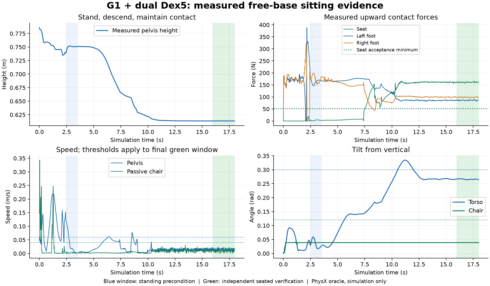

# 双 Dex5 与被动办公椅：自由平衡坐下实验

状态：自由坐下单项已通过限定配置下的独立仿真验收，2026-09-23；P4 整体仍为 `PARTIAL`。受支撑十指打字基线与本实验分别验收。自由坐下的结果以保存的接触轨迹和独立验证为准，不能由录像存在、策略加载或下蹲高度推断。

## 保存的普通椅子基线

原普通椅子的场景、录像、三个阶段截图与原始报告已保存在 [`artifacts/dex5/baselines/fixed-chair-assisted-20260923/`](../artifacts/dex5/baselines/fixed-chair-assisted-20260923/)。

- [`scene.usd`](../artifacts/dex5/baselines/fixed-chair-assisted-20260923/scene.usd) 保存初始场景层和原来的资产引用；不是逐帧烘焙的动作文件。
- [`demo.mp4`](../artifacts/dex5/baselines/fixed-chair-assisted-20260923/demo.mp4) 保存原来的受支撑坐下与双手十指打字。
- [`manifest.json`](../artifacts/dex5/baselines/fixed-chair-assisted-20260923/manifest.json) 保存文件哈希。原场景资产与远程地面引用仍需可访问，跨机器应重新生成。

该基线使用骨盆平移/升降机构，不能证明自由平衡。原通过记录、姿态种子与打字 Adapter 保留不变，见 [Dex5 演示](DEX5_SEATED_DEMO.md)。

## 论文启发与实现边界

[Stay Seated 原文](https://arxiv.org/html/2608.28090v1)和[作者公告](https://www.takatohorii.jp/blog/rsj2026-yanagida-seated-locomotion/)研究已经坐在无动力轮椅上的 G1，通过足地作用力驱动机器人—椅子系统；骨盆与座面没有刚性连接。它不提供站立到坐下的直接证明。本文借鉴分离的身体/椅子动力学、骨盆碰撞细化、接触与滑移评价。论文使用 mjlab/MuJoCo，不能直接将其接触求解参数当成 PhysX 参数。

当前没有将作者的坐姿移动策略接入本项目。本实验采用独立来源的 [NVIDIA GR00T WholeBodyControl](https://github.com/NVlabs/GR00T-WholeBodyControl) 平衡网络作为站立和高度控制候选，**不称为 Stay Seated 复现**，也没有宣称该网络已适配真实 G1 + Dex5。

## 资产和控制

| 项目 | 实现与假设 |
| --- | --- |
| 机器人 | 官方锁定版本 G1 mode 15 + 左右 Dex5-1；69 个关节坐标，61 个主动、8 个近似硬耦合坐标 |
| 自由底座 | 不固定到世界；没有骨盆滑轨、升降机构、座椅焊接或托举外力；运动中不写根位姿 |
| 初始状态 | 只在第一步前设置一次站姿和根状态；必须有完整站立观测，直接从坐姿初始化不能通过 |
| 手腕安装 | 自由坐下变体将掌根沿腕轴移至 0.10 m，消除较大 Dex5 掌壳与 G1 腕壳重叠；未标定真实转接板质量/几何 |
| 碰撞 | 启用全身自碰撞；骨盆补上源 URDF 缺失的碰撞网格，骨盆/手部采用凸分解；仅过滤掌壳与各指第二个同心基关节壳体的 10 对机构碰撞 |
| 被动椅 | 从用户指定 P1 USD 抽取，11 个刚体、5 个转向和 5 个滚动关节，无驱动、无世界固定关节 |
| 轮地模型 | 保留 P1 以滑动为主的摩擦与滚动限制；没有独立座面旋转关节，尚非论文球形万向轮模型或真实轮胎辨识模型 |
| 座垫模型 | 默认采用 PhysX 力型隐式弹簧接触，20,000 N/m、600 Ns/m，座面摩擦 0.8/0.7；轮椅求解迭代 32/8、去穿透速度上限 1 m/s。这些是未实测辨识的工程近似，原 P1 资产不被覆盖 |
| 桌前空间 | 最终配置保留原桌面与键盘位置；双臂收于身前，避免撑桌或撞显示器。早期使用增加 0.55 m 净空的布局单独诊断，未把移动桌子当成载人移动 |
| 低层策略 | 200 Hz 物理、50 Hz 神经策略；15 个下肢/腰部目标，双臂和手指通过独立驱动保持预备姿态 |
| 接触转换 | 双足承重且座面支持超过体重 45% 持续 0.12 秒后，冻结高度指令并继续主动平衡；随后用 2 秒将前倾指令从 0.20 rad 调整至 0.05 rad；不冻结根或关节，失去座面支持超过 0.5 秒停止仿真 |
| 动力学来源 | 重力、惯量、接触和无动力轮椅均由 PhysX 推进；关节驱动保留 URDF 力矩限幅 |

网络观察由本体关节位置/速度、重力方向、角速度、上次动作与有界高度/姿态指令组成。接触真值用于 Adapter 的承重阶段切换，椅子姿态与接触力另交独立验证；网络本身不输入椅子位姿。不能以“控制器说坐好了”替代物理证据。仿真仍使用状态 Oracle，真机需要相应传感器或估计器；尚未证明真机可观测性。

座垫配置依据 [PhysX 官方接触材料接口](https://docs.omniverse.nvidia.com/kit/docs/omni_usd_schema_physics/latest/physxschema/class_physx_schema_physx_material_a_p_i.html)实现。它允许有阻尼的接触形变；没有增加托举力、根位置伺服或骨盆—椅子约束。`--chair-contact-mode p1_rigid` 保留原刚性座面分支，`cushion` 是当前默认变体。

原始椅子无需先运行整个 P1 Demo。抽取的 [`p1_passive_office_chair.usda`](../configs/simulation/p1_passive_office_chair.usda) 与[溯源文件](../configs/simulation/p1_passive_office_chair.provenance.json)随工程保存，记录原 P1 场景哈希。未修改用户的原场景。

## 复现

环境为 Isaac Sim 5.1.0、Isaac Lab 2.3.2，使用现有本机 Isaac 环境中的 NumPy、Torch、ONNX Runtime、Pillow 和 ffmpeg。核心验证只依赖 Python 标准库。GPU 物理与 RTX 渲染需要可用 NVIDIA 驱动；一次运行一个 Isaac 进程。

```bash
cd /home/descfly/humanoid-computer-agent
make free-sit-assets
make isaac-free-sit FREE_SIT_RUN_DIR=artifacts/free-sit/reproduce \
  FREE_SIT_ARGS='--seed 7 --video'
make verify-free-sit FREE_SIT_RUN_DIR=artifacts/free-sit/reproduce
make check
make demo
```

默认配置为 18 秒、最低高度指令 0.54 m、下降 8 秒、前倾指令 0.20 rad，坐稳时调整至 0.05 rad。每次必须选择新输出目录，避免覆盖原始证据。`--no-headless` 可以显示窗口；省略 `--video` 仍保存物理轨迹和阶段截图。`--height` 为网络指令，不是强行设置的根高度；`--chair-x`、`--robot-x` 和 `--desk-offset-x` 改变初始布局。不同参数需要重新验收，失败保持失败。

模型[锁文件](../configs/simulation/free_sitting_policy.json)记录官方固定提交、1,886,682 字节的 ONNX、SHA-256 和[许可证](../references/P4_posture_and_chair/GR00T_LICENSE.txt)。下载工具拒绝不同内容，不自动覆盖哈希不符的本地模型。Unitree 资产沿用 [Dex5 资产锁定](DEX5_ASSET_AUDIT.md)。

输出包含 `scene.usda`、`report.json`、`physics.jsonl`、阶段截图及可选 `demo.mp4`。USD 是初始可加载场景；运动由控制器复现。报告保留配置、软件/GPU版本、实现哈希、关节顺序、模型哈希、接触点、足底支持、椅子运动和失败原因。仿真停止后，独立工具重新读取记录判定，退出码为 0 才表示该次独立验收通过；失败运行保留原始记录。

## 实际运行证据（2026-09-23）

最终版本在同一台 RTX 5090 上分别启动两个 Isaac 进程运行：`accepted-seed7` 保存录像，`repeated-seed7` 不录视频。两次都完成 18 秒仿真并通过退出后的独立验证。实现、模型、URDF、USD 与物理配置哈希相同，900 个物理样本和关节运动记录逐项一致；请求仅输出目录和录像开关不同。这是同机器、同种子复现，不是多种子成功率或跨硬件确定性结论。

- [完整录像：18.25 秒，双视角，1280×540 / 20 fps](../artifacts/free-sit/accepted-seed7/demo.mp4)，已完整解码检查。
- [两次独立验收汇总](../reports/isaac_free_sitting_acceptance.json)、[复现配置与文件哈希](../reports/isaac_free_sitting_reproducibility.json)。
- [录像运行完整报告](../reports/isaac_free_sitting_runs/seed7-video.json)、[重复运行完整报告](../reports/isaac_free_sitting_runs/seed7-no-video.json)。
- [坐稳截图](../reports/isaac_free_sitting_runs/finished.png)、[承重转换截图](../reports/isaac_free_sitting_runs/load-transfer.png)。

| 观测量 | 两次运行结果 | 验收要求 |
| --- | --- | --- |
| 站立平均骨盆高度 → 最终高度 | 0.7506 → 0.6135 m | 完成至少 0.10 m 高度变化，并验证站立前置条件 |
| 承重阶段切换时刻 | 10.86 s | 双足接地，座面支持超过体重 45% 持续 0.12 s |
| 最后 2 秒座面支持 | 156.16–165.98 N | 最低约 52.10 N（体重的 15%） |
| 最后 2 秒左右足最低支持 | 82.15 / 96.30 N | 各不低于 10 N |
| 最后 2 秒最大骨盆 / 椅子速度 | 0.02325 / 0.01996 m/s | 不超过 0.06 / 0.04 m/s |
| 最后 2 秒最大足滑动速度 | 0.01909 m/s | 不超过 0.06 m/s |
| 最后 2 秒最大躯干 / 椅子倾角 | 0.26799 / 0.03888 rad | 不超过 0.30 / 0.12 rad |
| 全程最大单刚体接触力 | 457.51 N | 不超过 1,500 N |
| 最后 2 秒非预期身体接触 | 0 N | 不超过 5 N |

机器人 78 个刚体与椅子 11 个刚体均启用重力、均非运动学刚体。机器人没有外部支撑，运动过程中根状态写入次数为零。双臂维持预备姿态，当前录像没有敲键盘；座椅仅被动小幅运动，没有主动载人移动。躯干调整指令从 0.20 rad 减小到 0.05 rad，但实际最终躯干仍有约 0.265 rad 前倾，不能把指令值冒充实际姿态。



调试过程保存在[实验历史](../reports/isaac_free_sitting_experiments.json)，包含失败记录与当时配置，不合并计算成功率。原刚性座面在桌前配置出现 1,779 N 冲击并被守卫终止；仅冻结关节目标又会倾倒。最终采用有阻尼座垫接触、达到足够座面承重后冻结高度指令并继续主动平衡，再逐渐收回前倾指令。此前扩大桌前净空的通过记录不作为最终桌前配置的复现证据。

最终代码的 `make check` 通过 145 项测试，`make demo` 通过。普通椅子基线存档也重新核对了全部文件哈希。这些检查与物理验收分别记录；没有把纯 Python demo 成功当成自由坐下成功。

## 独立验收

[`free_sitting.py`](../src/vskill_os/simulation/free_sitting.py)不依赖 Isaac 或神经网络。它要求：

1. 起始时间与观测连续；第 2.5–3.5 秒双足承重且座面不承重，4 秒时通过站立前置条件才能下降。
2. 身体确实降低至少 0.10 m，不能用初始坐姿代替坐下过程。
3. 最后至少 2 秒，座面支持不低于机器人重量的 15%，左右足支持各不低于 10 N。
4. 从椅子姿态、接触点和力重新计算座面支持，排除碰到靠背或座面前侧；不信任 `on_seat` 文字标志。
5. 骨盆投影距座面边缘至少 25 mm；骨盆速度不超过 0.06 m/s、椅子速度不超过 0.04 m/s、足部滑动速度不超过 0.06 m/s。
6. 坐稳阶段躯干倾角不超过 0.30 rad、椅子不超过 0.12 rad，其他身体接触力不超过 5 N。

运行守卫独立检查异常数值、跌倒、过大倾角、1,500 N 冲击、驱动限幅以及非预期身体接触。接触峰值使用最近四个物理步的历史，在 50 Hz 检查。关节 `applied_torque` 对隐式驱动是估计值；当前记录和限幅不能冒充全部关节真实测得力矩，更不属于硬件安全认证。静态场景和接触几何均是仿真近似。

测试覆盖悬空、缺失接触、错误接触位置、初始坐姿、支撑作弊、滑移、座缘、倾角、冲击、缺帧和非法值。测试通过只证明验证逻辑；物理成功另外记录。

## 后续阶段与退出条件

| 阶段 | 必须得到的证据 |
| --- | --- |
| 自由坐下（限定配置已通过） | 无托举的站立 → 接触转换 → 稳定承重；已保存完整录像与同种子重复运行 |
| 坐姿调整（部分） | 已实现承重后的前倾指令回收并验证稳定窗口；独立的多方向姿态调整 Skill 尚待接入 |
| 载人椅移动 | 接入椅子任务策略，足地推进产生椅子位移；不能直接给椅子施力或写椅子根轨迹 |
| 靠桌与打字 | 移动后重新标定键盘和双手可达，降低手臂期间持续验证坐姿，再接入原十指事件验证 |
| 鲁棒性 | 多种初始距离、载荷、桌椅尺寸、摩擦和扰动；报告失败率，不从单个种子推断可靠性 |

自由坐下实验不会自动把 P4 全部标为完成，也不会让受支撑打字记录继承自由平衡资格。
