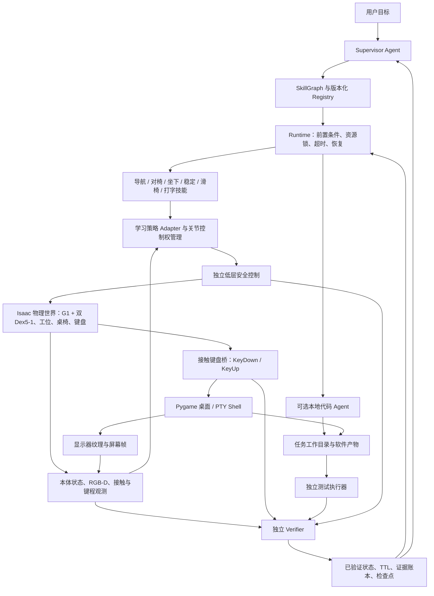
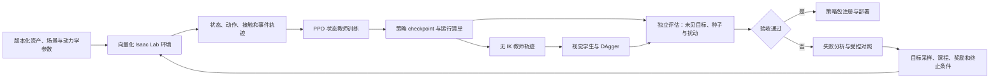

# 学习驱动的人形机器人实体计算机操作：整体架构

> 本文是 LEARN 子项目的目标设计，服从 [统一架构](ARCHITECTURE.md)。M0–M6 保留为学习验收编号，跨项目顺序见 [路线图](ROADMAP.md)；与 RSI 共用拟建的数据与策略描述层，不另建 Runtime。

版本：0.1.0 · 日期：2026-09-25 · 分支：`codex/learning-system-architecture`

状态：**目标架构与实施规范，尚未完成无 IK 策略训练**。本文是学习路线的总体设计入口；[基础运行时架构](ARCHITECTURE.md)解释已有核心组件，[训练调研](DEX5_LEARNING_WITHOUT_IK.md)提供方法依据和实验细节。文中的新模块、接口字段、技能和验收门槛均为待实现设计，除明确标注“已有”外，不代表已接入或已通过测试。

## 1. 目标与设计决策

目标是在 Isaac Sim 5.1 / Isaac Lab 2.3.2 中，让 G1 29DOF + 双 Dex5-1 在房间内到达工位，调整与被动脚轮办公椅的位置关系，自由平衡坐下，以双手十指操作实体键盘，观察虚拟屏幕，并通过独立测试确认软件任务完成。原普通椅子与已有演示保留为基线；轮式办公椅采用现有 P1 资产，座面名义高度以已验证的 0.44 m 配置起步。

核心决策：

1. **学习产生运动**：策略直接输出有界关节目标；训练、部署、示范和初始化数据生成都不使用 IK，不把旧 IK 轨迹蒸馏成“无 IK”策略。
2. **Agent 选择技能**：高层只表达目标和 L2/L3 技能调用，不能生成关节位置、速度或力矩。
3. **物理产生输入**：KeyDown/KeyUp 来自指尖接触与键帽行程；策略、Agent、奖励函数不能直接写键盘事件来代替触键。
4. **证据决定完成**：策略返回声明，Verifier 独立写入已验证状态；代码 Agent 的完成消息不等于软件测试成功。
5. **安全独立执行**：限位、限速、力矩、碰撞、支撑和超时保护不由策略自行关闭。训练同样保留保护与失败记录。
6. **仿真与硬件共用技能契约**：传感器、物理后端、策略推理、代码 Agent 和测试执行器通过适配器隔离；核心领域模型保持标准库依赖。

PD 驱动、正运动学观测和关节限幅不属于 IK。禁止从指尖笛卡尔目标反求关节角、IK 残差动作、雅可比压键辅助、运行中根位姿轨迹写入或骨盆托举。训练回合初始化允许 reset，但最终连续演示不允许靠 reset 跳过行为阶段。

## 2. 系统总图

图中的“接触观测”在仿真教师阶段可用物理真值；部署学生策略只允许读取其声明支持的传感器。Verifier 可以在仿真验收中读取真值，但必须标注证据来源，不能将它冒充机器人视觉能力。

代码 Agent 有两种明确区分的路径：机器人通过实体键盘在桌面中启动代码任务，或 Runtime 通过 `CodeAgentAdapter` 直接委托软件工作。后者可以验证软件协作接口，但不能充当“机器人亲自输入”的证据。软件产物进入同一个独立测试接口；测试结果和相机读取结果分别保存。

## 3. 分层与责任

| 层/模块 | 输入 → 输出 | 责任及边界 | 当前情况 |
|---|---|---|---|
| Agent / SkillGraph | 用户任务、已验证事实 → 技能目标 | 任务分解、就绪节点选择、有限重试；不访问电机 | 核心框架已有 |
| Skill Runtime | 版本化契约、目标 → 声明与原始证据 | 前置条件、资源互斥、超时、取消、调用验证器 | 已有 |
| 学习技能控制器 | 目标、观测历史 → 策略动作 | 坐下/打字等有限时域闭环；不能自行提交成功状态 | 新无 IK 路径待实现 |
| Policy Adapter | 策略包、观测 → 有界关节目标 | 推理、动作映射、历史缓存；仅此低层边界接触关节动作 | 已有平衡适配器，新技能待实现 |
| Safety / Control ownership | 动作、实测状态 → 可执行动作或停止 | 单关节单控制者；独立保护和异常记录 | 现有守卫可复用，统一管理待实现 |
| Physics / Hardware Adapter | 关节驱动 → 带时间戳观测 | 同契约连接 PhysX 或未来真实硬件 | Isaac 场景已有，训练批处理待实现 |
| 键盘桥与虚拟计算机 | 接触/键程 → 事件 → 画面 | 物理事件唯一入口；PTY、Pygame、显示纹理 | 已有特定任务验收 |
| Perception Adapter | RGB-D、本体传感器 → 估计与置信度 | 键盘/椅子定位、屏幕识别；不静默使用真值 | RGB-D/OCR 链路已有，视觉控制待训练 |
| Verifier / Ledger | 原始证据、规则 → 已验证事实 | 物理/GUI/软件分别判定、状态过期、追溯 | 已有；新策略接入待完成 |
| Training / Evaluation | 环境、数据、种子 → checkpoint、评估报告 | 与在线 Runtime 分离；评估决定策略是否可发布 | 拟建，椅子研究代码不是完整训练后端 |

现有 `ActionGraph` 仍拒绝低层关节命令。学习路线保留其接触、键事件、屏幕门禁及超时语义；不沿用旧版笛卡尔预定位 + DLS 执行链。技能将键号/指法/释放目标交给学习适配器，不将笛卡尔节点解释成隐藏的 IK 调用。此兼容层是待实现工作，现有图配置不能直接标成学习版。

## 4. 技能、状态和恢复

以下是目标技能集合，统一使用现有 `SkillContract` 字段：`name`、`version`、`preconditions`、`local_postconditions`、`next_skill_readiness`、`resources`、`failure_codes`、`recoveries`。首版建议为 `0.1.0`；表中名称和状态是设计名，实现时需显式注册。

| 技能 | 前置条件 → 验证后置条件 | 独占资源 | 典型失败与恢复 |
|---|---|---|---|
| `navigate_to_workstation` | 可站立、地图有效 → 到达工位区域并停止 | 身体控制、导航感知 | `PATH_BLOCKED`：停止后重规划 |
| `align_to_chair` | 到达工位、椅子估计有效 → 坐下区域与朝向满足要求 | 身体控制、椅子感知 | `CHAIR_MOVED`：更新估计与重新对齐 |
| `sit_down` | 已对齐、目标座面可用 → 座面承重、姿态稳定 | 全身控制 | `LOST_SUPPORT` / `SEAT_MISSED`：终止并交安全控制，不盲目重试 |
| `stabilize_seated` | 座面接触存在 → 椅速和躯干状态稳定 | 下肢/腰、上肢交接 | `UNSTABLE_SEAT`：有界稳定恢复 |
| `reposition_seated` | 坐稳、双手与键盘脱离 → 到达目标且重新坐稳 | 全身控制、椅子感知 | `NO_PROGRESS` / `CHAIR_TILT`：停止并重新验证 |
| `type_text` | 坐稳、键盘定位有效、全部键释放 → 精确事件串、全部释放 | 双臂双手、键盘、下肢稳定协调 | `WRONG_KEY` / `STUCK_KEY` / `TIMEOUT`：先验证释放，再决定修正 |
| `verify_screen` | 新屏幕帧可用 → 目标画面被观测到 | 头部相机/屏幕感知 | `SCREEN_UNREADABLE`：有限重观测或重新定位 |
| `run_software_task` | 工作目录与任务允许 → 产物可供测试 | 软件工作目录、代码 worker | `AGENT_FAILED`：依据错误证据重新委托 |
| `test_artifact` | 产物版本固定 → 独立测试结果 | 测试工作目录/执行器 | `TEST_FAILED`：带证据修复后重新测试 |

主线：到达 → 对椅 → 坐下 → 稳定 → 键盘定位 → 打字 → 观察屏幕 → 软件测试。主动滑椅是可选恢复/扩展，不是初版静止工位任务的强制依赖。

椅子移动使坐姿稳定与键盘标定失效；键盘移动使相关手部目标失效；屏幕更新使旧屏幕结论失效；软件文件变化使旧测试结果失效。Runtime 利用事实 TTL 和依赖传播使后续技能重新验证，不能沿用已经过期的“已就绪”。

取消必须先停止新的按键意图，再由安全控制协调释放与保持支撑。若物理释放失败，记录 `STUCK_KEY`；即使为清理终端连接发送了数字释放，也必须标注为管理事件，不能作为物理 KeyUp 成功。异常停止不保证仅靠位置保持就能防止跌倒；恢复控制器的适用状态必须单独验证。

## 5. 学习策略与动作空间

| 策略阶段 | 动作维度 | 控制权 |
|---|---:|---|
| 单臂单手触键 | 23 | 7 个臂/腕关节 + 16 个 Dex5 独立驱动 |
| 双臂双手打字 | 46 | 两组 23；与下肢/腰 15 维策略互斥分区 |
| 站立到坐下 | 29 | 身体策略控制双臂、双腿与腰；手指另以直接关节目标保持 |
| 全身联合优化 | 61 | G1 29 + 两手 32，由统一策略控制 |

双手共 8 个耦合坐标不单独发动作。任何 29 维身体策略与 46 维打字策略都存在手臂重叠，禁止直接相加。控制权管理器在坐下到打字交接时验证当前状态、目标连续性与策略包兼容性，再原子切换；冻结下肢的 15 + 46 方案与 61 维联合方案是两种部署配置。

基线算法选择 PPO / RSL-RL，动作通过限幅/限速和 PD 关节驱动产生力矩。建议起点为物理 200 Hz、策略 50 Hz；这是待实测的项目配置。动作计算与接触事件读取频率不同：事件桥逐物理子步读取，不能遗漏两个策略周期之间的按下/释放。

第一阶段训练特权状态教师；第二阶段以无 IK 教师的 rollout 训练 RGB-D + 本体状态学生，使用 DAgger 补充学生访问状态。未来多字符串泛化可探索专家蒸馏或 Flow Matching，但不作为首个闭环的必要依赖。算法出处和取舍以[已完成调研](DEX5_LEARNING_WITHOUT_IK.md)为准。

现有 GR00T 下肢网络可作隔离的过渡对照，但其上游训练数据尚未完成严格无 IK 来源审计。其本地运行路径没有手部 IK，不代表其全部数据来源已经合规；严格无 IK 发布要求审计通过或重新训练替代策略。

## 6. 训练系统与数据闭环

环境负责物理 reset/step、并行实例隔离和原始观测；奖励模块负责优化信号；Evaluator 调用独立判据。三者不能通过共享一个“成功布尔量”来证明任务成立。训练奖励可使用距离与键程塑形，最终成绩只认目标事件、释放、支撑和屏幕/软件证据。

训练课程：单键按下/释放 → 五指覆盖 → 双手十指固定短串 → 未见短串 → 自由坐姿扰动 → 从站姿连续坐下/打字 → 视觉控制。坐下任务可与手部课程分别开发，完整系统验收仍必须连贯执行。固定指法用于保证十指参与；自由指法分配作为后续消融，不默认等价于十指能力。

训练时关闭大部分渲染和 PTY，仅保存评估样本；视觉阶段另行测量吞吐。每个环境独立维护键程迟滞、字符进度、历史观测与策略隐藏状态。不能把现有单环境 CPU/SciPy 循环直接复制成 GPU 训练实现。

数据集记录：来源类型、策略/资产哈希、关节顺序、传感器配置、时间戳、种子、终止原因和是否包含特权信息。拒绝 `dex5_postures.json`、IK 校准轨迹、来源不明的关节标签进入严格无 IK 训练集。人工直接关节初态也需要来源说明；坐姿 reset 轨迹与完整站姿 rollout 分开统计。

按目标字符串、键盘布局/姿态和动力学参数划分训练/验证/测试集；同一轨迹的相邻帧不得跨集合。调参只使用验证集，最终测试集冻结。物理域随机化在基础任务可学之后加入，范围受机构可达性与可解释参数约束。

## 7. 接口与策略包规范

复用 `interfaces.py` 中机器人、感知、运动策略、代码 Agent、测试和 worker 端口。下面的消息字段是新增设计，尚未定义为现有 Python 类型：

| 数据 | 必需内容 | 约束 |
|---|---|---|
| `SkillGoal` | 调用 ID、契约版本、任务目标、截止时间 | 无关节命令；文本目标不等于输入证据 |
| `ObservationFrame` | 单调时间、序号、来源、关节/传感器字段、有效性 | 单位与坐标系版本化；过期/缺失观测显式失败 |
| `PolicyAction` | 策略 ID、关节顺序、动作、有效期限、控制权令牌 | 只在低层进程流转；禁止直达高层图节点 |
| `KeyEvent` | 环境/调用 ID、序号、时间、键号、边沿、接触与键程关联 | 桥负责产生，接收端去重；序列缺口导致验收失败或重放恢复 |
| `EvidenceBundle` | 运行/调用 ID、原始文件引用与哈希、采样时钟、来源 | 不依赖策略自报成功；与现有 `Evidence` 通过适配器关联 |
| `PolicyManifest` | 模型哈希、观测/动作 schema、归一化、历史长度、频率、资产/驱动版本、训练数据来源 | 不匹配即拒绝加载；缺失验收不自动启用 |

策略包还要包含训练与评估配置、种子、无 IK 来源审计、支持的技能版本、动作/关节/执行器映射以及回归报告。模型权重与归一化、历史状态定义必须成套发布。旧状态教师和视觉学生使用不同的观测 schema，不能只替换权重而复用错误的输入。

在线部署只读策略包；训练 worker 无权限在运行中热改正在控制机器人的模型。新策略必须独立验收后在安全空闲状态切换。worker 断开或推理超时时使旧动作过期，安全控制接管并记录失败，不能无限重发最后一条动作。

## 8. 虚拟计算机与验证链

物理桥 → PTY 输入 → Shell/应用执行 → Pygame 像素 → Isaac 显示器材质 → 机器人 RGB-D → 屏幕 Verifier。每段保留事件序号、帧号和时间关联；时钟域不同需保存映射，不能仅凭文件创建时间推断因果。

验证分三域：

- **物理域**：机器人自由根、座面支撑、椅速/倾角、指尖接触、目标键程、正确按下/释放、无额外键与滞留。
- **GUI 域**：来自固定安装机器人相机的真实帧，记录前后画面变化与识别结果；PTY 文本、纹理原图和外部摄影机录像不能替代机器人相机证据。
- **软件域**：独立测试执行器对固定产物版本运行指定测试，保存退出状态与结果；模型自报完成、终端出现“成功”都不是替代品。

真实 Shell 工作目录不等于操作系统沙箱。执行器应声明环境隔离、允许工作目录、时间/资源限制和测试规格来源；测试规格不能由被测代码任务静默削弱。具体隔离实现仍通过 Adapter 接入。

## 9. 目录与迁移方案

| 路径 | 角色 | 状态 |
|---|---|---|
| `src/vskill_os/{domain,contracts,interfaces,runtime,verifier,ledger}.py` | 核心契约、执行、证据与状态 | 已有，保持与厂商依赖隔离 |
| `src/vskill_os/action_graph/` | 有限动作目标与证据门禁 | 已有，学习执行器兼容待开发 |
| `src/vskill_os/adapters/isaac/` | Isaac 物理场景、相机与演示控制 | 已有；旧 IK 路径仅作为基线 |
| `src/vskill_os/simulation/keyboard_bridge.py` | 键帽到事件 | 已有；批处理与训练接入待开发 |
| `src/vskill_os/adapters/{virtual_computer,local_code_agent}.py` | PTY/Pygame、代码与测试适配 | 已有接口/实现，完整代码任务尚待验收 |
| `src/vskill_os/chair/` | 椅子研究模型与训练接口 | 已有研究代码，不能当成已验收物理学习策略 |
| `src/vskill_os/learning/` | 与后端无关的策略描述、数据来源、实验清单 | **拟建**；不得导入 Isaac/Torch |
| `src/vskill_os/adapters/isaac/learning/` | 向量化任务、观测、奖励、reset/step、物理采集 | **拟建**；Isaac/Torch 可选依赖边界 |
| `src/vskill_os/adapters/learned_policy.py` | 策略包加载、推理与动作映射 | **拟建**；与现有策略端口衔接 |
| `configs/learning/`、`tools/train_learning.py`、`tools/evaluate_learning.py` | 配置与训练/评估入口 | **拟建**；本轮未提供可运行训练命令 |
| `artifacts/learning/<run_id>/`、`reports/learning/<run_id>/` | checkpoint、轨迹、视频与验收 | **拟建**；大文件与可审计报告分开管理 |

迁移时先提取共享资产和原始证据采集，保留旧录像复现入口；再增加无 IK 策略适配器和向量化环境，复用验证语义，最后接入 Skill Runtime。不能靠改旧模块名称或删除文档中的 IK 字样完成迁移。

## 10. 研究问题、里程碑与交付门槛

本文采用 learning-research 的“问题—假设—最小实验—证据—调整”方法组织开发。下面是项目假设，不是已有结论；成功率门槛属于提案。

| 阶段 | 要回答的问题 | 最小证据与继续条件 |
|---|---|---|
| M0 环境与数据审计 | 动作、接触和键事件是否可信且无 IK？ | 1/16/64 环境映射检查、无事件串扰、无接触缓冲溢出；记录吞吐与显存 |
| M1 单指 | 直接关节 PPO 能否学会按下并释放？ | 三种子，各 100 评估回合；单指完整成功率目标 ≥95%，包含全部失败 |
| M2 十指 | 固定指法能否实现双手协调？ | 46 维十指短串完整成功率目标 ≥90%；逐指覆盖与全部释放 |
| M3 连续行为 | 分别学习的坐下与打字能否平稳交接？ | 从站姿完整运行，禁止诊断 reset；同时报告整段成功率和交接失败 |
| M4 屏幕与任务 | 触键是否真的改变计算机状态？ | 事件转发、输入前后机器人图像、独立软件结果在同一调用链关联 |
| M5 泛化与视觉 | 去掉特权观测后能否可靠工作？ | 未见字符串/扰动和 RGB-D 学生评估；报告相对教师的下降，不混用成绩 |
| M6 扩展 | 导航、主动滑椅、全身联合控制是否带来收益？ | 每项独立对照通过后再加入全任务，避免把接口存在当成果 |

首个投入点是 M0→M1，不从 61 维视觉全身端到端训练起步。坐下策略单独学习，导航与主动滑椅分阶段补齐。现有 RTX 5090 的有效环境数、速度和训练耗时未知，必须先实测；不承诺固定小时数训练成功。

每次实验保存代码/资产/配置哈希、随机种子、聚合环境转移数、模型与归一化参数、训练曲线、独立验证、代表性成功和失败视频。对照优先采用单变量：指法条件、奖励塑形、观测历史、域随机化、冻结下肢/联合控制。若不收敛，先查动作/事件/奖励，再查优化与预算，最后修改研究假设。

发布学习版连续 demo 的必要证据是：无 IK 路径及数据来源审计、无外部支撑的完整物理过程、十指正确事件与最终释放、机器人相机证据，以及所宣称软件任务的独立测试。现有混合控制视频可以比较效果，但不能升级标注为学习结果。

## 11. 当前基线与本次交付

现有自由坐下采用学习平衡网络与预设高度/躯干指令；现有十指打字仍采用 IK。虚拟屏幕已有实体输入 `ls`/Enter 的闭环记录，但不等于代码 Agent 已完成真实编程任务。具体证据及限制以[连续演示说明](CONTINUOUS_COMPUTER_DEMO.md)为准。

本次交付是学习路线整体架构文件、文档入口及新 Git 分支。未训练新模型、未替换现有控制器、未新增导航或滑椅能力。后续实现应逐项更新本文件的“已有/待实现”状态，并引用对应评估报告。
