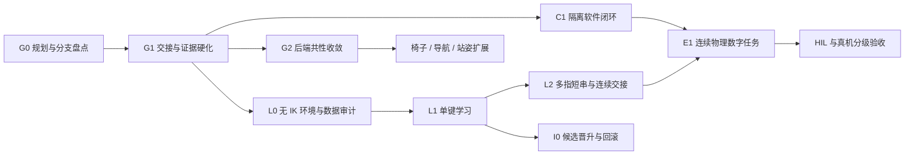

# 统一路线图

更新：2026-09-25。本文件唯一维护跨子项目优先级；专项文档负责实验细节，能力事实见[子项目登记](WORKSTREAMS.md)。以下顺序是工程依赖与默认建议，不承诺训练耗时，不自动启动后续任务。

## 1. 主线与扩展

近期主线：**整理共同基线 → 补齐交接与证据 → 静止工位软件闭环 / 无 IK 单键学习 → 连续任务验收**。

Dex5 保留为已有连续演示基线及严格无 IK 学习的起点；站姿 Dex3 保留为独立比较路线。主动滑椅、导航、语音和真机在各自门槛通过后组合进入主任务。RSI 复用学习路线，首先完成候选可验证与可回滚，不先建设完整自主改进器。

图中的两条研发路径可以独立推进；软件接口可先用受控输入开发，最终 E1 必须有真实物理输入证据。既有 IK 版本也可完成单独的系统闭环评估，但不能据此通过无 IK 学习门槛。

## 2. 任务与退出门槛

| 编号 | 范围与前置 | 交付 / 退出门槛 | 现状 |
|---|---|---|---|
| G0 | 项目治理，本轮 | 四个维护入口、工作树盘点、历史入口迁移、文档检查与核心回归 | 见[整理验收](REORGANIZATION.md) |
| G1 | CORE；G0 后优先 | 资源锁内重检有效状态；等待期间过期/撤销不得执行；取消与失败不得留下可用旧事实；运行证据绑定后端、控制方式和版本；补独立失败回归 | 待实现，不启动物理训练 |
| G2 | SIM / D3-6 / DESKTOP | 对照两个工作树的桌面、相机、资产和事件桥；逐项适配共享接口；保留原路径回归与 5.1/6.0.1 环境隔离 | 待整合；不要一次合并两个大功能提交 |
| C1 | DESKTOP；G1 | 真实隔离代码任务首稿失败 → 独立测试拒绝 → 反馈修复 → 固定规格复测；记录产物哈希、退出码、超时与恢复；禁止完成文本绕过测试 | 适配器已有，端到端待验收 |
| L0 | LEARN；G1，可复用 G2 成果 | 无 IK 来源清单；直接关节动作映射、接触/键程、释放和环境隔离；1/16/64 环境检查并记录吞吐/显存；缺失物理后端时保持阻塞 | 规划；对应学习 M0 |
| L1 | LEARN；L0 | 单键按下与释放；三种子、每种 100 个独立评估回合；成功率提案 ≥95%；保留失败与未见目标，不能用合成回放替代 | 规划；对应 M1 |
| L2 | LEARN / D5；L1 | 五指覆盖 → 双手固定短串 → 坐下/打字交接；十指短串成功率提案 ≥90%；连续段无 reset、无外部支撑，观测与事件完整 | 规划；对应 M2/M3，指标仍需实验验证 |
| E1 | CORE / DESKTOP / LEARN；C1、L2 | 同一次物理时间线完成输入、机器人读屏、软件测试；同时报告整段失败与交接失败，绑定策略/资产/输入版本 | 规划；对应 M4 |
| I0 | IMPROVE；先完成 L0 数据，至少 L1 有候选 | 候选归档、固定保留集评估、显式晋升、退化拒绝与回滚；三次连续候选更新可审计 | 规划；RSI 与 LEARN 共用数据层 |
| X | CHAIR / NAV / VOICE / D3-6，按具体任务启动 | 各自完成物理 worker、失败恢复、稳定/释放/感知门槛后再接 E1 | 独立扩展，不统一宣称完成 |
| H | REAL；所用技能的仿真门槛通过 | 实际硬件身份、时钟/传感器与控制停止、HIL、小范围真机、对应 Verifier | 未开放为已有能力 |

**默认下一项为 G1-01：资源锁内状态重检。** 若任务明确要求训练，选 L0 中不依赖未完成并发功能的离线审计与环境最小实验；不要直接启动 61 维视觉全身学习。若任务明确要求站姿演示，在 D3-6 工作树先修复 `afjk` 超时/释放失败，成绩仍按该路线单独记录。

### G1 的可领取任务

G1 是里程碑，不作为一次大改动提交。按顺序拆成：

- **G1-01 状态重检**：限于 `runtime.py` 与状态有效性测试；技能排队取得锁后，重新处理 TTL/依赖并读取新快照。构造“等待时过期”和“等待时被撤销”负例，证明控制器不会运行；正常调用与既有恢复仍通过。
- **G1-02 撤销与取消交接**：明确正在运行的技能何时停止、失败后哪些事实撤销；先做替身与独立验证，再接物理 worker。
- **G1-03 证据清单**：定义运行来源、后端、手型/姿态、控制方式、版本和文件哈希；历史报告通过显式适配读取，未知字段保持未知，不能补写成通过。

每项都须单独通过现有回归并更新证据；跨 worker 控制权在具体物理后端接入时另立任务，不把 G1-01 的局部修复当成完整并发安全。

## 3. 历史编号映射

| 原编号 | 在统一路线图中的位置 |
|---|---|
| P0 / SIM-00 | CORE / G1 持续回归 |
| P1 / SIM-01、SIM-02 | SIM / G2；资产通过不代表动作完成 |
| P2 / SIM-03 / SIM03-D5 | D3-5 与 D5 的不同实验基线；学习替换进入 L0–L2 |
| P3 / SIM-04 | DESKTOP / C1，最终接 E1 |
| P4 / SIM-05 | D5 自由坐下基线 + CHAIR 扩展；主动滑椅另验收 |
| P5 / SIM-06 | NAV / VOICE 扩展 |
| SIM-07 | E1 连续集成验收 |
| SIM-08 / 学习 M0–M5 | L0–L2、E1，之后再做视觉泛化 M5 |
| 学习 M6 | X 可选扩展 |
| P6 / SIM-09 | H 真机门槛；自改进部分归 I0 |
| RSI R0–R7 / RSI-T 系列 | 数据基础复用 L0，候选与晋升归 I0，高级自主课程和递归改进后置 |

编号保留供历史报告引用，不创建同一能力的重复任务。指标变化必须说明理由并保留旧结果；不能通过改阶段名称或移动完成标准使失败变为成功。

## 4. 分支整合门槛

先按[分支登记](BRANCHES.md)固化未提交成果，再逐个能力迁移。每次仅整合一个边界，包含契约、适配实现、负例、复现入口和证据；运行 `make check`、`make demo` 及该路线特定验收。轻量测试与物理测试单独记录。

来源未固化、报告缺少对应原始数据或环境不兼容时保留为候选，不覆盖当前基线。硬件/厂商依赖不得进入核心领域模型，训练奖励不得替代独立评估，线上策略不得被训练进程直接热改。
