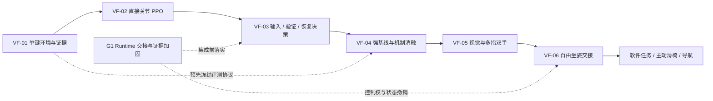

# 统一路线图

更新：2026-09-26。本文件唯一维护跨子项目优先级；专项文档负责实验细节，能力事实见[子项目登记](WORKSTREAMS.md)。以下顺序是工程依赖与默认建议，不承诺训练耗时，不自动启动后续任务。

## 1. 当前研究主线

**面向实体计算机操作的验证反馈驱动技能学习**：从单臂单手、少量按键起步，利用物理接触和屏幕证据学习何时继续输入、何时验证、如何从错误中恢复。先建立能严格比较的局部闭环，再扩展到视觉、双手、自由坐姿和软件任务。

六阶段工程架构在根目录 [verification-feedback-skill-learning/](../verification-feedback-skill-learning/README.md) 维护；以下只统一优先级。阶段 1–4 是首轮方法研究范围，正式的发表级新颖性仍需逐篇文献对照与实验支持。

| 当前顺序 | 实施文件 | 对应原工程里程碑 |
|---|---|---|
| VF-01 | [环境与证据](../verification-feedback-skill-learning/01_environment_and_evidence/README.md) | L0 / G1-03；独立离线环境先行，不依赖整个系统全部并发功能 |
| VF-02 | [直接关节 PPO](../verification-feedback-skill-learning/02_joint_ppo_baseline/README.md) | L1；仅在低层 Adapter 输出关节动作 |
| VF-03 | [输入、验证与恢复](../verification-feedback-skill-learning/03_verification_and_recovery/README.md) | 新增方法核心，复用 CORE、DESKTOP、LEARN；小规模真实读屏先行 |
| VF-04 | [严格评测](../verification-feedback-skill-learning/04_benchmark_and_ablations/README.md) | 单手阶段就比较六组方法，不等待双手或真实编程任务 |
| VF-05 | [视觉与双手](../verification-feedback-skill-learning/05_visual_policy_and_bimanual/README.md) | L2 的多指部分 / 学习 M5，机制成立后展开 |
| VF-06 | [坐姿交接](../verification-feedback-skill-learning/06_seated_skill_handoff/README.md) | L2 连续交接 / E1 的物理数字部分；软件 C1 随后独立验收 |

**VF-01-T01–T05 已交付各自单键诊断范围**：离线契约、物理闭环、文本反馈、1/16/64 批环境，以及[真实终端与机器人相机](../verification-feedback-skill-learning/01_environment_and_evidence/DESKTOP_CAMERA.md)。**VF-02-T01 已通过动作映射与停止恢复验收**，见[实现说明](../verification-feedback-skill-learning/02_joint_ppo_baseline/ACTION_MAPPING.md)。**VF-02-T02 单键可学性诊断已交付**，见[单种子 PPO 与独立复验](../verification-feedback-skill-learning/02_joint_ppo_baseline/SINGLE_KEY_PPO.md)。下一项为 **VF-02-T03：单键重复验收**（三个训练种子，每种子 100 个独立评估回合）。当前 PPO 仅覆盖固定工位单键特权状态；风险预测器、分层决策和视觉学生尚未交付。

## 2. 原工程里程碑：支持项与后续扩展

下表保留已有工程编号，服务于上述研究主线，不另构成“软件闭环或双手先于学习机制”的顺序。具体数据/动作/评估设计见六阶段文件。

| 编号 | 范围与前置 | 交付 / 退出门槛 | 现状 |
|---|---|---|---|
| G0 | 项目治理，本轮 | 四个维护入口、工作树盘点、历史入口迁移、文档检查与核心回归 | 见[整理验收](REORGANIZATION.md) |
| G1 | CORE；物理多技能/并发集成前落实 | 资源锁内重检有效状态；等待期间过期/撤销不得执行；取消与失败不得留下可用旧事实；运行证据绑定后端、控制方式和版本；补独立失败回归 | 待实现，不启动物理训练 |
| G2 | SIM / D3-6 / DESKTOP | 对照两个工作树的桌面、相机、资产和事件桥；逐项适配共享接口；保留原路径回归与 5.1/6.0.1 环境隔离 | 待整合；不要一次合并两个大功能提交 |
| C1 | DESKTOP；首轮短串研究后扩展 | 真实隔离代码任务首稿失败 → 独立测试拒绝 → 反馈修复 → 固定规格复测；记录产物哈希、退出码、超时与恢复；禁止完成文本绕过测试 | 适配器已有，端到端待验收 |
| L0 | LEARN；对应 VF-01，集成时满足相关 G1 守卫 | 无 IK 来源清单；直接关节动作映射、接触/键程、释放和环境隔离；1/16/64 环境检查并记录吞吐/显存；缺失物理后端时保持阻塞 | 部分：单键契约、物理、批环境及 PTY/机器人相机已验收；多键与真实退格另验收；对应 M0 |
| L1 | LEARN；L0 | 单键按下与释放；三种子、每种 100 个独立评估回合；成功率提案 ≥95%；保留失败与未见目标，不能用合成回放替代 | 规划；对应 M1 |
| L2 | LEARN / D5；L1 | 五指覆盖 → 双手固定短串 → 坐下/打字交接；十指短串成功率提案 ≥90%；连续段无 reset、无外部支撑，观测与事件完整 | 规划；对应 M2/M3，指标仍需实验验证 |
| E1 | CORE / DESKTOP / LEARN；C1、L2 | 同一次物理时间线完成输入、机器人读屏、软件测试；同时报告整段失败与交接失败，绑定策略/资产/输入版本 | 规划；对应 M4 |
| I0 | IMPROVE；后续扩展，复用 VF-01 数据与 VF-04 评估 | 候选归档、固定保留集评估、显式晋升、退化拒绝与回滚；三次连续候选更新可审计 | 规划；RSI 与 LEARN 共用数据层 |
| X | CHAIR / NAV / VOICE / D3-6，按具体任务启动 | 各自完成物理 worker、失败恢复、稳定/释放/感知门槛后再接 E1 | 独立扩展，不统一宣称完成 |
| H | REAL；所用技能的仿真门槛通过 | 实际硬件身份、时钟/传感器与控制停止、HIL、小范围真机、对应 Verifier | 未开放为已有能力 |

**研究默认下一项以 VF-02-T03 为准。** G1-01 等运行时加固仍保留为集成门槛。单种子 PPO 诊断不代表完成运行时并发加固、多种子验收或冻结技能发布。站姿 Dex3 继续单独保存其基线和失败记录，不混入 Dex5 动作维度或本课题成绩。

### G1 的可领取任务

G1 是里程碑，不作为一次大改动提交。按顺序拆成：

- **G1-01 状态重检**：限于 `runtime.py` 与状态有效性测试；技能排队取得锁后，重新处理 TTL/依赖并读取新快照。构造“等待时过期”和“等待时被撤销”负例，证明控制器不会运行；正常调用与既有恢复仍通过。
- **G1-02 撤销与取消交接**：明确正在运行的技能何时停止、失败后哪些事实撤销；先做替身与独立验证，再接物理 worker。
- **G1-03 证据清单**：定义运行来源、后端、手型/姿态、控制方式、版本和文件哈希；历史报告通过显式适配读取，未知字段保持未知，不能补写成通过。

每项都须单独通过现有回归并更新证据；跨 worker 控制权在具体物理后端接入时另立任务，不把 G1-01 的局部修复当成完整并发安全。

## 3. 历史编号映射

| 原编号 | 在统一路线图中的位置 |
|---|---|
| P0 / SIM-00 | CORE / G1 持续回归 |
| P1 / SIM-01、SIM-02 | SIM / G2；资产通过不代表动作完成 |
| P2 / SIM-03 / SIM03-D5 | D3-5 与 D5 的不同实验基线；学习替换进入 L0–L2 |
| P3 / SIM-04 | DESKTOP / C1，最终接 E1 |
| P4 / SIM-05 | D5 自由坐下基线 + CHAIR 扩展；主动滑椅另验收 |
| P5 / SIM-06 | NAV / VOICE 扩展 |
| SIM-07 | E1 连续集成验收 |
| SIM-08 / 学习 M0–M5 | L0–L2、E1，之后再做视觉泛化 M5 |
| 学习 M6 | X 可选扩展 |
| P6 / SIM-09 | H 真机门槛；自改进部分归 I0 |
| RSI R0–R7 / RSI-T 系列 | 数据基础复用 L0，候选与晋升归 I0，高级自主课程和递归改进后置 |

编号保留供历史报告引用，不创建同一能力的重复任务。指标变化必须说明理由并保留旧结果；不能通过改阶段名称或移动完成标准使失败变为成功。

## 4. 分支整合门槛

先按[分支登记](BRANCHES.md)固化未提交成果，再逐个能力迁移。每次仅整合一个边界，包含契约、适配实现、负例、复现入口和证据；运行 `make check`、`make demo` 及该路线特定验收。轻量测试与物理测试单独记录。

来源未固化、报告缺少对应原始数据或环境不兼容时保留为候选，不覆盖当前基线。硬件/厂商依赖不得进入核心领域模型，训练奖励不得替代独立评估，线上策略不得被训练进程直接热改。
