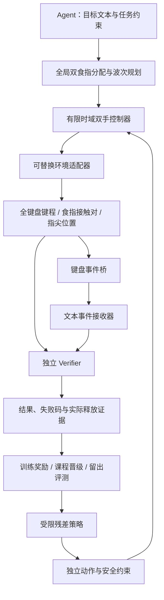

# 站立双食指协同：实现边界与训练规划

本分支把原项目的 P2 收敛为“G1 mode 15 / 5010 + 双 Dex3-1、每手一根食指、站姿固定基座”。不执行坐下或椅子移动。目标运行环境是 Isaac Sim 6.0.1；当前已有其他 Isaac 5.x 任务占用环境，本次交付优先完善框架与 CPU 回归，**不启动新的 Kit、物理仿真或 GPU 训练**。

## 系统边界

- Agent 只选择有限时域技能和目标；规划与训练策略均不产生机器人关节命令。
- 两手在同一个物理时钟内更新目标。预定位可以并行；字母提交必须遵循文本顺序。
- Shift 与主键分配给不同食指。双食指不能执行 Ctrl+Alt+T 这样的三键同时保持任务。
- 全部 74 个键都参与传感检查，不能只监测目标键而遗漏误触。
- 基座固定是当前能力边界。自由站立平衡、全身自碰撞、真实触觉、视觉定位和 sim-to-real 需独立验收。
- 文本接收器验证实际事件解码结果，但不是相机 OCR。不得把这条数字链路称为独立视觉验收。

## 与原规划的对应关系

| 原阶段 | 本分支落实 | 后续物理验收 |
|---|---|---|
| P0 契约/独立验证 | 版本化计划、错误码、资源、观测/动作契约、证据来源 | 仿真和真机适配器使用相同上层契约 |
| P1 资产与仿真 | 复用有来源及哈希的 mode 15 + Dex3 资产；独立 6.0.1 启动器 | 核对 43 主动关节、74 键、站姿、接触对及固定镜头 |
| P2 双手打字 | 全局分配、预定位波次、顺序提交、Shift 双手协作、失败释放 | 左右食指真实触键和重复可见运行 |
| P4 坐姿/椅子 | 不纳入本任务 | 不以任何坐姿报告证明站姿能力 |
| P6 学习与改进 | CPU 训练框架、课程、随机化、继续训练、留出集评测 | 新增并验证物理训练环境；再评估物理残差策略 |

## 课程与晋级

1. **单键**：固定键盘与姿态；覆盖不同键区，先验证触键、键程和释放。
2. **交替双手**：从 `flfl`、`akak` 开始；测量手部分配、事件顺序与共享区域等待。
3. **短文本**：增加重复键和空格，比较单手与双手计划的移动代价、成功率、每键耗时。
4. **Shift 协作**：先保持修饰键，再敲主键，最后按顺序释放；两只食指都有可追溯的接触证据。

CPU 合成训练器用于验证上述管线，不模拟真实质量、摩擦或关节动力学。CEM 是可复现的低维残差基线，不是已经训练完成的物理策略。物理训练环境的接入点为 `--adapter module:factory`；目前**没有取得验收的 Isaac 6 训练环境**，不得直接把合成检查点部署到真机。

每阶段只能通过留出验证集晋级。最终评测使用与训练和晋级验证不同的随机种子命名空间。记录准确率、完整文本成功率、错误事件、释放失败、峰值力、双手参与情况和步数；奖励增长不能代替成功门禁。

## 物理训练环境接入清单

接入 `TypingEnvironment` 时必须落实这些行为，而非只返回 reward/done：

- `reset` 在上一回合真实释放后复位，初始化空事件历史和 tick 0，返回实际初始传感观测。
- `step` 同时更新两手的有界笛卡尔残差，仅在适配器内求 IK 和执行关节控制，每次返回一个控制 tick。
- 观测的接触必须来自指定食指与键帽接触对，键程来自关节状态，按键状态来自传感事件桥。
- 随机化参数必须实际作用于环境，保存已实现和未实现字段；不能把随机化数值只写进日志。
- 失败、异常、超时和取消都进入双手抬起与释放流程。逻辑清空事件不能冒充物理释放。
- 建立物理回归记录后才能报告物理通过率；固定基座不产生自由平衡结论。

## 空闲后的一次性验收流程

1. 只读确认现有任务结束；守卫拒绝进程可见性未知、占用检查失败、Kit 或 GPU 计算仍忙的情况，不结束其他进程。
2. 在新目录运行场景检查，确认双 Dex3 资产、全键盘、站姿和指尖接触传感器。
3. 从 `afjk` 开始保存报告和动作帧，逐键核对接触、位移、事件与释放；失败报告原样保留。
4. 在新报告目录重复运行并进行故障注入。建议先每个目标键 20 次，再统计短文本 100 个固定 seed 回合；这些是待执行的验收方案，不是当前成绩。
5. 物理控制基线通过后再接训练环境。对照零残差和已训练残差，比较留出集成功率与力/误触指标，禁止仅比较训练 reward。

上游实现仍保留历史 P1/P2、Dex5 或坐姿资料，便于追踪来源。当前任务的入口、约束与能力状态以 [站立使用指南](STANDING_DEX3_DEMO_CN.md)、[训练指南](DEX3_TRAINING_CN.md) 和本分支新增报告为准。
