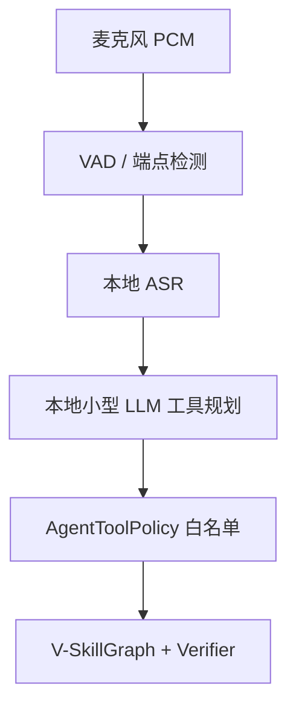

# 本地轻量语音—LLM 栈

## 推荐的两级部署

语音和高层规划不是实时控制器。控制循环持续运行，语音链路只在一句话完成、任务节点完成或失败时触发。



| 部署档 | VAD/ASR | LLM | 用途 |
|---|---|---|---|
| 机器人边缘 | sherpa-onnx VAD + SenseVoiceSmall GGUF/轻量中英模型 | Qwen3 1.7B 量化，llama.cpp | 断网可用、简单意图、应急命令；复杂规划可转工作站 |
| GPU 工作站 | FunASR + SenseVoiceSmall | Qwen3 4B Instruct，llama.cpp 或 vLLM | 中文工具选择、失败归因、任务分解 |

配置分别位于 `configs/models/robot_edge.json` 与 `configs/models/workstation.json`。这些是候选配置，不代表已经下载模型；模型运行时通过 adapter 接入，核心包没有强制模型依赖。

## 选型依据

- [sherpa-onnx](https://github.com/k2-fsa/sherpa-onnx) 支持离线 VAD、流式/非流式 ASR、TTS、多平台和嵌入式环境，并提供中英双语流式模型；适合机器人边缘链路。
- [SenseVoiceSmall](https://github.com/QwenAudio/SenseVoice) 的已发布 checkpoint 支持普通话、粤语、英语、日语、韩语，并支持语言、情绪与音频事件标签；中文短命令应先与 sherpa zipformer、[whisper.cpp](https://github.com/ggml-org/whisper.cpp) 做实测再定版。
- [Qwen3](https://github.com/QwenLM/Qwen3) 官方给出 llama.cpp、Ollama、vLLM 等本地部署路径，中文与工具使用更贴合本项目；LLM 只产生结构化 Skill 调用。
- [llama.cpp](https://github.com/ggml-org/llama.cpp) 用于量化 GGUF 和 loopback OpenAI-compatible 服务。运行时版本、chat template 和模型量化必须一起锁定并做工具调用回归。

## 安全边界

`VoiceCommandPipeline` 包含两个独立边界：

1. LLM 只能从显式工具 schema 中选择；
2. `AgentToolPolicy` 再次执行白名单、每轮调用上限和低层名称阻断。

任何含 `joint`、`torque`、`motor`、`low_cmd`、`dds` 的调用都会被拒绝。即使 LLM 给出合法 Skill，Runtime 仍检查前置条件和资源锁；Skill 声称完成后仍由 Verifier 决定状态是否写入。

## 已实现的本地运行边界

- `ScriptedASR`：仿真/测试替身；
- `RuleBasedToolPlanner`：完全离线且确定性的 Agent 基线；
- `OpenAICompatibleToolPlanner`：仅允许 `localhost/127.0.0.1` 的本地推理端点；
- `LocalModelStack`：加载 VAD、ASR、LLM、TTS 候选配置；
- `AgentToolPolicy`：过滤越权和过量工具调用。

可先验证文本到工具规划，无需模型：

```bash
PYTHONPATH=src python3 -m vskill_os.cli voice-plan \
  "创建一个 Python 程序并独立运行测试"
```

## 评测要求

模型选型不要依据通用聊天榜单，建立项目内命令集：

- 中英混合的工位、终端、文件、测试命令；
- 噪声、回声、远场、机器人电机声；
- 同音词与技术词热词；
- 否定、取消、继续、恢复和紧急停止；
- ASR 字错但语义仍可恢复的样本；
- 诱导 LLM 直接输出关节/力矩的越权样本。

指标包括 VAD 漏检率、命令字错率、端点延迟、工具选择准确率、参数准确率、越权调用率、恢复率和端到端可验证完成率。安全命令应由独立关键词/硬件通道兜底，不能只依赖生成式 LLM。

