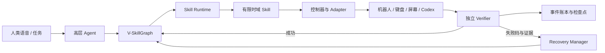

# Robot–Physics–Agent 项目总览

本文是面向规划和 Codex 开发任务的总入口。它描述项目要解决什么问题、为什么值得做、系统边界、阶段依赖和文档导航。当前代码状态的细节以 [`PROJECT_HANDOFF.md`](PROJECT_HANDOFF.md) 和现有技术文档为准。

## 1. 一句话定义

构建一个运行于 Unitree G1 的、由独立验证器约束的 Agent–Skill 系统：机器人接受人类语音目标，自主到达工位、建立可操作坐姿，通过实体键盘和屏幕使用代码智能体，并依据物理、GUI 和软件证据判断任务是否真正完成。

## 2. 目标任务

首个完整任务定义为：

```text
人类说：“去工位 A，用 Codex 写一个 hello world 并验证。”
→ 机器人理解并确认目标
→ 导航到工位并对齐椅子
→ 坐下、必要时移动椅子并恢复稳定工作姿态
→ 标定键盘和屏幕
→ 双手/多指按下 Ctrl+Alt+T
→ 在终端中启动 Codex 并提交任务
→ 持续观察屏幕、键盘事件和代码产物
→ 独立运行测试；失败则把证据反馈给 Codex 修复
→ 测试通过后向人类报告
```

这个任务同时覆盖语音理解、导航、全身控制、双手精细操作、人机界面理解、数字 Agent 协作、验证和失败恢复。

## 3. 项目价值

### 3.1 实用价值

- 让机器人操作只有物理入口、没有 API 或远程权限的计算机和设备；
- 复用人类已有工作环境，而不是为每台设备重新开发机器接口；
- 支持危险、隔离、遗留或临时环境中的本地计算机操作；
- 把代码智能体的数字能力与人形机器人的物理行动连接起来。

### 3.2 研究价值

- 研究物理状态、GUI 状态和软件状态之间如何可靠交接；
- 研究有限时域 Skill 如何被高层 Agent 组合、验证和恢复；
- 形成可复现的实体计算机使用评测，而不只展示成功视频；
- 研究机器人专用的手—键盘交互方式，不强制模仿人类指法；
- 让技能通过偏置估计、指派优化和残差策略逐步改进，同时不破坏安全边界。

### 3.3 建议收敛的核心贡献

首篇工作的主线建议保持为：

> Verifier-grounded V-SkillGraph：以“下一技能是否真正就绪”为核心，在物理—GUI—软件三域中完成可追踪的执行、验证与局部恢复。

导航、坐下、打字和代码任务是验证这一主线的能力模块。某个模块形成足够独立的方法贡献后，再拆分为单独工作。

## 4. 不可破坏的系统边界

1. Agent 只调用 L2/L3 Skill，不输出关节位置、速度、力矩或 DDS 命令。
2. 控制器可以声明局部结果，只有 Verifier 可以写入已验证任务状态。
3. 每个 Skill 必须声明前置条件、后置条件、资源、失败码、恢复方式和版本。
4. 仿真与真机使用同一 Skill 契约，通过 Adapter 替换实现。
5. 代码 Agent 的“完成”消息不是通过证据；必须由独立测试器验证。
6. 急停、碰撞、跌倒、过力和资源互斥独立于 LLM 和学习策略。
7. 训练期可用的仿真真值不得未经声明进入真机策略或 Verifier。

## 5. 系统结构



### 5.1 推荐能力边界

| 能力 | 推荐形式 | 原因 |
|---|---|---|
| 全局导航 | 独立 L3 复合 Skill/子系统 | 内部可含定位、规划和避障，但对 Agent 只暴露目标与到达证据 |
| 坐下与椅子调整 | 多阶段 L3 Skill | 接触转换风险高，需要独立守卫和局部恢复 |
| 键盘标定 | L2 Skill | 有明确输入、输出、误差和重标定路径 |
| 单键、组合键、文本输入 | L2 Skill 族 | 便于分别评测接触、时序、误触和纠错 |
| 代码任务 | L3 复合 Skill | 内部组合启动、提交、观察、测试和修复 |
| 语音理解 | Agent 输入 Adapter | 不进入高频控制环；只产生结构化任务或 Skill 调用 |

全局导航可以拥有自己的规划器、地图和恢复逻辑，但默认不再增加一个能够自由调用低层控制的 LLM Agent。

## 6. 技术路线

```text
纯 Python 契约与验证基线
→ Isaac Sim + Pygame/PTY 混合仿真
→ 单键与 Ctrl+Alt+T
→ 连续文本与代码 Agent 闭环
→ 坐下、椅子调整和工作姿态
→ 导航与本地语音
→ 真机适配、故障评测和安全约束下的技能自改进
```

阶段是依赖关系，不是时间承诺。每一阶段必须通过验收门槛后才扩大任务范围。

## 7. 当前状态摘要

| 能力 | 状态 | 说明 |
|---|---|---|
| Skill 契约、Runtime、Verifier、Ledger、Recovery | 已有可运行基线 | 纯 Python，可执行故障恢复场景 |
| G1 29DOF/5010 身份与策略兼容检查 | 已有接口和校验 | 仿真固定 mode 15；真机 `mode_machine` 尚未确认 |
| P0 状态有效期与 worker 协议 | 纯 Python 已完成 | TTL/依赖失效、请求/进度/取消/结果/健康消息和本地进程替身 |
| P1 键帽—桌面混合仿真 | 已完成 | Isaac 5.1 中 G1 mode 15/5010 + 双 Dex3、74 键带标识 PhysX 接触、标准操作侧、三路 RTX 相机与 PTY 端到端通过 |
| 导航、坐下、坐姿移动 | 语义与控制边界已定义 | 尚未接真实 Isaac/ROS 2 策略 |
| 键盘几何、Dex3 指派、组合键和纠错 | P2 部分完成 | 纯 Python 文本/纠错与 Isaac 自动事件诊断存在；GUI 可见实体触键、真机与 camera-only 待后续 |
| Codex 代码闭环 | 模拟实现 | 真实 Codex Adapter 和隔离执行环境待接 |
| 本地语音—LLM | 接口与候选配置 | 模型尚未锁定和实测 |
| 实体机器人端到端 | 未实现 | 需先完成仿真阶段门槛 |

## 8. 成功标准

项目最终不以“机器人动过”或“模型说完成”为成功，而以以下联合结果为准：

- 任务完成率及其置信区间；
- 每个 Skill 的局部成功率和下一技能交接失败率；
- 误触、漏触、卡键、焦点丢失、测试失败等分类统计；
- 自动恢复率、恢复代价和人工接管率；
- 物理、GUI、软件证据的一致性；
- 相同 Skill 在仿真和真机上的契约一致性；
- 安全越界和未验证状态推进次数为零。

## 9. 文档导航

### 面向 Codex 的执行入口

- [`CODEX_WORKPLAN.md`](CODEX_WORKPLAN.md)：如何选择任务、约束范围并验收；
- [`sim_guidance.md`](simulation/sim_guidance.md)：Isaac Sim、Pygame/PTY、麦克风和验证桥接方案；
- [`HAND_SELECTION.md`](simulation/HAND_SELECTION.md)：Dex3、Dex5、DG-5F-S 等灵巧手选型；
- [`phases/README.md`](phases/README.md)：阶段索引和任务编号。

### 既有技术文档

- [`PROJECT_OVERVIEW.md`](PROJECT_OVERVIEW.md)：当前研究总览；
- [`ARCHITECTURE.md`](ARCHITECTURE.md)：软件架构；
- [`SKILL_SPEC.md`](core/SKILL_SPEC.md)：Skill 契约规范；
- [`SIMULATION.md`](core/SIMULATION.md)：当前纯 Python 模拟器；
- [`CONTROL_PHASES.md`](core/CONTROL_PHASES.md)：G1 控制阶段、坐下、坐姿移动和 Dex3；
- [`VOICE_LLM.md`](integrations/VOICE_LLM.md)：本地语音和轻量 LLM；
- [`G1_29DOF_5010.md`](core/G1_29DOF_5010.md)：机器人硬件身份与部署防错；
- [`BENCHMARK.md`](core/BENCHMARK.md)：评测与故障注入；
- [`RELATED_PROJECTS.md`](integrations/RELATED_PROJECTS.md)：上游项目和集成决策。
