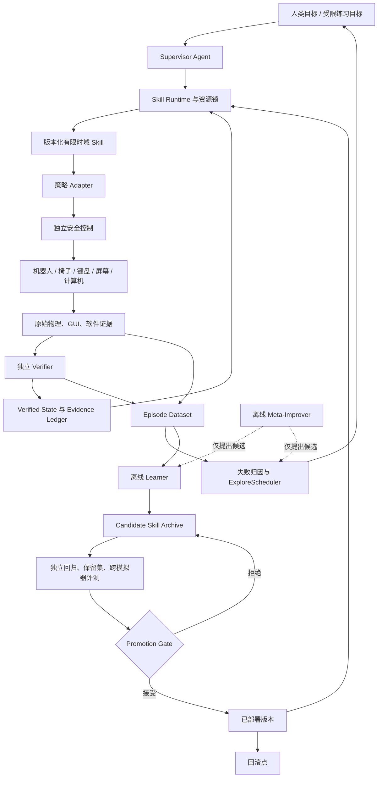

# 受约束 RSI：自改进子项目设计

> 本文是 IMPROVE 子项目的专项设计，服从 [统一架构](../../ARCHITECTURE.md) 与 [路线图](../../ROADMAP.md)。Episode、策略 Manifest 和评估接口与 LEARN 共建；本文的 R/RSI-T 编号不构成另一套全项目优先级。严格无 IK 路线不得使用 IK 残差或旧 IK 示范；此类对照需单独标注。

版本：0.1.0 · 日期：2026-09-25 · 状态：**研究与工程实施规划**

本文把机器人自我改进、物理交互学习与当前实体计算机操作项目合并为一条可实施、可评测、可回滚的路线。它不表示相关学习能力已经实现。已有系统事实以 [`overview.md`](../../overview.md)、[`LEARNING_SYSTEM_ARCHITECTURE.md`](../learning/LEARNING_SYSTEM_ARCHITECTURE.md) 和阶段文档为准；算法背景见 [`RSI_RESEARCH_CN.md`](RSI_RESEARCH_CN.md)，可复用软件见 [`RSI_CODEBASES.md`](RSI_CODEBASES.md)。

## 0. 结论先行

建议把项目对内称为 **Verifier-Grounded Embodied Self-Improvement**，中文为“独立验证约束下的机器人持续自我改进”；对外慎用无修饰的“RSI”。近期要证明的不是机器人能够无限递归改写自己，而是：

> 在安全规则、验证规则、技能契约和评测集固定的条件下，机器人能否利用自己与键盘、椅子、工位和计算机交互产生的证据，持续提出更好的技能候选，并经过独立门禁后可靠升级？

最优切入口是**键盘技能**，而不是一开始训练完整的“语音—导航—坐下—编程”端到端策略：

- 编程任务高度结构化，物理接触、键事件、屏幕状态和软件测试都能提供自动证据；
- 键盘操作有高空间精度、时序、多指协同和错误恢复，研究难度足够；
- 不同手型可能产生不同于人类指法的最优策略，适合形成形态相关 Benchmark；
- 相比跑酷等任务，固定坐姿和受限工作区更容易控制真机风险与试验成本；
- 完成局部闭环后，可自然扩展到椅子调整、坐姿、导航和全任务技能组合。

建议把“自我改进”作为横向研究层接入现有 P0–P6，而不是另建一个绕开 Runtime、Verifier 和安全层的端到端系统。

## 1. 项目目标、科学问题与技术方案

三者需要分开陈述：

| 类型 | 本项目内容 |
|---|---|
| 项目目标 | 机器人接受语音目标，到达工位并坐下，通过实体键盘和屏幕完成代码任务，并能在长期交互中提升可靠性、泛化和自主性 |
| 科学问题 | 多域独立证据能否让机器人在相同交互预算下学得更快、更稳，并防止虚假改进、灾难性遗忘和不安全升级？ |
| 技术方案 | 版本化 Skill + 物理/GUI/软件 Verifier + episode 数据集 + 学习器 + 候选档案 + 独立评测 + 晋升/回滚门禁 |

### 1.1 建议的核心贡献层级

按由近到远排列：

1. **可验证的物理—数字学习闭环**：用接触、键程、键事件、屏幕和软件测试共同标注技能结果。
2. **受约束的持续技能改进机制**：候选只能在 episode 之间更新，经回归、保留集和安全门禁后晋升。
3. **形态相关的手—键盘策略 Benchmark**：比较不同手型、指派、控制方式和键盘条件下的效率、可靠性与适应速度。
4. **自主课程与失败驱动练习**：机器人根据失败类型和学习进展选择下一项安全练习。
5. **受约束递归改进**：后期允许系统离线改进课程、奖励、训练配置或 Skill 实现，但不能修改治理边界。

首篇论文不应同时声称五项贡献。推荐先集中证明第 1–2 项；第 3 项可成为独立 Benchmark 工作，第 4–5 项分别作为后续工作。

## 2. “RSI”能力分级与声明规则

| 级别 | 被更新的对象 | 本项目例子 | 可使用的声明 |
|---|---|---|---|
| L0 静态执行 | 无持久更新 | 固定轨迹或冻结策略打字 | 可验证执行基线 |
| L1 在线适应 | 标定、状态估计、少量有界参数 | 键盘位姿、每键落点偏置、键程估计 | online adaptation |
| L2 技能自我改进 | Skill 内的策略或残差 | 交互后更新 `press_key` / `press_chord` | continual skill improvement |
| L3 自主学习 | 任务选择、数据采集、恢复与 reset | 主动练习弱键位、组合键和扰动 | autonomous improvement |
| L4 受约束递归改进 | 学习器、课程器或候选生成机制 | 离线修改奖励、训练配置、恢复逻辑 | constrained recursive improvement |

只有当“改进器本身”发生变化，并在相同数据、算力、实体交互和人工预算下提高后续改进速度时，才讨论 L4。代码被修改、训练轮数增加或单次成功视频都不构成 RSI 证据。

## 3. 可证伪的研究假设

| 假设 | 最小支持证据 | 证伪或转向条件 |
|---|---|---|
| H1：多域验证标签比控制器自报或单一键事件标签更有用 | 相同数据量、模型和训练预算下，保留键盘/扰动的成功率更高，误触更少 | 多种子置信区间持续重叠，或标签成本抵消全部收益；转向“验证用于安全晋升而非训练标签” |
| H2：失败类型驱动的自动课程比随机/固定课程更省交互 | 达到同一可靠性所需 episode、人工分钟和 reset 时间更少 | 课程器集中采样不可学或传感器故障任务；先加入可学性与异常筛除 |
| H3：机器人形态专用策略优于强制人类指法 | 在同一手型上，自由指派或学习指派提高可靠性/速度；跨手型最优分配显著不同 | 固定人类指法在全部条件下相当或更优；Benchmark 转向机械/控制协同设计而非“非人指法” |
| H4：版本档案与独立晋升门禁能减少回归 | 连续多次升级后旧任务保留率、安全指标和误触指标不劣于直接热更新 | 门禁无法预测真机退化；增加跨模拟器、会话分组和小流量真机门槛 |
| H5：低维交互模型能减少实体试验 | 力—位移、延迟或落点模型使候选筛选更省真实按键次数 | 预测误差下降但决策无改善；停止扩大世界模型，保留直接残差学习 |

这些是假设，不是当前结果。每项实验都应保存失败结果与转向依据。

## 4. 总体架构：执行、改进、治理三层



三个关键隔离面：

- **执行层**完成任务，不能修改自己的权限或验证结论；
- **改进层**读取版本化 episode，只能产出候选，不能直接使能真机；
- **治理层**拥有晋升、原子切换与回滚权，规则独立于候选策略和 Agent。

## 5. 哪些可以进化，哪些必须冻结

| 类别 | 允许更新 | 不允许更新 |
|---|---|---|
| 手—键盘 | 指尖/腕部小残差、落点偏置、深度、保持时间、释放轨迹、手指分配、键盘先验 | 力/速度/关节/工作空间硬限制，物理按键证据定义 |
| 姿态与椅子 | 目标姿态参数、受限残差、恢复触发阈值的候选 | 跌倒保护、支撑判据、碰撞规则、急停 |
| 导航 | 局部代价、恢复选择、到站效率模型 | 地图权限、安全距离硬门槛、低层直接越权 |
| Agent/SkillGraph | 技能选择策略、有限重试、已批准的恢复组合 | Skill 资源锁、Agent 工具权限、直接关节命令 |
| 训练系统 | 数据采样、课程、奖励塑形、模型结构、超参数 | 最终 Verifier、冻结测试集、预算核算方式 |
| 软件任务 | 代码候选、测试后修复策略 | 被测任务自行改测试、LLM 自报通过、逃逸隔离环境 |

任何“让模型同时修改奖励和最终成功判据”的方案都会失去可证伪性，应拒绝。

## 6. 三个时间尺度的改进环

### 6.1 快环：单次 episode 内，不更新模型权重

- 更新键盘/椅子位姿估计与置信度；
- 根据触键反馈做有界微调；
- 发现误触、卡键或焦点丢失后执行固定恢复 Skill；
- 保证当前策略版本和 Verifier 版本在 episode 内不变。

### 6.2 中环：episode 之间更新技能候选

- 汇总成功、失败、恢复和人工接管轨迹；
- 先做统计标定/参数搜索，再做 BC、残差 RL 或 HIL-RL；
- 候选以新版本进入档案，在冻结评测上比较；
- 晋升后保留上一稳定版本与一键回滚信息。

### 6.3 慢环：发布之间改进学习机制

- 自动课程选择；
- 低维物理模型或世界模型辅助候选筛选；
- LLM 提出奖励、训练配置、指法搜索或恢复代码候选；
- 改进器本身也用外层冻结任务和公平预算评测。

慢环不能直接修改正在运行的机器人，也不能访问治理层密钥或改变最终评测。

## 7. 与现有 P0–P6 的双轨路线

现有 P 阶段回答“系统是否具备能力”，下面的 R 阶段回答“能力能否通过交互可靠改进”。二者共享 Skill 契约和证据，不另造一套 Runtime。

| RSI 阶段 | 依赖的项目阶段 | 核心问题 | 主要产物 | 退出门槛 |
|---|---|---|---|---|
| R0 测量底座 | P0、P1，P2 可并行 | 是否能无泄漏地重放一次成功、失败和恢复？ | `EpisodeRecord`、数据来源标签、策略 Manifest、冻结 Benchmark v0 | 哈希可校验；动作、证据、标签和版本可追溯；相邻帧不跨数据集 |
| R1 参数适应 | P2 单键 | 简单校准是否已经足够？ | 每键/每指偏置、深度、保持和释放参数；统计/搜索基线 | 未见位姿/键盘上优于冻结控制器，且误触和安全不恶化 |
| R2 残差技能学习 | P2 单键与释放 | 学习残差是否比参数搜索有额外收益？ | 受限动作 Adapter、BC/残差 RL 候选、候选档案 | 多种子、同预算优于 R1；退化候选被门禁拒绝 |
| R3 双手与人工纠正 | P2、P3 | 组合键、文本纠错和接管数据能否稳定学习？ | `press_chord`、`type_text` 数据，示范/纠正来源标记 | Ctrl+Alt+T、短串、全部释放和错误恢复联合通过 |
| R4 自主课程与 reset | R2/R3 | 系统能否自主选择安全且有学习价值的练习？ | ExploreScheduler、ResetSkill、随机/固定课程对照 | 达到同一性能所需交互或人工时间下降；reset 成本完整计入 |
| R5 形态与工位泛化 | P2、P4 | 最优策略是否依赖手型、键盘、坐姿和工位？ | Dex3/Dex5 或其他手型的统一任务协议、跨域切分 | 报告形态内、跨形态、跨键盘结果；不把机械优势归功于算法 |
| R6 全身技能改进 | P4、P5 | 局部学习能否扩展到坐姿、椅子调整和导航？ | 分技能残差与恢复模型；控制权交接评测 | 每项先独立优于基线，再进入端到端；无未验证状态推进 |
| R7 真机与受约束递归改进 | P6 且 R0–R6 门槛满足 | 改进是否能安全迁移，改进器本身能否变好？ | HIL、小流量发布、跨模拟器回归、Meta-Improver 沙箱 | 真机收益可重复、旧任务保留、安全不退化；L4 另做公平外层评测 |

R0–R2 是自改进子项目内的起步范围；跨项目顺序见 [统一路线图](../../ROADMAP.md)。R4 之前不需要世界模型；R7 之前不需要让代码 Agent 修改训练系统。

## 8. 首篇论文的最小闭环

建议工作标题：

> **Verifier-Grounded Continual Improvement of Physical Keyboard Skills**

### 8.1 范围

- 固定 G1 上身或固定手臂台架；
- 单指到少量多指、单键到组合键；
- 物理键帽必须产生真实接触/键程和 KeyDown/KeyUp；
- 使用键盘位姿、阻力、视觉误差和邻键干扰的训练/测试扰动；
- 最终评测不需要先解决完整导航和自由坐下。

### 8.2 主对照

| 组别 | 控制与数据 | 回答的问题 |
|---|---|---|
| B0 冻结控制器 | 不学习 | 初始能力是多少？ |
| B1 参数校准 | 同预算统计估计/黑盒搜索 | 深度学习是否必要？ |
| B2 行为克隆 | 相同交互数据 | 收益是否只来自更多数据？ |
| B3 残差学习 + 随机课程 | 固定课程分布 | 学习控制器本身有何收益？ |
| B4 残差学习 + 验证器驱动课程 | 失败类型/学习进展采样 | 自动课程是否提高样本效率？ |

标签质量消融只在仿真或离线数据中进行：多域验证标签、键事件单标签、控制器自报标签。真机安全层在所有组中保持开启。

### 8.3 数据切分

- 训练/开发/最终测试按**物理键盘实体、采集会话、键盘位姿、姿态范围和任务串**分组；
- 同一轨迹的相邻帧不能跨集合；
- 参与候选选择的集合只能称开发/晋升集；
- 最终测试集冻结，Meta-Improver 也不可读取其逐任务结果。

### 8.4 指标

主要指标：

- 首次完整成功率与恢复后成功率；
- 每千次尝试的误触、漏触、重复触发和卡键；
- 组合键时序成功率、全部释放率、完整命令成功率；
- 达到目标可靠性所需的实体尝试数、人工分钟、reset 时间和 GPU 小时；
- 晋升后的旧任务保留率、回滚率和安全停止率。

建议同时报告固定交互预算下的增益 `ΔS(N)` 与学习曲线下面积，而不是只报告最终最好 checkpoint。物理、键事件、GUI 和软件结果分别统计，不能互相替代。

### 8.5 成功与负结果

论文级完成需要：可重放数据、冻结切分、多种子学习曲线、置信区间、完整失败分布、候选版本链和负结果。若 B1 与 B4 无显著差异，合理结论可能是“可验证统计校准已足够”，这仍是对键盘技能设计有价值的结果。

## 9. 论文与产品演进建议

| 顺序 | 研究产物 | 核心新意 | 不应混入的范围 |
|---|---|---|---|
| Paper A | Verified Physical Keyboard Skill Improvement | 多域标签、残差学习、晋升门禁 | 完整导航、自由对话、大 VLA |
| Paper/Benchmark B | Morphology-Aware Physical Computer Use | 不同灵巧手、指法/动作策略和键盘条件 | 把硬件差异错误归为算法收益 |
| Paper C | Verifier-Guided Autonomous Skill Growth | 自动课程、reset、恢复与技能覆盖增长 | 未受限的真机开放探索 |
| Paper D | Constrained Recursive Improvement of Robot Learning Pipelines | 改进器档案、外层预算、代码/奖励候选 | 修改安全/Verifier 或以训练分数替代最终证据 |
| 产品线 | 工位自主作业 | 语音、导航、坐姿、打字、代码任务和报告 | 为演示牺牲证据链和安全边界 |

## 10. 可直接交给 Codex 的工程任务

每个任务均为有界任务，完成后停止，不自动领取下一项。

| 编号 | 任务 | 主要修改范围 | 验收 |
|---|---|---|---|
| RSI-T01 | 定义 `EpisodeRecord` 与来源枚举 | `src/vskill_os/learning/`、schema 测试 | 一个成功、失败、恢复 episode 可序列化、重放并校验哈希 |
| RSI-T02 | 建立 Keyboard Benchmark v0 | 配置、独立 evaluator、报告 schema | 固定种子/分组切分；物理、事件、GUI 指标分别输出 |
| RSI-T03 | 建立 `PolicyManifest` 与候选档案 | 核心协议、文件后端、兼容性测试 | 缺少观测/动作/资产/版本字段的候选拒绝加载 |
| RSI-T04 | 实现 Promotion Gate 替身 | evaluator、registry adapter、回滚测试 | 故意退化、越界和遗忘候选被拒绝；稳定版本可原子恢复 |
| RSI-T05 | 每键位参数校准基线 | 独立学习 worker、Adapter | 不修改 Agent/Verifier；生成候选而非热改运行策略 |
| RSI-T06 | 受限残差学习 Adapter | Isaac 学习环境、训练/推理进程 | 动作范围硬限制；B0/B1/B2/B3 同预算报告 |
| RSI-T07 | 示范与接管数据接入 | teleop/LeRobot 转换器 | 示范、接管、恢复和自主数据来源不混淆 |
| RSI-T08 | ExploreScheduler v0 | 纯 Python bandit/课程接口 | 与固定/随机课程比较；保存采样概率与选择依据 |
| RSI-T09 | ResetSkill 与自主运行预算 | Skill 契约、恢复、成本记录 | reset 成功/失败/人工时间进入报告，不被免费忽略 |
| RSI-T10 | 形态 Benchmark v0 | 手型 Adapter、统一任务描述 | 至少两种手型或一实一仿代理；统一指标且分开硬件能力 |
| RSI-T11 | HIL/小流量真机门禁 | P6 Adapter、shadow/canary 报告 | 身份、频率、关节序、归一化不符即拒绝；支持回滚 |
| RSI-T12 | Meta-Improver 沙箱 | 隔离代码 worker、外层 evaluator | 只能改白名单目录；无硬件权限；冻结测试和预算下评测 |

近期推荐顺序：

```text
RSI-T01 → RSI-T02 → RSI-T03 → RSI-T04
        → RSI-T05 → RSI-T06
        → RSI-T07 → RSI-T08 → RSI-T09
```

在 RSI-T04 前不部署学习候选；在 RSI-T09 前不宣称自主持续学习；在 RSI-T11 前不宣称真机自我改进；在 RSI-T12 外层评测通过前不宣称递归自我改进。

## 11. 最小数据与接口规范

每个 episode 至少记录：

- `run_id`、`episode_id`、任务、随机种子与开始/结束时间；
- 机器人、手、键盘、椅子、场景、传感器和标定版本；
- Skill、策略、代码、配置、资产和 Verifier 哈希；
- 原始观测、请求动作、实际动作、安全裁剪、接管和取消；
- 接触、键程、KeyDown/KeyUp、屏幕帧、OCR/GUI 与软件测试证据；
- 控制器声明、Verifier 标签、标签置信度/冲突及来源；
- 失败码、恢复链、reset 成本、人工时间与终止原因；
- 数据划分、探索选择依据与采样概率。

建议新增的核心协议：

- `EpisodeDatasetAdapter`
- `LearnerAdapter`
- `PolicyManifest`
- `CandidateArchive`
- `CandidateEvaluator`
- `PromotionGate`
- `ExploreScheduler`
- `ResetSkill`

核心包只定义协议和标准库元数据。Isaac、PyTorch/JAX、LeRobot、HIL-SERL 和厂商 SDK 进入可选 Adapter 或独立 worker。

## 12. 晋升、回滚与真机发布

候选的固定晋升链：

```text
schema/契约检查
→ 数据与来源审计
→ 离线回放和单元回归
→ 冻结开发集仿真评测
→ 旧任务保留与故障注入
→ 第二物理后端或参数扰动评测
→ 阴影运行（仅延迟/动作合理性）
→ 台架/HIL
→ 小流量真机 canary
→ 晋升或回滚
```

硬限制越界、未验证状态推进、测试集泄漏、身份不匹配或证据缺失直接拒绝，不允许用平均成功率抵消。阴影运行和离线回放不能证明真实闭环性能，只是前置筛选。

## 13. 仿真与计算资源决策

### 13.1 主仿真基线

当前已有验收应继续锁定 **Isaac Sim 5.1 + Isaac Lab 2.3.2 + PhysX**，直到 Paper A 的基线和数据格式冻结。中途升级仿真版本会把引擎变化与算法收益混在一起。

### 13.2 新版本与 Newton

Isaac Lab 3.0/Isaac Sim 6.x 和 Newton 建议放入独立环境：

- 先做资产、关节、接触和键事件的 sim-to-sim 回归；
- Newton 作为高速训练或第二物理后端候选，不作为当前键盘证据唯一真值；
- 只有在键帽行程、摩擦、迟滞、多指接触和相机/屏幕链达到同等门槛后，才替换主基线；
- 同一论文实验中固定引擎版本和 commit。

### 13.3 资源投入顺序

1. 单卡小策略、状态观测、参数校准和低维残差；
2. 视觉学生、示范/接管和并行仿真；
3. 自动课程与低维世界模型；
4. 多 GPU VLA 或视频世界模型，仅在已有数据规模和明确收益假设后投入。

不预先承诺固定训练小时或样本数；先用 pilot 测量方差、吞吐和最小关心效应，再确定正式预算。

## 14. 关键风险与应对

| 风险 | 早期信号 | 应对 |
|---|---|---|
| 仿真接触不可信 | 策略利用穿透、事件桥或特权状态作弊 | 独立键程/接触证据、相机复核、跨参数与跨引擎评测 |
| 把验证泄漏当学习能力 | 训练奖励直接读最终 Verifier 或测试答案 | 来源标签、训练/评测进程隔离、冻结最终规则 |
| RSI 概念过度包装 | 只有一次微调却声称递归进化 | 使用 L0–L4 分级并严格限制声明 |
| 真机在线 RL 风险高 | 大动作、频繁安全裁剪、reset 失败 | 固定台架、小残差、HIL-SERL 式接管、先仿真再 canary |
| 灾难性遗忘 | 新键位变好但旧组合键退化 | 旧任务回归、候选档案、保留数据与回滚 |
| 自动课程钻空子 | 重复简单任务或集中不可学任务 | 覆盖率、学习进展、可学性和异常筛除联合打分 |
| 形态比较不公平 | 手型、控制频率和传感器不同 | 固定任务协议，分别报告硬件上限、算法增益和资源预算 |
| 上游依赖失控 | Isaac/JAX/PyTorch/SDK 冲突 | 每个重型 codebase 独立环境/容器，通过 Adapter 通信 |
| 软件自改写越权 | 候选修改测试、安全或部署配置 | 白名单目录、只读评测、无硬件凭证、人工批准发布 |

## 15. 停止与转向标准

- 若物理接触—键事件链无法稳定复现，暂停学习，回到 P2 证据和仿真建模；
- 若参数校准已经达到目标且残差学习无稳定收益，停止扩大 RL，优先做形态/泛化 Benchmark；
- 若自动课程不节省交互或人工预算，保留固定课程并分析任务可学性；
- 若世界模型只改善预测、不改善动作选择，停止扩大模型；
- 若跨模拟器排序与真机排序持续不一致，提高真机 pilot 权重而非继续堆仿真规模；
- 若候选门禁无法拦截故意退化策略，禁止任何自动晋升。

## 16. 当前最值得做的四件事

1. 冻结键盘 Benchmark v0、数据切分与多域证据定义；
2. 实现 `EpisodeRecord`、`PolicyManifest`、候选档案和回滚门禁；
3. 先比较冻结控制器、参数校准、BC 和小残差策略；
4. 在以上闭环可复现后，再引入 HIL-SERL 式接管和自动课程。

这四项能够同时服务论文、真机安全和后续 RSI；直接从 DGM、Eureka、OpenPI 或大型世界模型起步，现阶段会增加依赖和算力，却不会补上最关键的证据与治理缺口。
