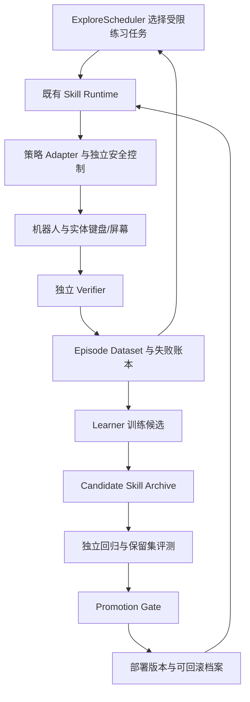

# Robot–Physics–Agent：机器人自我改进与物理交互学习调研

调研日期：2026-09-16。本文是研究与实施建议，不代表相关能力已经实现。论文结果、代码公开状态和课程可访问性以本次查看的官方页面为依据；没有执行外部训练代码或复现论文。建议顺序是结合当前仓库作出的判断。

## 1. 建议定位

建议将项目定位为：**面向实体计算机操作的、由独立验证驱动的机器人持续学习与自主探索平台**。

可使用英文工作名称：**Verifier-Grounded Robot Self-Improvement through Physical Computer Use**。

研究主问题可以收敛为：

> 机器人能否利用物理接触、键盘事件、屏幕反馈和软件测试，持续提高技能，在未见过的工位与任务上变得更可靠，并在相同交互预算下降低人工介入？

第一项实验建议选“固定基座、单指/少量手指、实体按键的交互自改进”。之后扩展到组合键、文本纠错、自主课程和技能组合。全身导航、坐下、跨形态迁移可以作为后续扩展。

项目的研究优势在于三域证据与技能交接：能够研究**什么数据值得学习、失败该归因给谁、改进是否真实、改进能否保留**。这些比单纯接入一种 RL 算法更可能构成独立贡献，但新颖性仍需进一步对照具体投稿领域的文献。

## 2. RSI 的含义与可检验层级

机器人文献中的 self-improvement 不必然意味着 recursive self-improvement。本文用以下工作定义避免混淆；这是本项目的研究分类，不是统一行业分级。

| 层级 | 实际发生的变化 | 本项目中的例子 | 如何证明 |
|---|---|---|---|
| 在线适应 | 更新标定、状态估计或少量参数 | 新键盘上的落点偏置、键程估计 | 在受控扰动后恢复性能；区分瞬时估计和持久学习 |
| 技能自我改进 | 交互经验更新策略，之后重复部署 | 学到更可靠的按键残差策略 | 固定预算、独立测试集上优于冻结策略 |
| 持续/开放式学习 | 长期积累技能，主动选择新任务 | 自主练习弱键位、组合键、纠错 | 任务覆盖增加，旧任务保留，人工介入减少 |
| 受约束递归改进 | 系统改进其收集数据、训练或提出改进的机制 | 改进课程选择器或训练候选生成器 | 后续未见任务上，改进速度或样本效率优于固定改进器 |

修改代码本身并不充分证明 RSI；只做更多训练也不充分。较强的 RSI 实验应明确“改进器”发生了什么变化，并在相同总算力、数据与人工预算下测量其后续改进能力。

[Darwin Gödel Machine（DGM，2025）](https://sakana.ai/dgm/)研究了代码 Agent 修改自身代码、通过编程基准筛选、维护候选档案的机制。其证据来自数字编程任务，不能直接外推为实体机器人已具备递归进化能力。

## 3. 与当前仓库的实际衔接

本次检查了 [README](../../../README.md)、[架构](../../ARCHITECTURE.md)、[P6 规划](../../phases/phase_6_sim2real_self_improvement.md)、[项目构想](../../proposals/ideaself.md)及相关源码。

| 现有基础 | 可复用价值 | 仍缺的能力 |
|---|---|---|
| 独立 Verifier 与物理/GUI/软件证据 | 构造成功标签、拒绝未验证状态 | 标签质量评测、证据冲突与不确定性处理 |
| `EventLedger`、恢复记忆与检查点 | 追踪失败原因、数据出处与恢复结果 | 连续观测—动作轨迹、训练数据集版本、采集策略概率等学习元数据 |
| 版本化 Skill 契约与 Registry | 候选保持同一输入/输出语义 | 多版本持久档案、晋升门禁、原子切换、完整回滚 |
| ActionGraph 与独立动作验证器 | 将精细动作封装在有限时域内 | 可学习参数范围与残差策略 Adapter |
| 随机故障 Benchmark | 比较任务恢复和误报完成 | 接触动力学任务、学习曲线、跨键盘测试与遗忘评测 |
| P1 仿真资产与键帽—PTY 链路 | 提供可重复实验场景 | P2 清晰可见的实体触键验收、真实感知与真机证据 |

重要实现细节：当前 [registry.py](../../../src/vskill_os/registry.py) 保存的是每个名称对应的当前 Skill；`replace()` 是直接替换，不能视为已实现策略晋升系统。[ledger.py](../../../src/vskill_os/ledger.py) 记录事件不等于已有完整 RL replay buffer。[benchmark.py](../../../src/vskill_os/benchmark.py) 的故障注入基线不等于物理策略学习的验证。

仓库当前把 P2 标为 `PARTIAL`、P6 标为 `PLANNED`。因此，可以提前建设学习数据和离线评测设施，但实体策略效果必须等接触证据与 P2 门槛补齐后再报告。本次不修改阶段状态。

## 4. 六个探索方向与优先级

### A. 可验证的按键参数适应与残差学习——最高优先级

保留几何/反馈控制基线，只学习手指—键位的落点偏置、按压深度、保持时长、释放轨迹或受限的末端残差。高层 Agent 只选择 Skill；策略动作经过低层 Adapter 与独立安全控制。

建议方法顺序：固定参数 → 每键位统计校准 → 受约束参数搜索/上下文 bandit → 残差 RL。只有简单方法遇到明显瓶颈，再增加策略复杂度。

[Residual Reinforcement Learning for Robot Control（ICRA 2019）](https://arxiv.org/abs/1812.03201)将传统控制与学习残差结合，并进行了真实接触装配实验。其思想适合已有控制器的本项目；原代码不能直接当作 G1/Dex3 控制器。

最小实验：训练时改变键盘平移、旋转、键帽阻力和观测误差；测试未见组合，比较首次按键成功率、邻键误触、重复触发、释放失败与接触力。核心问题是“同样交互次数，验证过的数据能否带来更可靠的持久改进”。

### B. 示范、纠正与自主经验结合——近期主线

先用少量示范或稳定控制器轨迹建立行为克隆基线，再把成功、失败及人工纠正轨迹放入明确区分来源的数据集。可选 ACT / Diffusion Policy；后续借鉴 HIL-SERL 的在线交互学习。

[HIL-SERL](https://hil-serl.github.io/)使用示范、奖励分类器与训练中人工接管；[官方代码](https://github.com/rail-berkeley/hil-serl)包含 actor/learner、数据缓冲与 Franka 示例。它是人参与的学习系统，不能宣传成天然无人值守。对本项目需要重做 Dex3 动作表示、接管方式和 Gym/Worker Adapter。

研究点：将人工纠正与自动恢复 Skill 的轨迹结合，减少重复人工示范。自动恢复成功不意味着整条轨迹都是专家数据；必须记录恢复前错误、恢复动作及最终验证结果。

### C. 主动探索与自动课程——适合第二阶段

建立 `ExploreScheduler`，从经过预定义约束的任务空间中选择下一次练习：键位、手指、组合键时序、键盘位姿、故障类型。初期采用学习进展、模型不确定性与任务覆盖率，比较随机采样和固定课程。

[SOAR（CoRL 2024）](https://auto-improvement.github.io/)研究自主采集经验并改进指令跟随策略；[Voyager](https://voyager.minedojo.org/)提供自动课程、技能库和反馈迭代思路，但其环境是 Minecraft，不能作为真机学习证据。

与项目的映射：经常漏按 Alt → 自动增加对应组合键练习 → 验证接触与时序 → 更新该技能 → 在完整命令任务上复测。不要只按“失败最多”分配训练量，可能把预算消耗在当前不可达或传感器异常的任务上。

重置也应成为明确的 Skill：统一抬指、释放全部按键、恢复安全姿态、清理测试输入框并重新确认焦点。报告重置耗时、失败和人工介入，才有资格讨论自主学习效率。[MoReFree / Reset-free RL with World Models](https://arxiv.org/abs/2408.09807)可作为减少人工重置的算法阅读材料，其结果不代表本平台已能无重置运行。

### D. 交互学习物理模型与世界模型——中期

先拟合低维模型：键帽力—位移、动作到键事件的延迟、手指落点误差分布、接触后的键盘滑移。通过信息量高但受限的探测动作减少不确定性，检验其是否帮助动作选择。之后再考虑视觉潜在世界模型。

[RISE（RSS 2026）](https://github.com/OpenDriveLab/RISE)将动作条件动力学模型与进度价值模型组合，通过想象 rollout 改进策略。官方仓库已列出训练代码、动力学模型和 Piper 部署流程；迁移到 G1/Dex3 仍需新数据与适配。

[Robot Self-Improvement via Human-Video Dynamics Models（2026 预印本）](https://ethz-mrl.github.io/robot-self-improvement-website/)研究从人类视频得到策略、动力学与价值先验，并把失败转化为纠正监督。本次页面仍标注 `Code (Coming Soon)`，适合作为前沿阅读，暂不作为近期交付依赖。

世界模型用于提出与筛选候选，真实验证器决定是否成功。键盘微小接触、重复键事件和力峰值不能只靠“预测视频看起来正确”验收。

### E. Agent 辅助技能代码与训练流程改进——后期 RSI 探索

允许改进 Agent 离线提出：指法搜索算法、恢复 Skill 的组合、训练超参数、特征处理、课程选择逻辑。每次输出候选包，在隔离环境评测，保留父版本、差异与证据。

[Eureka](https://eureka-research.github.io/)是 LLM 生成并迭代训练奖励的代表，原实验使用 Isaac Gym；它不是当前仓库 Isaac Lab 环境的即插即用组件。[DGM](https://sakana.ai/dgm/)可参考候选档案和改进器演化机制。

训练 reward shaping 与最终成功判据必须分开：可以研究奖励候选，但冻结最终 Verifier、验收任务、资源权限和物理硬限制。当前 `LocalCodeSandbox` 只服务固定模板基线；开展自动代码改写实验前，需要替换成真正隔离的执行环境。

机器人使用电脑编写自己的技能可以作为后期闭环展示。训练与编译仍应交给独立服务；应单独测量物理输入带来的研究价值和额外成本，避免打字速度成为所有学习实验的瓶颈。

### F. 跨键盘与跨手型的技能迁移——扩展方向

先做同一 G1/Dex3 在不同键盘布局、阻力和工位上的适应；数据充足后再比较手型。高层保持 `press_key` / `press_chord` 契约，底层更换手指指派与控制策略。

[RoboPianist](https://github.com/google-research/robopianist)提供多指琴键任务及训练入口，可借鉴时序和指法研究。它以仿真钢琴任务为核心，键盘尺寸、力学、机械手和反馈目标均与电脑键盘不同。

固定硬件算法赛道与跨形态系统赛道应分开；否则无法判断进步来自学习方法、机械结构还是执行器性能。

## 5. 推荐阅读与项目复现清单

“公开代码”仅表示查到作者提供的仓库，不表示本机已安装、训练可复现或权重可直接商用。部署前另查许可证、依赖、权重和硬件限制。

| 工作/项目 | 主要学习机制与证据范围 | 开放程度及本项目用途 |
|---|---|---|
| [Residual RL](https://arxiv.org/abs/1812.03201) | 传统控制叠加学习残差；真实装配 | 先读方法；作为小动作空间方案依据 |
| [SERL](https://serl-robot.github.io/) | 样本高效真实机器人 RL | 官方页面提供代码、文档、控制器；参考工程闭环 |
| [HIL-SERL](https://github.com/rail-berkeley/hil-serl) | 示范与人工纠正辅助 RL；真实操作 | 有训练及 Franka 流程；近期重点，需新 Adapter |
| [Diffusion Policy](https://diffusion-policy.cs.columbia.edu/) | 从示范学习动作序列 | 有代码与真实任务结果；作为冻结 IL 基线，不等于自改进算法 |
| [LeRobot](https://github.com/huggingface/lerobot) | 数据采集、训练、部署工具，含 ACT/Diffusion/HIL-SERL | 工程数据与训练入口；保持在可选训练服务中 |
| [SOAR](https://auto-improvement.github.io/) | 自主数据采集与后续策略提升；真实桌面任务 | 项目页提供代码和数据；参考探索与学习的连接 |
| [π*0.6 / RECAP](https://arxiv.org/abs/2511.14759) | 示范、自主经验与纠正结合的 VLA 改进 | 有论文和实验；本次未确认完整官方训练链可直接复现，不与 OpenPI 基础模型开源混同 |
| [RISE](https://github.com/OpenDriveLab/RISE) | 在组合世界模型中想象并改进；真实操作评测 | 已公开训练代码和动力学模型；中期选择性复现 |
| [Human-Video Dynamics Models](https://ethz-mrl.github.io/robot-self-improvement-website/) | 人类视频先验、失败纠正与策略更新 | 2026 预印本，代码待发布；关注机制 |
| [MoReFree](https://arxiv.org/abs/2408.09807) | 世界模型与减少环境重置 | 学习自主采样/重置问题；不要外推成 G1 无人训练已解决 |
| [Voyager](https://voyager.minedojo.org/) | 自动课程、可执行技能库、反馈迭代 | 虚拟环境；参考高层组织形式 |
| [OMNI-EPIC](https://github.com/maxencefaldor/omni-epic) | 自动生成仿真任务和奖励、持续扩展任务档案 | ICLR 2025，公开代码；适合受限课程生成研究 |
| [Eureka](https://eureka-research.github.io/) | LLM 搜索训练奖励并用 RL 结果迭代 | 公开代码；参考奖励候选搜索，需迁移仿真接口 |
| [DGM](https://github.com/jennyzzt/dgm) | 修改代码 Agent 自身实现、维护演化档案 | 数字编程研究；用于后期受约束改进器实验 |
| [RoboPianist](https://github.com/google-research/robopianist) | 多指琴键控制与时序学习 | 仿真基准和训练入口；用于相邻领域对照 |

最短阅读顺序：Residual RL → HIL-SERL → SOAR → RECAP → RISE。随后按研究分支选择 Voyager/OMNI-EPIC（课程与技能库）或 Eureka/DGM（代码与改进器）。

## 6. 建议新增的训练闭环

下面是拟议结构，组件尚未实现：

边界：高层 Agent 不产生关节命令；训练服务不直接使能硬件；只有 Verifier 写入派生事实；候选在 episode 之间切换，不能在动作执行途中改策略版本。学习服务只能提出变更，部署服务根据独立报告决定是否晋升。

最小新接口建议：`EpisodeDatasetAdapter`、`LearnerAdapter`、`CandidateEvaluator`、`PromotionGate`、`ResetSkill`。核心包只存协议与元数据，PyTorch/JAX/仿真训练依赖放独立环境。

每个 episode 至少保存：

- 任务、键盘/机器人/相机标定版本、Skill/策略哈希、仿真种子或真机试次 ID；
- 带时间戳的观测、请求动作、实际执行动作、安全裁剪及接管记录；
- 原始物理/GUI/软件证据、来源、同步质量、Verifier 版本与标签；
- 失败码、恢复过程、reset 成本、人工耗时和终止原因；
- 数据分组、训练/开发/最终测试划分与数据集哈希；
- 探索选择依据，采用 bandit 等方法时保存选择概率。

不要把失败轨迹全部丢弃：它们可用于价值学习、失败预测和恢复学习。奖励为零、标签不确定、传感器缺失和物理越界是不同事件，应分别标记。

## 7. 实验如何证明“真的在变好”

### 7.1 三域证据必须分别成立

按键成功至少涉及接触/键程证据、期望键事件及完整释放；终端命令还需要焦点和文本结果。软件测试通过只证明被测产物满足测试，不能倒推出机器人真实按过键。

研究应分开报告：控制器声明、独立物理观测、数字事件和软件结果。开发 Oracle、训练特权观测及部署可得观测使用不同来源标识，防止模拟器内部状态或直接事件注入泄漏到最终评测。

### 7.2 推荐对照与消融

| 对照 | 用途 |
|---|---|
| 冻结的几何/反馈控制器 | 初始能力与数据采集基线 |
| 固定控制器 + 统计校准/参数搜索 | 判断深度 RL 是否确有必要 |
| 同数据预算的行为克隆 | 判断收益是否只是来自额外数据 |
| 残差学习 + 随机任务 | 衡量学习策略本身 |
| 残差学习 + 自动课程 | 衡量探索策略贡献 |
| 验证过标签 vs 控制器自报/单一模态标签 | 衡量证据质量；弱验证对照仅在离线/仿真开展 |
| 固定改进器 vs 可更新改进器 | 后期检验递归改进的额外收益 |

真机安全层在所有真机组保持开启，不能为了消融关闭。

### 7.3 指标与数据切分

主要指标：首次成功率、恢复后成功率、每千次尝试的误触/卡键、完整命令成功率、人工接管次数、每小时有效成功任务数、累计实体尝试数、训练时间和计算成本。

同时测量：旧键盘任务保留率、跨键盘/工位泛化、验证器误接受/误拒绝、动作与屏幕交接失败、力/速度峰值和安全停止。

按键盘实体、采集日期/会话、姿态范围和任务族分组切分，避免同一轨迹相邻帧进入训练与测试。先冻结最终测试集；反复参与候选筛选的集合只能称开发/晋升集，不能继续称完全未见测试集。

建议先进行多随机种子仿真实验和小规模真机 pilot，再由观察到的方差与最小关心效应确定正式样本量。报告置信区间与失败分布，不能凭一次成功视频或少量试次断言安全或显著提升。

### 7.4 晋升条件

候选先经过契约/兼容性检查、离线数据审计、仿真与旧任务回归，再做有限真机验证。硬限制越界直接拒绝；性能门槛和允许退化范围在训练前约定。保存上一稳定版本，并在恢复、时序或误触指标恶化时回滚。

“阴影运行”只能检查候选动作是否合理、计算延迟是否可接受，无法证明其反事实闭环表现。离线回放同样不能替代真实 rollout。

## 8. 课程与公开学习资源

以下优先引用授课方官网。公开课材料不等于开放注册的认证 MOOC；表中“视频公开”仅针对核对到的学期或官方链接。

| 优先级 | 课程 | 已核对的访问形式 | 对本项目的作用 |
|---|---|---|---|
| 1 | [ETH Robot Learning: From Fundamentals to Foundation Models，2026，Oier Mees](https://cvg.ethz.ch/lectures/Robot-Learning/) | 逐讲 slides、视频与[官方练习仓库](https://github.com/mees-robot-learning-course/ethz-course-2026)；练习覆盖 PyTorch、控制/MDP、IL、RL | 最贴合的总览；连接 IL、RL、生成策略、世界模型与具身推理 |
| 1 | [Stanford CS224R，Spring 2025，Chelsea Finn](https://cs224r.stanford.edu/spring_2025/) | 讲义、作业与[官方公开视频列表](https://www.youtube.com/playlist?list=PLoROMvodv4rPwxE0ONYRa_itZFdaKCylL) | 系统掌握深度 RL；重点看 offline RL、exploration、hierarchical RL、autonomous learning 和 sim-to-real |
| 2 | [CMU 16-745 Optimal Control and Reinforcement Learning，Zachary Manchester](https://optimalcontrol.ri.cmu.edu/) | 课程网站、GitHub 作业、[2025 官方视频列表](https://www.youtube.com/playlist?list=PLZnJoM76RM6IAJfMXd1PgGNXn3dxhkVgI) | 补动力学、LQR、轨迹优化、MPC、系统辨识；支撑基线与残差控制 |
| 2 | [Berkeley CS285，Fall 2023，Sergey Levine](https://rail.eecs.berkeley.edu/deeprlcourse-fa23/) | 公开课程资料、作业、[官方视频列表](https://www.youtube.com/playlist?list=PL_iWQOsE6TfVYGEGiAOMaOzzv41Jfm_Ps) | 深入 IL、off-policy、model-based 与 offline RL；适合算法复现 |
| 3 | [CMU 16-831 Introduction to Robot Learning](https://sites.google.com/view/16-831-cmu/home) | 当前页面对应 Spring 2026，介绍 ML/RL/IL/视觉学习与作业；本次未核实完整公开视频系列 | 作为机器人学习大纲与论文选题补充，不承诺全部可在线听课 |
| 3 | [Stanford CS330 Deep Multi-Task and Meta Learning](https://cs330.stanford.edu/) | 官网列出 2019–2022 的公开视频；当前录播通过 Canvas | 后期多任务、少样本适应、元学习、终身学习；不是 RSI 专门课程 |
| 补基础 | [ETH Robot Dynamics](https://rsl.ethz.ch/education-students/lectures/robotdynamics.html) | 官方说明课程材料经 Moodle 分发，不能视作完整公开网课 | 多刚体运动学、动力学、接触力；有访问权限时学习 |
| 补基础 | [MIT Robotic Manipulation，Russ Tedrake](https://manipulation.csail.mit.edu/) | 公开在线教材及配套计算材料；本表不承诺所有当期课程录播公开 | 操作、接触、规划与优化；适合边查边做 |

如果只选三门：**ETH 2026 Robot Learning + Stanford CS224R 2025 + CMU 16-745 2025**。CS285 用于深入复现，不必与 CS224R 从头重复完整学习。基础薄弱时先补线性代数、概率、梯度优化、Python/PyTorch 和刚体坐标变换。

ETH 的重点顺序：Robot Control & MDPs → Imitation Learning → RL I/II → World Models → Generalist Robot Policies → Embodied Reasoning。官网已经把 HIL-SERL、Eureka、RECAP 和 Voyager 放入相关阅读，便于边学边建立研究联系。

## 9. 一条 12 周的学习—实验路径

以下是具备 Python/基本机器学习基础、每周能稳定投入约 12–15 小时的学习样例，不是全身真机系统交付工期。缺少台架或 P2 未验收时，相应阶段只做仿真，明确报告能力等级。

| 时间 | 学习重点 | 仓库相关产物 | 退出条件 |
|---|---|---|---|
| 第 1–2 周 | ETH 控制/MDP，CMU 坐标与控制基础 | 小型按键任务定义、接触与键事件同步记录、冻结基线 | 能重放成功/失败并解释证据来源 |
| 第 3–4 周 | ETH IL，Stanford/CS285 IL | 小数据集、行为克隆、每键位校准/参数搜索 | 完成公平的同预算基线比较 |
| 第 5–6 周 | off-policy RL、Residual RL、HIL-SERL | 受限动作的按键残差学习 Adapter | 在保留扰动上有重复实验支持的改进 |
| 第 7–8 周 | exploration、SOAR、自动课程 | 练习调度器与可验证 reset | 比随机课程更省交互或人工时间 |
| 第 9–10 周 | model-based RL、系统辨识、RISE | 简单力—位移/事件模型及组合键实验 | 模型确实改善决策，而非只降低预测误差 |
| 第 11–12 周 | continual learning、实验方法 | 跨键盘测试、旧任务回归、候选晋升/回滚报告 | 能说明泛化、遗忘、预算和负结果 |

后续单独阶段才尝试 Eureka/DGM 式候选代码搜索与改进器更新。完整 VLA 或大规模视频世界模型训练不能默认由仓库现有单机资源承担；先做小策略与低维模型，再依据实测显存/吞吐决定规模。

## 10. 第一轮实验提案

工作标题：**Verified Interaction Data for Continual Improvement of Physical Keyboard Skills**。

假设：在相同尝试次数和初始控制器下，多域证据产生的训练标签，比控制器自报或单一数字事件标签带来更好的跨键盘成功率与更少误触。该假设可能不成立，应预留负结果解释。

范围：固定基座、少量可达键位、单键到少量组合键；冻结最终验证规则。先完成 P2 的实体触键证据门槛，再引入学习。

四组起步：冻结控制器、校准/参数搜索、残差学习配随机课程、残差学习配自动课程。另在仿真中做标签质量消融，分析接触失败、事件错误和屏幕焦点错误的不同贡献。

对“完成”的定义：产出可重放数据、各组学习曲线、未见键盘/扰动测试、旧技能保留、人工与 reset 成本、全部失败记录、策略版本链。仅提高训练奖励不算完成。

若这项实验成立，再形成第二项研究：**Verifier-Guided Autonomous Curriculum and Skill Growth**；第三项才研究 **Constrained Recursive Improvement of Robot Learning Pipelines**，让改进器本身接受公平预算和独立测试。

## 11. 后续开发任务建议（均未实施）

| 建议编号 | 有界任务 | 验收产物 |
|---|---|---|
| EXP-01 | 定义学习 episode 与数据来源协议 | 一个成功、一个失败、一个恢复轨迹，可导出并校验哈希 |
| EXP-02 | 固定按键 Benchmark 和观测协议 | 明确 P2 证据门槛、分组数据划分与冻结基线 |
| EXP-03 | 实现每键位参数校准 | 保留扰动上的对照报告；失败可回退 |
| EXP-04 | 接入独立残差训练服务 | 不改变 Agent 权限，候选不能直接部署 |
| EXP-05 | 实现候选档案与晋升门禁 | 故意退化的候选被拒绝，稳定版本可恢复 |
| EXP-06 | 实现受限练习调度和 reset | 与随机/固定课程比较总交互与人工预算 |

这些是研究建议，不替代现有 P1–P6 的阶段依赖。当前最值得推进的是 EXP-01/02 与 P2 验收；具体训练实现应另开有界开发任务。
