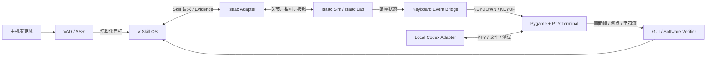

# Isaac Sim + Pygame/PTY 混合仿真指南

本文给出项目从纯 Python 状态机走向物理仿真的推荐方案。目标不是在 Isaac Sim 内重建完整桌面系统，而是让机器人、椅子、键盘和接触在物理仿真中运行，让终端、代码执行和语音在普通主机进程中运行，并用显式桥接连接两者。

## 1. 可行性结论

整体任务可以在仿真中实现：

- Isaac Sim/Isaac Lab：G1、灵巧手、桌椅、键盘、碰撞、关节和接触；
- Pygame：显示虚拟屏幕、接收 `KEYDOWN/KEYUP`、处理窗口焦点；
- PTY：提供真实 shell/终端字符流；
- 主机麦克风：提供真实语音输入，不需要模拟声波传播；
- 本地 ASR/LLM/Codex Adapter：在独立进程工作；
- V-Skill OS：负责 Skill 契约、状态推进、验证、账本和恢复。

该组合适合先验证闭环。它不等同于完整真实世界，因为接触、键帽材料、机构回差、摄像头噪声和系统延迟仍需要随机化与真机校准。

### 1.1 本机版本基线与 6.0.1 迁移门槛

当前 P1 继续锁定并已验证 Isaac Sim 5.1.0 + Isaac Lab 2.3.2。键帽标识、标准
操作侧和相机渲染不依赖 Isaac Sim 6，因此没有为本次场景修复迁移环境。

本机另有 Isaac Sim 6.0.1，但不能把 Isaac Lab 2.3.2 的 `_isaac_sim` 软链接直接
切过去。若后续决定迁移，应建立独立环境并同时完成：

1. 将 NVIDIA 驱动从当前 580.173.02 升级到 Isaac Sim 6.0.1 x86_64 官方测试的
   595.58.03 或更新 production branch；
2. 使用明确支持 Isaac Sim 6.0.1 的 Isaac Lab 3.0.0-beta2.patch1 或后续稳定版；
3. 重新执行 URDF→USD 转换、API 迁移、三路相机、PhysX 接触和 PTY 全量验收；
4. 保留现有 5.1/2.3.2 环境，直到新报告独立通过，不能原地覆盖。

版本依据：[Isaac Sim 6.0.1 系统要求](https://docs.isaacsim.omniverse.nvidia.com/6.0.1/installation/requirements.html)；
[Isaac Lab 3.0 发布说明](https://isaac-sim.github.io/IsaacLab/develop/source/refs/release_notes.html)。

## 2. 推荐进程边界



建议至少分成四个独立进程：

1. `vskill-runtime`：轻量、可测试、不依赖 Isaac；
2. `isaac-worker`：运行物理世界和传感器；
3. `desktop-worker`：运行 Pygame、PTY、屏幕帧和键盘事件；
4. `model-worker`：运行 ASR、轻量 LLM 或代码 Agent。

进程间消息必须带单调时钟时间戳、任务 ID、Skill 调用 ID 和证据来源。

## 3. 仿真世界的最小资产

第一版只需要：

- 固定基座或固定坐姿的 G1 29DOF；
- 双 Dex3-1 完整资产与 14 个可驱动关节；
- P1 可回放物理 key-switch drive，以及 P2 已验证的 Dex3 指尖触键控制；
- 固定桌面；
- 固定键盘底座；
- 至少覆盖 `Ctrl`、`Alt`、`T`、字母、数字、空格、回车、退格的独立键帽；
- 一个可作为相机纹理或外部窗口的虚拟屏幕；
- 头部相机和至少一个键盘视角；
- 指尖、键帽和必要的腕部接触传感器。

P1 不冒充行走、真实坐下或载人椅子移动策略，但必须提供这些阶段所需的完整资产：五脚万向轮办公椅、桌架、显示器支架、接触面和六阶段锚点。双 Dex3 在 P1 全量加载；P2 受限 DLS/事件链目前只作为诊断，GUI 可见实体触键尚未通过。策略学习与 camera-only 视觉伺服仍留给后续阶段。

## 4. 键帽到数字按键事件

每个键维护独立状态机：

```text
RELEASED
→ CONTACT
→ ACTUATED
→ HELD
→ RELEASING
→ RELEASED
```

建议规则：

- 指尖碰到键帽只产生物理接触证据，不立即产生数字事件；
- 键帽位移越过按下阈值时产生一次 `KEYDOWN`；
- 继续保持只更新 `HELD`，不能重复产生 `KEYDOWN`；
- 回升越过释放阈值时产生一次 `KEYUP`；
- 按下和释放阈值不同，形成迟滞，避免接触抖动；
- 超过最大保持时间或 Skill 异常时触发 `all_keys_up`；
- 同时记录邻键接触，供误触 Verifier 使用。

阈值应来自所选键盘的实测行程和仿真模型，不在核心领域模型中写死。

## 5. 组合键语义

`Ctrl+Alt+T` 不要求三个键在同一物理时刻触底。可靠时序是：

```text
prepose(all fingers)
→ keydown(ctrl)
→ keydown(alt)
→ verify(modifiers held)
→ keydown(t)
→ keyup(t)
→ keyup(alt)
→ keyup(ctrl)
→ verify(all fingers released and terminal focused)
```

需要新增的规划对象建议包括：

```text
ChordPlan
- key_assignments: 每个键对应的手和手指
- press_order / release_order
- hold_conditions
- maximum_duration
- collision_constraints
- expected_key_events
- recovery_policy
```

手指分配不采用固定人类指法，而由可达性、关节余量、碰撞风险和历史成功率共同决定。

## 6. Pygame 与 PTY 终端

### 6.1 MVP

Pygame 负责：

- 接受来自 `Keyboard Event Bridge` 的按键事件；
- 维护修饰键状态、焦点和窗口可见性；
- 把文本键转换为 PTY 输入；
- 渲染 PTY 输出为屏幕图像；
- 在收到正确组合键后创建并聚焦终端视图。

PTY 负责运行真实 shell 或受限命令行。代码执行必须位于隔离工作目录或容器中，不能把 Pygame 进程当作安全沙箱。

### 6.2 后续升级

- 将 Pygame 帧作为材质贴到 Isaac 屏幕；
- 从机器人相机观察屏幕并执行 OCR；
- 保留直接读取字符流的开发 Oracle，但论文评测切换到相机/OCR证据；
- 加入焦点丢失、窗口遮挡、分辨率和亮度扰动。

## 7. 麦克风与本地模型

真实麦克风输入可以直接进入主机 VAD/ASR；不需要在 Isaac 中模拟声音。语音链路只在完成一句话、Skill 结束或失败时工作，不进入机器人高频控制环。

推荐顺序：

1. 文本命令替身；
2. 预录音频；
3. 主机麦克风 + 本地 VAD/ASR；
4. 噪声、回声和电机声回放；
5. 真机麦克风阵列。

模型候选和安全边界见 [`VOICE_LLM.md`](VOICE_LLM.md)。

## 8. 证据分层

| 层级 | 示例来源 | 用途 |
|---|---|---|
| 开发 Oracle | Isaac 键帽位移、Pygame 事件、PTY 字符流、文件 API | 调试和自动标签 |
| 仿真可观测证据 | 相机、模拟触觉、关节反馈、屏幕图像 | 接近真机的 Verifier |
| 软件证据 | 独立测试退出码、stdout、产物哈希 | 判断代码任务是否通过 |
| 安全证据 | 过力、碰撞、倾角、接触丢失 | 独立抢占和停止 |

禁止用同一个来源既产生动作成功声明又验证该声明。例如，控制器内部的“已按下 T”不能替代键帽位移、键盘事件或屏幕变化。

## 9. 仿真随机化

按以下顺序增加难度：

1. 键盘平移与偏航；
2. 标定噪声和相机外参误差；
3. 键程、弹簧、阻尼和摩擦；
4. 控制/通信延迟、丢帧和时间抖动；
5. 指尖摩擦、软垫和机构回差；
6. 光照、遮挡、屏幕反光和 OCR 噪声；
7. 坐姿、桌椅和全身扰动。

一次只增加一类扰动，并保存种子和参数，避免失败无法归因。

## 10. 推荐验收阶梯

| 等级 | 任务 | 通过条件 |
|---|---|---|
| S1 | 虚拟探针按单键 | 每次物理按压恰好产生一对 Down/Up |
| S2 | Dex3 单指按 `T` | 接触、事件、释放三者一致，无邻键误触 |
| S3 | 双手 `Ctrl+Alt+T` | 修饰键保持、主键点按、终端出现并聚焦 |
| S4 | 短字符串 | 键盘事件和屏幕文本一致；错键可恢复 |
| S5 | 启动代码 Agent | PTY 可观察，超时/焦点/进程退出可分类 |
| S6 | hello world 闭环 | 独立测试失败可反馈修复，成功后才报告 |
| S7 | 加入坐姿和桌椅扰动 | 工作姿态失效时暂停输入并恢复 |

## 11. 版本与环境隔离

- Unitree 官方 G1 + Dex3 Isaac Lab 环境与其他 WBC/坐下项目可能依赖不同 Isaac 版本；
- 每个训练或仿真环境固定 Python、Isaac Sim、Isaac Lab、上游 commit 和资产哈希；
- V-Skill OS 通过 Adapter/DDS/IPC 连接，不把所有依赖强装进同一环境；
- 每个数据集记录机器人兼容性键、场景版本、随机种子和控制频率。

## 12. 可复用 NVIDIA 工作流

NVIDIA 技能目录中与本项目最接近的是：

- `i4h-workflow-dataset-teleop`：在 Isaac Sim 中遥操作并记录 HDF5；
- `i4h-workflow-dataset-replay`：回放已记录轨迹；
- `i4h-workflow-dataset-mimic`：对示范轨迹做数据扩增；
- `i4h-workflow-finetune`：把数据转换到 LeRobot 后训练策略。

这些是数据工作流，不是现成的键盘或双手组合键 Skill。只有在进入遥操作采集任务时才需要安装。
