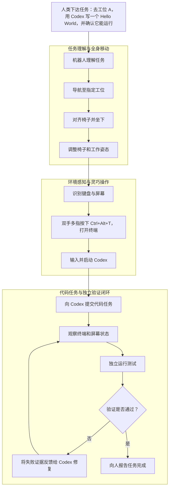
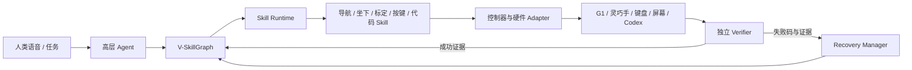

# Robot-Physics-Agent

## 面向人形机器人实体计算机操作的可验证具身智能系统

> 提出：李煜芯
> 项目定位：灵巧手核心能力验证平台、具身 Agent 系统研究、可持续

---

## 一、摘要

我希望推动一个 **Robot-Physics-Agent** 项目：让人形机器人接受人的自然语言任务，自主到达工位、建立稳定工作姿态，使用双手和灵巧手操作实体键盘与电脑，并通过屏幕、键盘事件和软件测试结果判断任务是否真正完成。

首个代表性任务是：




项目表面上是“机器人使用电脑”，本质上是在构建一种新的能力范式：

> **把人形机器人的物理行动能力、灵巧手精细操作能力和数字智能体的软件能力连接起来，并用独立验证器保证长程任务不会在错误状态上继续执行。**

- **编程是合适的较为长程任务：**目标高度结构化，既能逐步增加难度，能通过按键事件、终端状态、文件产物和独立测试自动验收。
- **全身运动挑战真实但相对可控：**导航、坐下和姿态调整仍涉及运控与接触切换，但相比跑酷和跳跃，可以在低速、固定工位、吊具和阶段门禁下逐步开放。
- **键盘有潜力形成灵巧手 Benchmark：**任务和数字结果可以统一，不同三指/五指手则可学习各自最优、甚至不同于人手的操作策略；评测需区分固定硬件算法赛道与形态自适应系统赛道。

该项目可以与公司灵巧手任务结合。键盘不是一个孤立演示，而是高密度、可量化、可自动生成标签的精细操作任务，特别适合训练、评测和迭代灵巧手算法。

我建议先把项目作为robot physics agent的一个探索先验推进：现阶段继续完成仿真和最小闭环：单指单键、组合键和终端交互达到明确门槛后，再申请灵巧手台架及 G1 双手资源。这样可以用较低的前期成本验证方向，同时保留较大的论文、数据、算法和产品扩展空间。

---

## 二、原因

### 2.1 可作为某种物理世界与数字世界的接口

当前机器人通常在以下两类环境中工作：

- 在物理世界中移动、抓取和操作物体；
- 在数字世界中由软件 Agent 调用 API、执行代码或控制应用。

但现实中大量设备只有为人设计的物理入口，例如键盘、按钮、旋钮、触摸屏和控制台；设备可能没有开放 API，也可能因为安全、权限、网络隔离或遗留系统而不能接入软件 Agent。

如果机器人能够像人一样使用这些接口，就可以把数字智能能力扩展到原本无法直接接入的设备。电脑键盘是这一方向最合适的起点：任务语义清楚，失败容易归因，数字结果可以自动验证，且可以自然扩展到工业控制台、实验仪器、隔离网络终端和其他人机界面。

### 2.2 编程任务高度结构化，天然适合自动评测

选择“让机器人调用代码 Agent 完成编程”还有一个重要优势：任务结果比开放式家务更容易定义和复现。系统不仅能判断机器人有没有完成动作，还能得到多层、相互独立的结果证据：

- 物理层：目标键是否触底、是否误触邻键、修饰键是否释放；
- 交互层：操作系统是否收到正确事件、终端是否聚焦、字符流是否匹配；
- 软件层：目标文件是否存在、代码差异是否符合约束、测试退出码和输出是否正确；
- 任务层：失败后是否完成修复、是否在预算内结束、是否错误报告完成。

编程任务还可以从单行 Hello World，逐步扩展到命令执行、文件修改、单元测试修复和多轮软件工程任务，难度梯度连续且能复用成熟的测试体系。SWE-bench 等代码 Agent 基准已经证明，软件任务可以通过仓库快照和独立测试套件进行执行式验收；本项目是在此基础上增加实体键盘、屏幕观察和机器人动作链，而不是重新发明软件正确性的评价方法。

需要强调的是，“高度结构化”不等于“任务一定简单”。依赖、环境、超时和 GUI 焦点仍会带来不确定性，所以必须固定容器、任务版本、测试命令和随机种子，并且禁止使用代码 Agent 自己的完成声明作为正确性证据。

### 2.3 导航与坐下具有运控挑战，但风险边界相对可控

从房间入口走到工位、对齐椅子、坐下和调整姿态仍然是真实的全身运动控制问题，尤其坐下涉及视野受限、多接触切换、座面冲击和稳定性判断，不能将其描述成低风险动作。

但与高速跑酷、跳跃、翻越和强动态抗扰相比，这组任务具有更有利的工程条件：

- 速度低、活动区域固定，路径和障碍可以预先建图；
- 桌椅、地面和工位尺寸可测量，可设置明确进入域和停止域；
- 可使用吊具、软垫、限速、力阈值和分阶段使能；
- 导航、坐下、调整和操作可以分别验收，不要求一次训练端到端策略；
- 机器人到达稳定工作姿态后，大部分计算机任务在准静态状态下完成。

因此，更准确的表述是：**该项目保留了有研究价值的全身运控和接触切换问题，同时能够通过低速、结构化环境和阶段门禁，把真机风险控制在比跑酷任务更容易管理的范围内。**这对内部探索项目尤其重要，因为可以先在固定基座和固定坐姿下完成核心论文闭环，再逐步增加导航和坐下能力。

### 2.4 键盘有条件成为面向不同灵巧手的 Benchmark

传统抓取任务往往只回答“有没有抓起来”，很难系统分析毫米级落点误差、换向回差、邻近碰撞、多指时序和持续保持等问题。键盘任务天然提供更细粒度的评价：

- 一个键是否被真正触发；
- 是否误触邻键；
- 是否只产生一次 KeyDown/KeyUp；
- 修饰键是否被稳定保持；
- 双手时序是否正确；
- 输入文本是否与目标一致；
- 错误能否被发现并局部修复。

这使键盘有潜力成为灵巧手的“标准化考场”，而不仅是展示视频。它能够反向驱动手部机构、指尖材料、触觉、控制频率、回差补偿、视觉伺服和多指规划的改进。

但这里不能直接把不同灵巧手的 WPM 放在一起排名。三指手、五指手、欠驱动手和高自由度手在质量、指尖尺寸、横摆能力、腕部补偿和控制频率上并不等价。建议将 Benchmark 划分为两个互补赛道：

| 赛道 | 约束 | 主要回答的问题 |
|---|---|---|
| 固定硬件算法赛道 | 使用同一 G1、同一手型、同一键盘和任务集 | 哪种感知、规划、控制或学习方法更好 |
| 形态自适应系统赛道 | 不同手型可采用各自最优指法、腕部轨迹和控制器 | 某种灵巧手在真实键盘任务上的系统能力与适用边界 |

两个赛道都应报告成功率、每键准确率、邻键误触、组合键成功率、纠错次数、任务耗时、接触力、安全停止、标定扰动鲁棒性和长时间稳定性；WPM 只能作为其中一个效率指标。

不同灵巧手产生不同最优策略并不是 Benchmark 的缺陷，反而可能构成研究问题：三指手可能依赖双手分区和腕部移动，五指手可能形成局部并行和更少腕部位移，欠驱动手可能偏向整手姿态模板。只要任务、键盘、证据和指标统一，就能同时研究“算法优劣”和“形态如何改变策略”。

### 2.5 延展

项目包含多个相互连接、又可单独形成论文问题的方向：

1. 跨物理—GUI—软件状态的可验证 Agent–Skill 系统；
2. 面向密集键位的双手多指分配和组合键控制；
3. 视觉、触觉和键盘事件联合监督下的精细操作学习；
4. 坐下、椅子调整、屏幕可见性与双手可达性联合优化；
5. 基于失败证据的安全技能自改进；
6. 人形机器人实体计算机使用 Benchmark 和数据集。

### 2.6 灵巧手路线

项目可持续积累以下资产：

- 双手多指键盘交互数据；
- 不同灵巧手的回差、重复定位和邻键误触测试结果；
- 指尖—按键成功矩阵和动态手指分配模型；
- 键盘标定、视觉伺服、接触控制与错误恢复 Skill；
- 仿真—台架—G1 真机一致的评测流程；
- 物理操作与软件任务联合验证的数据和基础设施。

这些资产既可用于算法论文，也能服务灵巧手产品定义和硬件迭代。相较一次性的展示任务，标准化评测、数据闭环和可复用 Skill 更容易形成长期积累。

---

## 三、项目的核心技术判断

### 3.1 机器人不必模仿人类指法

项目不会预设机器人必须像人一样十指盲打。机器人的手指数量、横向自由度、腕部运动范围和关节速度与人不同，更合理的路线是让系统自动搜索适合本体的交互方式：

- 双手对键盘分区；
- 根据可达性和历史成功率动态指派手指；
- 通过腕部移动弥补三指手横向自由度不足；
- 对组合键采用“先保持修饰键、再点按主键”的时序控制；
- 对高频键形成专用姿态和最短路径；
- 在安全约束内学习落点、深度、保持力和释放轨迹的残差。

这不仅可能优于直接模仿人类指法，也能形成“机器人专用人机接口操作策略”的独立研究贡献。

### 3.2 闭环必须包含观察、判断、验证和恢复

长程任务不能由一个大模型直接从语音输出全身关节命令。推荐架构是：



核心原则是：控制器可以报告“动作执行结束”，但只有独立 Verifier 能确认任务状态。例如：

- 手指碰到键帽，不等于按键已触发；
- 产生按键事件，不等于终端已经获得焦点；
- Codex 输出“任务完成”，不等于代码测试通过；
- 臀部接触椅面，不等于机器人已进入稳定可打字姿态。

这套机制可以明显降低长程任务中的错误累积，并使失败能够定位、回放和恢复。

### 3.3 全局导航可作为独立复合 Skill

全局导航适合独立成一个 L3 Skill/子系统，内部包含定位、全局规划、局部避障、速度控制和到站对齐；但高层 Agent 只调用：

```text
navigate_to_workstation(workstation_id="A")
```

导航系统返回进度、失败码和到达证据，高层模型不能绕过它直接控制关节或底层速度。这既便于复用现有导航算法，也能保持系统安全边界。

### 3.4 自进化应限定在 Skill 内，而不是修改安全规则

项目允许系统根据历史失败逐步改进：

- 每个手指在每个键位上的落点偏置；
- 按压深度、保持力和释放轨迹；
- 手指—按键分配代价；
- 受限腕部/指尖残差策略；
- 不同键盘的标定先验。

但学习系统不能修改力和速度硬限制、碰撞守卫、Verifier 可信来源、Skill 前置条件、工具权限及机器人身份校验。新策略只能作为新 Skill 版本，经离线回放、仿真回归、阴影运行和小范围真机验证后逐步放量，并保留回滚能力。

---

## 四、当前进度

目前已经初步完成仿真资产与项目架构

| 能力 | 当前状态 | 已有证据与边界 |
|---|---|---|
| Agent–Skill Runtime、Verifier、Ledger、Recovery | 已完成纯 Python 基线 | 支持前置条件、资源锁、失败码、证据记录和局部恢复 |
| G1 资产 | 已完成 Isaac 基线 | G1 29DoF、5010 腕部、mode 15 已通过资产和关节集合校验 |
| 灵巧手资产 | 已完成双 Dex3 加载与关节运动验证 | 左右 Dex3 共 14 个手部关节可驱动；尚未宣称真机能力 |
| 物理键盘 | 已完成 P1 | 74 个独立键帽、4 mm 键程、PhysX 接触与高对比键帽标识 |
| 桌椅与房间 | 已完成资产底座 | 8×6 m 房间、A/B/C 三工位、显示器、桌架和五脚轮椅 |
| 仿真视觉 | 已完成基础采集 | 头部、键盘和全景三路 RTX 相机输出 |
| 键盘—终端桥 | 已完成 | 物理键帽状态可生成 KeyDown/KeyUp，并驱动 Pygame/PTY |
| 组合键与文本 | 部分完成 | 纯 Python 组合键和纠错通过；Isaac 可见实体触键仍需进一步复核 |
| 代码 Agent 闭环 | 模拟实现 | 已证明“模型声称完成”不能替代独立测试；真实 Codex Adapter 待接入 |
| 导航、坐下和真机 | 尚未完成 | 已定义接口、资产和验证条件，需要后续策略及硬件资源 |


---

## 五、分阶段工作规划

阶段以可验证退出条件划分，而不是以演示效果或主观判断划分。只有前一阶段通过，才扩大机器人自由度和资源投入。

### 阶段 A：仿真单键和双手组合键闭环

### 阶段 B：连续文本和真实代码 Agent 闭环

### 阶段 C：坐下、椅子调整与稳定工作姿态

### 阶段 D：导航和本地语音入口

### 阶段 E：真机迁移与灵巧手自改进


## 六、预期研究与论文路线

### 方向 1：Verifier-Grounded Physical Computer Use

核心问题：机器人如何在物理动作、GUI 状态和软件执行三个域之间可靠交接，并在长程任务中避免“错误完成”。

可能贡献：

- 带前置条件、后置条件和下一技能就绪性的 V-SkillGraph；
- 独立 Verifier 和跨域 Evidence；
- 结构化失败码、局部恢复和事件账本；
- 可注入按键、焦点、姿态和代码故障的实体计算机使用 Benchmark。

这是首篇工作的推荐主线。导航、坐下和打字作为能力模块服务这一主线，不必在第一篇中同时提出所有模块的新算法。

### 方向 2：Robot-Native Bimanual Typing

核心问题：具有有限手指和不同机构约束的机器人，是否可以形成比模仿人类更合适的键盘操作方式。

可能贡献：

- 动态手指—键位指派；
- 双手分区与修饰键保持规划；
- 几何控制、接触控制和学习残差结合；
- 基于数字按键事件自动标注的训练方法；
- 不同三指/五指灵巧手的可量化对比。

### 方向 3：Task-Constrained Seated Whole-Body Control

核心问题：如何让人形机器人完成坐下和椅子调整，同时满足稳定、视野和上肢精细操作需求。

可能贡献：

- 多接触坐下与工作姿态状态机；
- 屏幕可见、键盘可达和稳定裕度联合目标；
- 坐姿椅子重定位与结束后再稳定；
- 上肢按键扰动下的全身补偿。

### 方向 4：Safe Skill Self-Improvement

核心问题：如何允许机器人根据长期失败数据改进操作，而不让学习系统改变安全边界或验证规则。

可能贡献：

- 版本化技能和回滚机制；
- 失败证据驱动的落点/力/指派更新；
- 离线回放、仿真回归、阴影运行和真机放量流程；
- 安全规则与学习策略的结构性隔离。

---

## 七、对公司的价值

### 7.1 服务灵巧手主线

项目能提供一个比普通抓取更严格、更容易量化的灵巧手应用场景，暴露并评测：

- 指尖重复定位和换向回差；
- 多指独立控制与通信同步；
- 邻近碰撞和接触斑大小；
- 修饰键持续保持和异常卸力；
- 触觉、视觉和关节反馈的闭环价值；
- 连续运行中的温漂、误差和指尖磨损。

这些指标可以直接支持灵巧手机构、控制器、SDK 和触觉方案的选择与迭代。

### 7.2 形成高辨识度 Demo

“人形机器人听懂任务，走到工位坐下，用实体键盘调用代码 Agent 完成编程并自行验证”具有较强的完整故事性。它同时展示人形运动、灵巧操作、多模态感知、Agent 和自主恢复，比单点动作更能体现系统能力。

---

## 八、主要风险与控制方式

| 风险 | 影响 | 控制方式 |
|---|---|---|
| 项目跨度过大 | 端到端长期无法闭环 | 先固定姿态和单键，每阶段设置独立退出条件 |
| Dex3 横向自由度和精度有限 | 连续文本速度或覆盖不足 | 双手分区、腕部移动、动态指派；必要时对比高自由度手 |
| 仿真接触与真机差距 | 仿真成功无法迁移 | 尽早上单手台架，实测键程、回差、摩擦和延迟并随机化 |
| 多指同时控制不稳定 | 修饰键漏按、误触或卡键 | 采用有序组合键、独立保持验证和统一 `all_keys_up` |
| 屏幕/OCR判断不可靠 | 错误推进任务状态 | 开发 Oracle 与最终相机证据分离，多证据交叉验证 |
| 代码 Agent 错误或幻觉 | 错误报告任务完成 | 隔离执行，由独立测试器和产物哈希验证 |
| 真机全身实验安全风险 | 碰撞、跌倒或设备损坏 | 从固定台架逐级开放，安全层独立于 LLM 和学习策略 |
| 论文主线发散 | 系统内容多但贡献不集中 | 首篇聚焦可验证技能交接，其他能力按独立问题拆分 |

---

## 十、建议的项目决策

建议公司批准以下最小决策：

1. 将 Robot-Physics-Agent 作为与灵巧手主线相关的内部探索项目；
2. 允许我继续完成单键、组合键和代码 Agent 仿真闭环；
3. 指定一位灵巧手方向同事进行阶段评审，帮助约束真机接口与安全边界；
4. 仿真达到明确门槛后，开放一只灵巧手固定台架进行小规模验证；
5. 只有台架结果证明方向可行后，再决定是否投入 G1 双手、五指手或更完整的场地资源。

这一路线的前期投入较小：主要依赖现有仿真、软件开发和有限技术评审；但一旦打通，能够同时支持灵巧手算法、具身 Agent、全身控制、Benchmark、数据积累和高辨识度展示，具有较好的风险收益比。

---

## 十一、需要负责人和团队共同确认的问题

以下问题不会阻止继续完成仿真，但会影响论文主线、硬件投入和后续开放方式：

1. 首篇工作是否以“可验证的物理—数字 Agent 闭环”为唯一主贡献，把导航和坐下作为可替换 Skill，而不是同时追求多个算法创新？
2. 灵巧手 Benchmark 的首个固定硬件是否选 Dex3，还是直接选择公司重点投入的其他手型？
3. 公司更希望优先获得论文/Benchmark、灵巧手内部测试平台，还是完整对外 Demo？三者的任务排序会不同。
4. 哪些机器人模型、控制接口、触觉数据和实验结果可以公开，哪些只能作为内部研发资产？
5. 单手台架达到什么指标后，才值得开放 G1 双手和完整工位资源？

建议第一次汇报只请求对“方向、首个仿真门槛和单手台架触发条件”达成共识，不需要一次决定所有后续投入。

---

## 十二、三分钟口头汇报版本

我想推进一个 Robot-Physics-Agent 项目。第一阶段先在 Isaac Sim 中，让 G1 在固定工作姿态下，用双 Dex3 操作按真实布局和键程建模的键盘，按下 `Ctrl+Alt+T` 打开终端，再通过物理按键调用 Codex 写一个 Hello World。系统不会因为 Codex 说“完成了”就结束，而是独立运行测试，测试失败就把错误反馈给 Codex 修复，只有真正通过才向人报告。

我选择编程作为目标任务，是因为它高度结构化、难度可以逐级扩展，而且结果天然适合自动评测。物理侧可以检查接触、键帽位移和按键事件，软件侧可以检查文件、测试退出码和运行结果。这使系统不仅有展示效果，也能形成可重复的实验和明确的论文指标。

键盘也有条件发展成灵巧手 Benchmark。每次按键都能评测指尖精度、回差、邻键误触、多指保持和双手协调。不同灵巧手不一定应该模仿人类，也可能形成完全不同的最优策略：三指手依赖双手分区和腕部移动，五指手可能减少腕部运动并提高局部并行。为保证公平，可以设置固定手型的算法赛道，以及允许每种手使用最佳策略的形态自适应赛道。

完整项目还包括从门口导航到工位、坐到椅子上和调整工作姿态。这些动作仍然涉及全身运控和接触切换，但与跑酷、跳跃等强动态任务相比，可以在低速、固定场地、吊具和阶段门禁下推进。我们也可以先固定姿态完成灵巧手和 Agent 闭环，再逐步开放坐下和导航，因此前期风险和资源占用相对可控。

研究上可以拆成可验证 Agent–Skill 系统、机器人专用双手打字、任务约束坐姿全身控制和安全技能自改进等多个方向。首篇论文我建议只聚焦“物理—GUI—软件三域中的可验证技能交接和故障恢复”，避免贡献发散。

目前我已经完成了运行时和验证器基线，并在 Isaac Sim 中搭建了 G1 29DoF、双 Dex3、74 键物理键盘、桌椅房间、三路相机和 PTY 终端闭环。下一步最关键的是完成可见、可重复的 Dex3 仿真指尖实际触键和双手组合键。我的建议是先让我把这一仿真门槛做完；通过后，希望获得一只灵巧手的固定台架和接口支持。单手台架数据通过后，再申请 G1 双手资源。这样前期投入可控，但能较快判断这个方向是否值得成为公司灵巧手和具身 Agent 的长期项目。

---

## 十三、公开技术基础与相关入口

- [NVIDIA Isaac Sim](https://docs.isaacsim.omniverse.nvidia.com/)
- [NVIDIA Isaac Lab](https://isaac-sim.github.io/IsaacLab/)
- [Unitree Sim IsaacLab：G1 与 Dex3](https://github.com/unitreerobotics/unitree_sim_isaaclab)
- [Unitree Dex3-1](https://unitree-robot.com/mobile/Dex3-1/index.html)
- [Newton Physics](https://github.com/newton-physics/newton)
- [本项目相关工作与集成决策](../RELATED_PROJECTS.md)

---

## 十四、参考项目与实现可能性证据

### 14.1 如何理解这些先例

目前没有发现一个公开项目已经完整实现“语音指令—G1 导航—坐下—双手实体键盘—代码 Agent—独立测试—失败恢复”的全部链路。因此，下列参考不能证明本项目端到端一定成功。

它们能够证明的是：本项目所需的主要子能力分别已有论文、官方工具链或开源原型支持。项目的研究风险主要位于 **高密度键盘上的 G1 双手精细操作、跨域状态验证以及各子系统的可靠交接**，而不是每个组件都要从零发明。

### 14.2 编程和计算机操作可以执行式评测

| 参考项目 | 已证明或提供的能力 | 对本项目的支持 | 不能直接证明的部分 |
|---|---|---|---|
| [SWE-bench](https://arxiv.org/abs/2310.06770) | 用真实 GitHub 问题、仓库快照和测试套件评价代码 Agent | 编程结果可通过独立测试执行式验收，适合作为软件侧 Verifier | 不包含机器人、实体键盘或 GUI 焦点 |
| [OSWorld](https://os-world.github.io/) | 在真实桌面应用和操作系统环境中建立任务、执行和评价 | 证明终端、文件、跨应用操作可以组织成可复现的 computer-use 任务 | 动作来自软件 Agent，不是机器人手指 |

这两类工作说明，代码和桌面任务已有成熟的任务定义与自动评分思想。本项目的新增难点是把软件侧任务与物理按键、屏幕观察、工作姿态和机器人安全连接起来。

### 14.3 机器人操作标准键盘已有直接先例

| 参考项目 | 已证明或报告的能力 | 对本项目的支持 | 采用时的边界 |
|---|---|---|---|
| [DART Hand](https://experts.umn.edu/en/publications/design-and-implementation-of-a-dexterous-anthropomorphic-robotic-/) | 单只拟人灵巧手在标准键盘上达到约 20 WPM | 直接证明灵巧手可以在标准键盘上完成连续物理输入 | 为专门设计的 19-DoF 手，不代表 Dex3 或 G1 可达到相同性能 |
| [Hierarchical DRL for Typing with a Dual-Arm Humanoid Robot](https://doi.org/10.1017/S0269888924000080) | 双臂人形机器人打字，在论文中报告仿真和真机实验 | 证明键盘定位、双臂控制和学习式输入能够组合 | 任务平台、末端结构和评测协议与本项目不同，尚未解决跨域 Verifier |
| [RoboPianist](https://arxiv.org/abs/2304.04150) | 用深度强化学习研究高空间/时间精度的多指琴键控制 | 支持把密集键位、多指协调和指法规划作为机器人学习问题 | 钢琴键比电脑键盘更大、间距更宽，不能替代电脑键盘实验 |
| [三指机器人手和弦实验](https://www.frontiersin.org/journals/robotics-and-ai/articles/10.3389/frobt.2024.1463744/full) | 三指机械手完成多键和弦按压 | 支持三指手执行“保持多个键”的基本可行性 | 尚不代表能稳定完成电脑组合键、邻键避碰和连续文本 |

这些工作支持“机器人可以物理打字”这一基本判断，也说明键盘/琴键可以作为精细操作任务。它们没有覆盖本项目最关键的完整证据链：按键物理状态、操作系统事件、屏幕结果和软件测试必须一致。

### 14.4 G1、Dex3、仿真和数据链已有官方基础

| 参考项目 | 已提供的能力 | 本项目计划如何使用 |
|---|---|---|
| [Unitree Sim IsaacLab](https://github.com/unitreerobotics/unitree_sim_isaaclab) | 官方 G1-29DoF、Dex3、相机、DDS、数据记录和移动操作场景；仿真与真机使用同类 DDS 接口 | 作为 G1/Dex3 资产、通信和仿真事实源，通过独立 Adapter 接入 |
| [Unitree XR Teleoperate](https://github.com/unitreerobotics/xr_teleoperate) | G1/灵巧手遥操作和数据记录 | 采集单键、组合键、纠错和失败恢复示范，再转为统一 episode schema |
| [Unitree LeRobot](https://github.com/unitreerobotics/unitree_lerobot) | 数据转换、ACT/Diffusion Policy 训练和真机闭环部署链 | 作为学习式按键策略基线，与几何控制和受限残差策略比较 |
| [Isaac Lab](https://isaac-sim.github.io/IsaacLab/) | 刚体、关节、接触传感器、并行训练、相机和机器人学习环境 | 构建键帽、指尖、桌椅、随机化和批量评测环境 |
| [Newton Physics](https://github.com/newton-physics/newton) | Warp GPU 物理、MuJoCo Warp、多求解器和可扩展仿真 | 作为后续跨引擎对照和大规模参数搜索方向；当前不替代 PhysX 主线 |

Unitree 官方工具链证明 G1 与 Dex3 的仿真、控制和数据接口已经存在，但其现有任务主要是抓取、堆叠和移动操作，不能被表述为官方已经支持键盘输入。本项目需要新增键盘资产、按键事件桥、双手规划与验证协议。

### 14.5 导航、坐下和坐姿调整已有分模块基础

| 参考项目 | 已证明或提供的能力 | 对本项目的支持 | 仍需本项目验证的部分 |
|---|---|---|---|
| [Unitree RL Lab](https://github.com/unitreerobotics/unitree_rl_lab) | G1-29DoF velocity tracking、Isaac Lab 训练、MuJoCo sim-to-sim 和真机部署流程 | 导航 Skill 可复用低层速度跟踪策略，不必重新学习所有行走能力 | 工位地图、路径规划、到站精对齐和安全门禁 |
| [WBC-AGILE](https://github.com/nvidia-isaac/WBC-AGILE) | 官方开源框架展示 G1 的 velocity-height tracking、sit-down/stand-up 和 sim-to-real 流程 | 支持把坐下/站起作为独立策略 Adapter 接入 | 与本项目椅子几何、双手负载、5010/Dex3 惯量和工作姿态的兼容性 |
| [Stay Seated](https://arxiv.org/abs/2608.28090) | 论文报告 G1 在无动力万向轮椅上的全向坐姿移动和零样本 sim-to-real | 直接支持“机器人坐在椅子上短距离调整工位位置”的可研究性 | 当前仍需独立复现；不能把论文定性演示当成本项目真机指标 |
| [GR00T Whole-Body Control](https://github.com/NVlabs/GR00T-WholeBodyControl) | G1 全身控制、遥操作和数据导出相关基础 | 可作为上肢—躯干协同和任务约束 WBC 候选 Adapter | 毫米级触键、坐姿稳定和屏幕可见联合目标 |

这些先例说明，导航、坐下和坐姿调整不是没有技术基础的设想。相较跑酷，它们可在低速、固定场地和分阶段门禁下推进；但坐下仍涉及真实接触转换和跌倒风险，必须从仿真、吊具和固定台架逐级开放。

### 14.6 与键盘最接近的 G1 社区原型

- [G1 Piano Play](https://github.com/meetsitaram/g1-piano-play) 已探索 G1 坐姿、双手到键盘区域的 reach/contact reward，可作为触键环境和奖励设计参考；它目前主要证明 reach/contact 原型，不是成熟的电脑打字系统。
- [RP1M](https://arxiv.org/abs/2408.11048) 将双手机器人钢琴演奏视为兼具高速精确运动和接触丰富操作的任务，并通过指法/落点规划生成大规模运动数据；它支持“键位任务可形成数据集与 Benchmark”的方向，但仍需针对电脑键盘重新定义几何、按键事件和错误恢复。

社区项目的证据等级低于官方工具链和同行评审论文，适合用于缩短环境搭建时间或形成基线，不应直接作为项目能力声明。

### 14.7 可行性综合判断

| 子能力 | 外部证据成熟度 | 本项目当前判断 |
|---|---|---|
| 编程任务与软件测试验收 | 高 | 可直接复用成熟模式，工程风险较低 |
| 桌面/终端任务组织 | 高 | Pygame/PTY 可先闭环，之后升级真实桌面和相机观察 |
| 机器人单键与连续键盘输入 | 中高 | 有直接论文先例，但 G1+Dex3 仍需专项验证 |
| G1 行走到工位 | 高 | 低层 locomotion 可复用，主要新增导航和精对齐 |
| G1 坐下/站起 | 中高 | 已有 sim-to-real 框架，需适配具体椅子和手部负载 |
| 坐姿移动与工作姿态 | 中 | 有近期论文支持，工程和安全验证仍较多 |
| 双手高密度电脑键盘操作 | 中 | 是项目最重要的技术风险，也是核心论文机会 |
| 物理—GUI—软件三域验证与恢复 | 中低 | 单域组件成熟，完整组合尚少见，是本项目主要系统创新 |
| 语音到完整端到端任务 | 中 | 各模块可用，但可靠交接和安全开放必须阶段化 |

综合来看，项目不是“所有关键能力都有现成答案”的低风险集成，也不是缺少基础支撑的纯概念。更准确的定位是：**大部分底层能力已有可信先例，真正值得投入研究的是灵巧手在高密度键盘上的形态自适应策略，以及机器人物理行动与数字任务之间可验证、可恢复的系统闭环。**
