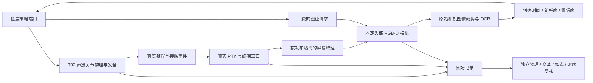
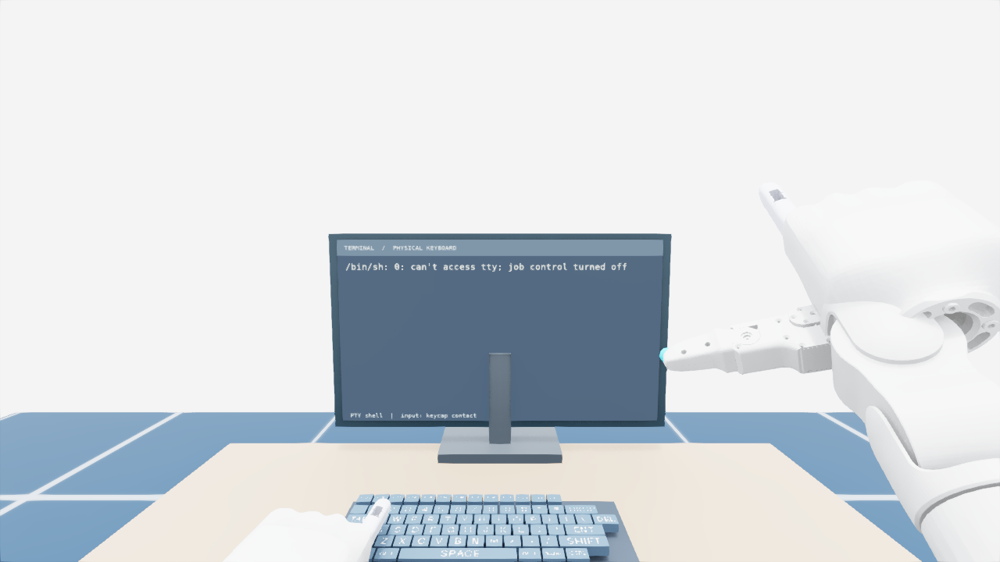

# VF-01-T05：真实桌面与机器人相机复验

状态：`DONE`（单键真实 PTY 与仿真机器人相机范围），2026-09-26。范围为固定工位、固定骨盆、左手单 `a` 的无 IK 直接关节诊断：实体键程/接触 → KeyDown/KeyUp → 真实 PTY 终端 → 屏幕纹理 → Isaac 机器人头部 RGB-D 相机 → OCR → 有预算的策略反馈 → 独立复核。

这里的终端有真实 `/bin/sh` 进程，输入字节由物理事件转发。机器人与相机仍在仿真中；不是实体机器人或实体显示器实验。输入只停留在终端当前行，不执行 Enter、命令或代码 Agent，不据此声明编程任务通过。手部动作沿用 T02 的人工诊断脉冲，尚未训练 PPO 或视觉策略。

## 工程结构



| 模块 | 路径（相对 `src/vskill_os/`） | 职责 |
|---|---|---|
| 相机契约与队列 | `learning/camera_feedback.py` | 明确相机来源、实际捕获时刻、请求/等待预算、白名单观察 |
| 独立队列复核 | `learning/camera_evaluation.py` | 重算请求准入、物理步取整、交付、超时、取消和每次可见内容 |
| 像素 OCR | `adapters/camera_ocr.py` | 只读取保存的机器人 RGB，固定 ROI 和预处理，保存原始 Tesseract TSV |
| 可读终端 | `adapters/learning_desktop.py` | 从 PTY 解码结果绘制较大的输入行，不接收目标文本或任务结论 |
| 物理/桌面协调 | Isaac `learning/desktop_env.py` | 原事件转发、独立终端进程、纹理资源、固定相机、策略端口与侧记录 |
| 固定诊断 | Isaac `learning/desktop_smoke.py` | 正常输入、跨回合重置、失焦、冻结纹理、缺失相机和提前结束 |
| 独立验收 | Isaac `learning/desktop_verify.py` | 物理证据绑定、PTY 重绘、原图重跑 OCR、头部安装/深度/反馈复核 |
| 有界运行 | Isaac `learning/desktop_runner.py` | 600 s 工作进程时限、失败保存和 CPU 离线验收 |

T02/T03/T04 已验收收集器保持原字节。T05 用新版本 `vf-desktop-camera-bundle/1` 侧记录组合 T02 原始物理包；T02 包中的“无相机”描述仅指该物理子记录，不代表 T05 没有独立相机证据。Agent 仍只调用技能，关节端口留在低层实验适配器内。

## 图像与桌面的证据边界

T03 的 `text_state_readout_v1` 保持不变。T05 使用独立的 `robot_camera_ocr_v1` DTO，不能把 PTY 内容装成相机读数。策略观察只含物理观察、已到达的 OCR 读数与预算；原始图片路径、终端文本、焦点真值、纹理历史、故障设置和验收结论留在监督侧。同进程接口隔离不等于对恶意 Python 反射代码的安全沙箱。

本体和实体键状态仍是允许的特权观察。这里验证的是相机反馈链路，并非已经去掉特权状态的视觉控制学生。

每次捕获保存完整 1280×720 RGB、对齐深度、内参、相机世界位姿、实测头部位姿、对应原始物理帧、屏幕纹理身份和哈希。相机使用已有固定安装变换，不自动瞄准屏幕、不移动根位姿。离线从原始关节状态和固定 URDF 正向计算头部姿态，核对相机安装；输入区域的深度还必须与屏幕平面几何一致。

OCR 使用冻结的输入行区域 `(436, 350, 830, 370)`、4 倍双三次放大、灰度自动对比度及 Tesseract `--psm 7 -l eng`。区域由单独的工位校准试验确定，不逐帧使用文本真值定位。没有目标字符白名单、期望字符串纠正或 PTY 文本回填。保留完整原图，离线重做裁剪并重新运行 OCR；Tesseract 二进制、英语模型和 Pillow 版本随记录保存。

终端第二行使用 52 像素等宽字体，第一行是实际 `/bin/sh` 启动信息。验证器拒绝不同的终端布局，而不是搜索哪个文本位置最像 `a`。这个固定工位 ROI 不适用于自由坐姿、窗口移动或任意桌面。识别置信度是 Tesseract 分数除以 100，门槛为 0.9，未经概率校准。没有 OCR 单词时返回缺失；低分噪声隐藏内容，不把“未检测到”当作可信空文本。

终端文本由真实 PTY 输出和 ANSI 解析获得，仅用于监督验收。独立评估重新绘制每个 PTY 快照，核对 PNG 与 RGBA；相机反馈则必须来自机器人 RGB。纹理冻结时，PTY 中已经有 `a` 也不能替代新画面或使任务通过。

## 重置与渲染历史

每回合启动新的 PTY 进程，清空相机反馈队列与预算，旧策略端口失效。各次纹理发布使用独立资源名，并保留上传缓冲，避免回合间资源复用。

首轮诊断发现默认时序抗锯齿会把上一回合的 `a` 留在新回合画面中。最终采用 Replicator 的 **FXAA**，不跨帧累积历史；每个相机帧记录并检查实际渲染设置。初始捕获在第一次物理按下之前，不能已经高置信度读到目标字符。失败诊断保留在本地 `run-20260926-first/`，不列入最终成绩。

渲染每次排空 8 帧，使用同一个已检查的物理状态，不推进仿真物理时钟。OCR 同步执行，其真实墙钟耗时独立记录。这不是实时相机控制性能；仿真暂停渲染/识别期间没有未记录的物理运动。等待交付时仍以正常关节保持动作推进物理，独立安全逐子步运行。

## 请求、时间与结束

沿用 T03 的预算默认值，但不复用其模拟文本读数类型：请求到采集至少 20 ms、采集到交付至少 80 ms、300 ms 超时、最大年龄 500 ms、最多 3 次请求、累计等待预算 900 ms、回合上限 3 s。T05 最多同时等待 1 次请求。

相机只在真实控制边界捕获，不把帧倒签为预定时刻。例如 2.1 s 发出请求，控制周期为 1/60 s，实际捕获为 2.1333 s、交付为 2.2167 s。仿真时间和渲染/OCR 墙钟成本分别报告。普通查看缓存不拍新图；`finish()` 不赠送末帧，也不返回成功标签。

每个回合先请求一次中途反馈，完成同一 2.1 s 实体按下/释放脉冲后请求末次验证。正常案例再保持 0.15 s；提前结束案例立即封存并取消请求。仅独立 Verifier 能把物理释放、实际终端内容、当前显示纹理和新鲜相机确认共同认定为通过。

## 固定验收案例

六个回合的种子依次为 7–12，所有回合执行同一个真实 `a` 按下与释放。负例的正确拒绝属于工程验收通过，不是任务成功。

| 案例 | 实际终端 | 相机与反馈要求 | 预期任务判定 |
|---|---|---|---|
| `visible_input` | `a` | 新鲜可读 `a`、深度/安装/纹理绑定通过 | 成功 |
| `visible_after_reset` | 新进程里的 `a` | 初始无旧输入，随后新鲜可读 `a` | 成功 |
| `focus_lost` | 空 | 软件路由焦点关闭，物理事件完整保留 | 拒绝 |
| `frozen_texture` | `a` | 显示停留在输入前，不能用 PTY 文本兜底 | 拒绝 |
| `missing_camera` | `a` | 明确的软件侧末次采集缺失，不伪造图像 | 拒绝 |
| `finish_before_camera` | `a` | 末次请求未采集就结束，无免费确认 | 拒绝 |

失焦是此适配器的软件输入路由扰动，不是实测操作系统窗口焦点切换。相机缺失是声明的软件侧故障注入，不代表拔掉了真实相机。物理输入未被删除或合成。

## 运行与本地记录

```bash
make isaac-learning-desktop
make verify-learning-desktop LEARNING_DESKTOP_RUN=/absolute/path/to/run-directory
make check
make demo
```

需要既有 Isaac Sim 5.1 / Isaac Lab 2.3.2、GPU、NumPy、Pillow、Pygame、pyte 及系统 Tesseract 英语模型。可选依赖组为 `learning-desktop`；本机复用 `artifacts/virtual-computer/deps/`。离线验收使用相同 Python/字体/OCR 环境，不启动 Isaac 应用或占用 GPU。

每个回合保留 T02 的原始物理文件，并增加 `desktop_spec.json`、`desktop_episode.json`、`desktop_manifest.json`、`desktop_evaluation.json` 及 `desktop/` 内的 RGB、深度、ROI 和实际终端图片。回合外保存完整桌面场景、工作进程状态、日志与 `desktop_suite.json`。物理包、源码、文件和相机帧均关联哈希；哈希用于追溯一致性，不是传感器真实性认证。

原始数据和失败诊断位于 Git 忽略的 `artifacts/verification_feedback/vf01/desktop_camera/`。最终便携报告为 [`vf01_t05_desktop_camera.json`](../../reports/verification_feedback/vf01_t05_desktop_camera.json)。

## 实测结果

`run-20260926T150056-770294` 六个案例均通过独立验收：两个正常案例端到端通过，四类负例正确拒绝；六回合均完成真实单键按下与释放。重跑 CPU 离线验收结果一致。共保存 10 对机器人 RGB-D，输入 ROI 的深度屏幕一致比例均为 1.0；两次正常末帧 OCR 置信度分别为 0.9661、0.9653。

正常完成时每回合两次验证，共计约 0.2333 s 仿真等待；提前结束回合约 0.1167 s。每次渲染加 OCR 的墙钟耗时约 0.144–0.282 s，整个工作进程约 140.71 s（含启动、稳定、物理、渲染和记录），不作为实时速度或训练吞吐。两正例不是学习成功率或统计泛化结论。

`make check`：238 项测试，237 通过、1 项可选桌面依赖测试跳过；`make demo` 通过。新增 12 项回归检查时序/预算、来源与观察白名单、旧帧/旧端口、缺失与低置信度隐藏、提前结束、伪造反馈及 OCR 不替换目标文本。真实桌面和机器人相机能力以本次 PhysX 记录为依据，单元替身不计入物理成绩。

下面两张图片是 `visible_after_reset` 回合的原始机器人 RGB，按记录哈希直接复制；没有重新绘制或在相机图上添加字符。

输入前：



输入后：


下一项为 **VF-02-T01：动作映射健康检查**。多键、重复字符、真实退格、恢复技能与 PPO 仍需后续分别实现和验收。
