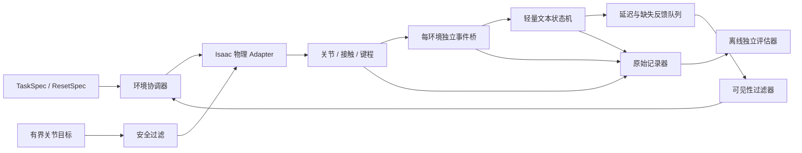

# 阶段 1：最小物理环境与可信证据

状态：`PARTIAL`。VF-01-T01 离线契约和 [VF-01-T02 单环境物理 reset/step](PHYSICAL_ENVIRONMENT.md) 已交付；在线反馈过滤与批环境尚待实现。共同定义见[接口与证据契约](../COMMON_CONTRACTS.md)，已运行的代码与验收见[实现说明](IMPLEMENTATION.md)。

## 范围与研究问题

先固定工位、手型和稳定姿态，只做一个键的接近、按下、释放。然后确定同一手臂可达的少量字符键和真实 Backspace，扩展到重复字符、相邻键与 4–8 字符串。字符集合、键盘几何和坐姿一并锁定；本阶段不训练 PPO，不同时开发导航或自由坐下。

要确认：接触、键程、数字事件、文本变化能否按同一调用关联，且数字清理不会被算作物理成功。

## 工程结构



| 模块 | 位置 | 职责与状态 |
|---|---|---|
| `TaskSpec / EpisodeRecord / ResetSpec` | `learning/contracts.py` | 已有 v1 标准库数据契约、时钟/版本/来源；`ResetSpec` 在 `learning/environment.py` |
| `TypingEnvironment` 协议 | `learning/environment.py` | 已有 reset/step/finish/close；区分终止与截断 |
| `SingleHandKeyboardEnv` | `adapters/isaac/learning/single_hand_env.py` | 已有单环境建场、直接关节驱动、逐子步采样；批环境待建 |
| `TextTaskState` | `learning/text_task.py` | 仅消费带来源的键事件；追加/退格、光标和焦点规则明确 |
| `FeedbackQueue / ObservationFilter` | `learning/feedback.py` | 记录采集/到达时刻；按验证请求提供可见反馈 |
| `EpisodeRecorder` | `learning/recording.py` | 关联四类记录与原始文件引用，不赋予任务成功 |
| `IndependentTypingEvaluator` | `learning/evaluation.py` | 已有合成契约验收：重算键程事件、文本、释放、时限与证据完整性；物理验收另由 `physical_evaluation.py` 与 Isaac `learning/verify.py` 实现 |
| 严格 JSON / 回放入口 | `learning/serialization.py`、`learning/replay.py`、`learning/cli.py` | 已有记录导入导出、哈希和 10 类可复核案例 |

表内位置相对 `src/vskill_os/`；未标注“已有”的模块仍为拟建。Isaac/Torch 不进入 `learning/`；后端选择由入口装配。

## reset / step 接口草案

```text
reset(spec) -> initial_observation, episode_metadata
step(joint_target_action) -> observation, reward_terms, terminated, truncated, record_refs
close() -> cleanup_record
```

初始化用经过来源审计的直接关节状态；不能读取旧 IK 校准姿态作为“无 IK 初态”。reset 可在训练回合边界设置状态，不能在被评估的动作中途重置根位姿或跳过释放。

`record_refs` 供记录器使用，不把实际文本、Verifier 结论等隐藏进 actor 可访问的 `info`。环境内物理推进、事件采样和文本消费的顺序固定；事件桥逐物理子步更新。物理终止保留失败终态，时间截断保留可 bootstrap 的最终观察。

## 已有复用点与改造边界

- [KeyboardEventBridge](../../src/vskill_os/simulation/keyboard_bridge.py)：复用阈值、迟滞、防抖和 reason；为每个环境建立实例，记录采样及事件关联。`maximum_hold` / `worker_shutdown` 不能作为物理释放。
- [Dex5 资产](../../src/vskill_os/simulation/dex5_assets.py)、[场景几何](../../src/vskill_os/adapters/isaac/dex5_scene_geometry.py)：提取资产与几何，不引入旧 IK 控制循环、姿态种子或依赖旧 demo 的隐藏 reset。
- [物理按键验证](../../src/vskill_os/simulation/dex5_typing.py)：复用事件/释放/过力判据思想；增加单手任务、管理释放拒绝、短串恢复记录，不把现有脚本包装后直接标为学习环境。
- [虚拟计算机](../../src/vskill_os/adapters/virtual_computer.py)与[机器人相机](../../src/vskill_os/adapters/isaac/virtual_screen.py)：小规模真实桌面复验的 Adapter；批量训练早期使用轻量文本状态机。

## 工程任务与最小检查

| 任务 | 交付 | 必须能发现的错误 |
|---|---|---|
| VF-01-T01 契约与离线记录 | `DONE`（契约）：v1 记录与独立评估，10 类样例、24 个新增测试 | 已覆盖重复/漏事件、文本不符、管理释放伪成功；详情见[验收](IMPLEMENTATION.md) |
| VF-01-T02 单环境物理闭环 | `DONE`（固定工位单 `a`）：直接关节 reset/step，10 个物理诊断回合，原始记录与独立验收；[说明](PHYSICAL_ENVIRONMENT.md) | 实测拒绝映射错、卡键、管理释放、过期/旧指令；全部键、过力与姿态守卫另有记录回归 |
| VF-01-T03 文本与反馈隔离 | 事件消费、延迟/缺失、策略输入过滤 | 超前读到文本真值、旧帧当新帧、漏字后盲目重按 |
| VF-01-T04 批环境与吞吐 | 1、16、64 环境的隔离/资源报告 | 状态、事件、随机数、隐藏状态或 reset 串扰 |
| VF-01-T05 真实桌面复验 | 小样本事件→真实文本框/终端→纹理→机器人相机 | 文本状态机通过但实际应用无效；PTY 文本替代相机 |

测试用手工记录只能标为契约证据。重复物理运行按事件语义、仿真时间与容差比较，UUID/墙钟差异不直接算复现失败。监控全部实体键，至少包含目标邻键；只记录计划键会漏掉误触。

## 退出门槛与失败处理

单环境必须有可重放的成功、失败与管理释放负例；reset 相同种子产生可解释的初态和扰动；评估器不能因控制器自报完成而通过。1/16/64 分别验证事件和 reset 隔离、接触缓冲、吞吐、峰值显存及数据丢失；某规模资源不足则记录失败并限定可用规模，不宣称该规模已通过。

实际短串键集及退格必须在同一物理设置下可达；否则先缩小/调整经过记录的任务设置，不伪造事件或悄悄重映射字符语义。真实桌面的小样本复验可晚于吞吐检查，但不能用纯文本状态机成绩声明真实读屏能力。

交付目录建议为 `artifacts/verification_feedback/vf01/<run_id>/` 与 `reports/verification_feedback/vf01/<run_id>/`，含配置、哈希、原始样例、失败表和资源测量。

返回[研究总览](../README.md)；下一阶段：[直接关节 PPO](../02_joint_ppo_baseline/README.md)。
