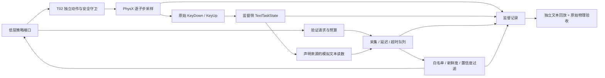

# VF-01-T03：文本状态与反馈隔离

状态：`DONE`（文本状态机与单环境集成范围），2026-09-26。本项把 T02 的实体触键接到独立文本状态机，再以有预算、有延迟的验证请求向策略提供读数。物理动作、数字结果和策略可见反馈分别保存、独立复核。它仍是固定工位、单手单 `a` 的工程验收，未训练策略。

读数来源固定为 `text_state_readout_v1`：从文本状态机生成的模拟反馈，不是 OCR、机器人相机或真实桌面。没有虚构图像或 `frame_sha256`，也不把该读数写成 `ScreenObservation`。真实桌面复验属于 T05。

## 工程结构与权限



| 模块 | 实现位置（相对 `src/vskill_os/`） | 作用 |
|---|---|---|
| 文本状态 | `learning/text_task.py` | 事件身份、按下/抬起、焦点、光标、编辑、历史快照 |
| 请求与可见性 | `learning/feedback.py` | 请求次数/等待预算、捕获与到达、缓存年龄、白名单 DTO |
| 监督回合 | `learning/feedback_session.py` | 冻结实验设置、事件、读数、发布记录和取消记录 |
| 文本读数适配器 | `adapters/text_feedback.py` | 以采集时刻快照生成模拟读数；注入明确记录的读数扰动 |
| 策略端口 | `adapters/feedback_environment.py` | 只开放观察、关节 step、请求验证、请求结束；隔离监督侧对象 |
| Isaac 组合与记录 | `adapters/isaac/learning/feedback_env.py` | 组合 T02；保存文本/反馈记录与原始物理回合的哈希绑定 |
| 离线独立回放 | `learning/feedback_evaluation.py` | 独立重算文本、请求准入、时间、预算与每次发布 |
| 物理绑定与验收 | `adapters/isaac/learning/feedback_verify.py` | 核对事件、观察、终止状态与 T02 原始记录；独立验证实际释放 |

Agent 仍只调用 L2/L3 技能。这里的关节端口仅供低层策略适配器使用，尚未注册新的学习技能。

### 策略与监督侧的区别

策略得到不可变的 `ActorObservation`，字段为回合身份、当前逻辑时间、目标键、本体状态、实体键程/接触、上一动作、已到达反馈和剩余验证预算。本体与实体键状态可由 `ObservationAccess` 关闭；原始键事件始终不在此版策略观察中。

文本真值、光标、焦点真值、故障计划、未到达反馈内容、原始事件、文件路径与 Verifier 结论仅在监督侧。`ActorStep` 只返回过滤后的观察、终止/截断及安全失败码，不提供隐藏 `info`、文本奖励或成功标签。返回验证请求的 receipt 也没有未来读数。

这是受信任策略代码的接口与数据边界；同一 Python 进程不构成针对恶意反射代码的安全沙箱。训练器不得把监督对象、记录文件或评估输出重新传给策略。

## 文本状态和扰动

每个回合独立保存文本、光标、焦点与数字按键状态。初始光标在文本末尾，默认焦点正确；没有隐藏的自动聚焦或自动纠错。

- 字符键在光标处插入；Backspace 删除光标前字符；Delete 删除光标后字符；Left/Right/Home/End 只移动光标。KeyUp 不修改文本。不实现选区、快捷键、剪贴板或 OS 自动重复。
- 同一键两次 KeyDown 之间必须出现 KeyUp。事件要求相同环境/回合/时钟、连续序号、唯一身份及单调到达时间；整个输入批次校验通过后才修改文本。
- 事件随逻辑时间推进一次性消费，不能在该时刻已经发布读数后再补交同时间事件。同一时刻先应用焦点变化和键事件，再采集文本。
- `DigitalInputPlan` 的丢失按 KeyDown 序号计数；焦点丢失和软件丢失分别记录，不删除或伪造物理事件，也不算作物理误触。
- 文本长度有上限，达到上限仍允许删除。历史快照不会随当前文本改变。

本次物理验收只执行真实 `a` 触键；其他编辑键语义已由 CPU 契约测试覆盖，其单手无 IK 可达性与物理恢复技能尚待后续验收。数字 KeyUp 能清理状态，但物理释放仍由 T02 原始键程/接触记录独立判断。

## 验证时间、预算与结束

默认设置来自 [`text_feedback_v1.json`](../../configs/learning/verification_feedback/text_feedback_v1.json)：

| 项目 | 默认值 |
|---|---|
| 请求至采集 | 20 ms |
| 采集至交付 | 80 ms |
| 每次请求超时 | 300 ms |
| 可用证据最大年龄 | 500 ms |
| 最低识别置信度 | 0.9 |
| 请求次数 / 同时待处理数 | 3 / 2 |
| 累计验证等待预算 / 回合时限 | 900 ms / 3 s |

每个接受的请求预留完整超时预算，交付后释放未用部分。等待预算是各请求从发出到响应/超时/取消的时间之和，并行请求也分别计费；它不是实测相机能耗或真实 OCR 算力开销。观察缓存不会触发额外采集。次数、等待、超时规则对 intermediate 和 final 完全相同。

队列保留采集、生成与交付时间，响应按请求身份关联，允许乱序到达。文本取自**采集时刻**而非交付时刻；缓存重读只增长年龄。返回状态为 `readable / missing / timeout / stale / low_confidence`。后三类无效读数和缺失读数都隐藏文本与置信度；真正识别到空文本才返回 `""`。旧帧早于请求、超过最大年龄、低置信度或缺失都不能用于完成判断。超时后不会再发布迟来的有效结果。

等待期间必须继续物理 hold step，动作限位、限速、接触/支撑保护照常工作；策略没有跳过物理的时钟推进接口。reset 必须发生在上一回合终止后，旧端口令牌失效，未返回的请求取消；新回合不继承文本、预算或缓存。close 可重复调用。

`request_verification("final")` 占用正常预算，之后不接受新验证请求；`finish()` 只表达结束声明，不触发免费读屏、不返回成功标签。提前结束可以保存回合，但没有已到达的最终反馈会被独立评估拒绝。最后一次确认必须在最后一次文本输入/焦点变化之后，且最后观察对应回合终态。

没有根据“暂时看不到新文本”自动重按的路径。CPU 的 `confirmed_retry` 案例只在完成抬起并拿到本次动作之后的新鲜空读数后，进行一次有界重试；该案例不声称已验收物理恢复技能。

## 独立记录与复核

每个物理回合保留 T02 原始文件，另增加：

```text
feedback_spec.json       冻结目标、权限、预算和声明的扰动
feedback_episode.json    vf-feedback/1；输入、文本轨迹、请求、读数、发布和取消
feedback_manifest.json   新收集器源码/文件哈希 + 原物理 manifest 哈希
feedback_evaluation.json 独立文本回放与物理绑定结果
```

`feedback_episode.json` 的物理回合哈希、事件序列、时钟、观察和终止时间必须与原始物理记录一致。T02 自带的旧 `text_oracle` 是“事件桥无损投影”，不表示 T03 软件丢失/失焦后的实际任务文本；本任务的文本来自 T03 独立消费记录，不能拿旧投影替代。

离线评估器不调用在线文本状态机、队列或过滤器来生成参考结果，而是依据外部冻结设置重新回放。哈希用于一致性追溯，不是传感器真实性认证。换代码版本应使用与录制一致的提交复核。

报告分开给出 `isolation_passed`、`text_task_passed`、`physical_primitive_passed` 和 `end_to_end_passed`。只有正确文本、新鲜且已发布的最终读数、合法预算、完整证据与真实释放共同成立才通过端到端门槛。负例正确拒绝属于**验收通过**，并不属于任务成功。

## 运行入口与证据

```bash
make demo-learning-feedback
make isaac-learning-feedback
make verify-learning-feedback LEARNING_FEEDBACK_RUN=/absolute/path/to/run-directory
make check
make demo
```

CPU 演示保存 10 类合成案例：正常等待、软件丢失、焦点丢失、缺失、提前结束、旧帧、超时、低置信度、错误但高置信度的读数，以及确认后的有界重试。实际 Isaac 诊断复用 T02 的直接关节 `a` 按下/释放，覆盖前述案例中的 8 类；不执行低置信度和恢复动作的物理案例。

原始记录位于 Git 忽略的 `artifacts/verification_feedback/vf01/feedback_physics/`，小型验收报告保存至 [`vf01_t03_feedback.json`](../../reports/verification_feedback/vf01_t03_feedback.json)。运行编号与实测结果以报告为准。

2026-09-26 的 `run-20260926T095808-215080` 已通过独立验收。8 回合均完成真实 `a` 按下与释放；正常等待回合在 2.25 s 结束并通过端到端判据，其他 7 回合按预期未通过任务判据。普通验证累计等待 0.20 s，超时案例 0.40 s；提前结束回合的末次请求被取消。工作进程耗时约 167.85 s（包含启动、reset、采样和落盘，不能当作训练吞吐）。

| 物理案例 | T03 文本状态 | 最终可见反馈 | 端到端判定 |
|---|---|---|---|
| 正常等待 | `a` | 新鲜 `a` | 成功 |
| 软件丢失 / 焦点丢失 | 空字符串 | 新鲜空字符串 | 文本错误 |
| 缺失反馈 | `a` | `missing`，无文本 | 无最终确认 |
| 提前结束 | `a` | 末次读数尚未到达 | 无最终确认 |
| 旧帧 | `a` | `stale`，无文本 | 无最终确认 |
| 超时 | `a` | `timeout`，无文本 | 无最终确认 |
| 高置信度错误读数 | 空字符串 | 新鲜但错误的 `a` | 真实文本不正确，拒绝伪成功 |

本 T03 的两个逻辑文本会话测试只证明软件隔离；后续 [T04](BATCH_ENVIRONMENT.md) 已另行完成 1/16/64 个 PhysX 环境实测。[T05](DESKTOP_CAMERA.md) 已另行完成真实 PTY 与机器人相机的单键六案例复验，使用独立相机来源类型。[T02 单键 PPO 诊断](../02_joint_ppo_baseline/SINGLE_KEY_PPO.md) 已另行交付；当前下一项为 **VF-02-T03：单键重复验收**。
