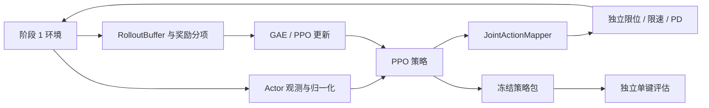

# 阶段 2：直接关节 PPO 与可复用低层技能

状态：`PARTIAL`。[VF-02-T01 动作映射健康检查](ACTION_MAPPING.md) 已完成：23 维具名 schema、掩码、独立限幅、执行目标反馈、停止恢复与 30/60/120 Hz 五案例物理验收通过。[VF-02-T02 单键可学性诊断](SINGLE_KEY_PPO.md) 已完成单种子 100 万转移与五检查点独立复验。VF-02-T03 跨目录汇总已修复并在原节点独立重验通过，三种子各 100/100。T04 已交付[离线几何前置检查](FEW_KEY_PREFLIGHT.md)，通用冻结低层技能包尚未交付。前置 VF-01 的单环境物理接口、释放判据和数据来源审计已通过。

## 控制范围

以 G1 + Dex5 的单侧臂/腕 7 维和手部 16 个独立驱动为完整 23 维 schema，耦合坐标不作为独立动作。最初仅开放完成单指任务所需的关节，用具名掩码限定；其余关节由记录在案的 PD 保持或冻结稳定模块控制。

在打开任一关节前检查控制权：身体策略若也输出手臂目标，必须屏蔽重叠或进行明确交接，不能直接叠加。关节顺序、可用限位、频率和支持方式均写入 manifest，不能只验证动作向量长度。

## 工程结构

| 模块与状态 | 位置（相对 `src/vskill_os/`） | 职责 |
|---|---|---|
| `ActionSchema / JointMask`（已实现） | `learning/policy_manifest.py` | 23 维具名动作、子集掩码、周期/尺度与关节顺序 |
| `JointActionMapper / JointActionSession`（已实现） | `adapters/isaac/learning/joint_action.py` | 从最终执行目标积分、独立限幅、停止/保持/恢复与令牌交接 |
| `check_mapping_trace`（已实现） | `learning/action_evaluation.py` | 绑定原始物理动作，独立重算映射与生命周期；物理成功另由 VF-01 Verifier 判定 |
| `teacher_observation`（已实现） | `adapters/isaac/learning/observations.py` | 关节角/速度、上一动作、目标键、指尖相对位姿、键程/接触 |
| `PressProgress / reward_terms`（已实现） | `adapters/isaac/learning/rewards.py` | 完整按下/释放进度与辅助塑形；保留各项曲线 |
| `PPOTrainer / rollout 张量`（已实现） | `adapters/learning_torch/ppo.py` | 采样、终态 GAE、更新与检查点；可恢复复验，未保存精确续训环境状态；Torch 可选依赖 |
| `LearnedPressKeySkill`（待实现） | `skills/learned_typing.py` | 以 key 为参数的有时限技能；仅返回声明与证据 |
| `ppo_verify / PrimitiveEvaluator`（单种子诊断已实现） | `adapters/isaac/learning/ppo_verify.py`、`learning/evaluation.py` | 权重/输入/动作与原始物理绑定，独立释放/安全/时间判据；三种子各 100/100，跨目录重验已通过 |

## 动作与观测

动作采用目标增量：

\[
q^{target}_{t+1}=\operatorname{clip}(q^{target}_t+\alpha a_t).
\]

`alpha` 逐关节配置并声明对应策略周期；改变 dt 时同时处理速度约束。独立安全过滤再执行关节位置、目标变化率与力/速度限制。保存 proposed 与 executed 两种目标，并把最终获准目标回写积分器，避免安全截断后仍积累不可执行目标。

reset 初始目标来自已审计初态和实测关节，不调用 IK，不使用 `dex5_postures.json`、旧 IK 校准轨迹或其导出的标签。FK 可作为仿真观测；利用 FK 读取指尖位置不意味着允许反解关节目标。

第一版是特权状态教师：精确目标键位置、指尖相对位置、接触与键程都需标注特权来源。实际文本可作训练标签/奖励，不作为 actor 输入；不将本阶段称为视觉控制。T02 采用固定物理单位归一化，无训练或评估统计拟合。若后续引入统计归一化，仅用训练集拟合、评估时冻结。

## 奖励与终止

主要进度只在目标键完成一次正确物理 Down→Up→净空后结算；未释放不能持续刷分。辅助项可使用接近距离、有效键程与释放净空，设置上限，不能压过真实任务结果。

分别记录误触、额外事件、过力、卡键、关节目标抖动和耗时惩罚。过力/支撑失败由独立安全层强制终止，不能靠负奖励让策略自行决定是否遵守。重复字符必须完成真实释放后重新按下。

GAE 区分物理失败 `terminated` 与时间截断 `truncated`：截断可对终态估值，不能对下一个 reset 状态估值。训练奖励和独立评估不共用一个“成功 bool”。

## 训练与交付顺序

| 任务 | 内容 | 门槛 |
|---|---|---|
| VF-02-T01 动作映射健康检查 | `DONE`：[实现与证据](ACTION_MAPPING.md)；19 项 CPU 检查、五个物理案例 | 无 IK；独立保护；极限两端属 CPU 证据，物理仅开放左食指 |
| VF-02-T02 单键可学性 | `DONE`：[单种子 PPO 与证据](SINGLE_KEY_PPO.md)；1,000,000 聚合转移、五检查点各 8 次复验 | 初始 0/8；训练后检查点完整物理成功。固定场景诊断，不以辅助奖励代替 |
| VF-02-T03 单键重复验收 | `DONE`：[三种子各 100/100，汇总修复与独立重验通过](MULTISEED.md) | 每种子 95/100；逐种子报告成功、参考区间和失败类型，不只池化平均 |
| VF-02-T04 少量键与退格 | `PARTIAL`：[离线几何检查](FEW_KEY_PREFLIGHT.md)已完成；目标条件策略、重复字符、真实 Backspace 尚待物理实现 | 每个任务键独立通过；退格消费真实按键改变文本 |
| VF-02-T05 冻结技能包 | 策略、归一化、关节 schema、配置/来源哈希和验收 | 阶段 3/4 各方法使用同一技能版本；修订版本需统一重测 |

`10^6` 是聚合环境转移数，不是每环境步数，也不是保证收敛的预算。记录环境数、控制/物理步数、训练时间和显存；不预先承诺训练小时数。

若不出现学习进展，依次检查动作映射/初态可达、键帽接触和事件、奖励与终止、观测归一化/GAE，最后再调整网络与预算。单键通过只证明控制基线，不证明后续短串或学习验证机制。

## 已有代码的使用方式

[Dex5 主动与耦合关节定义](../../src/vskill_os/simulation/dex5_assets.py)用于建立具名 schema；[chair_torch.py](../../src/vskill_os/adapters/chair_torch.py)可作为已有可选训练适配边界的参考，不直接视为该任务的 PPO；[typing.py](../../src/vskill_os/typing.py)中的目标文本规划与底层动作保持分离。旧 IK 控制仅作单独记录的效果对照。

返回[研究总览](../README.md)；下一阶段：[输入、验证与恢复决策](../03_verification_and_recovery/README.md)。
