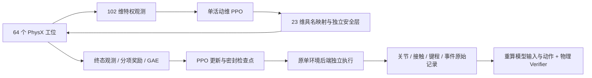
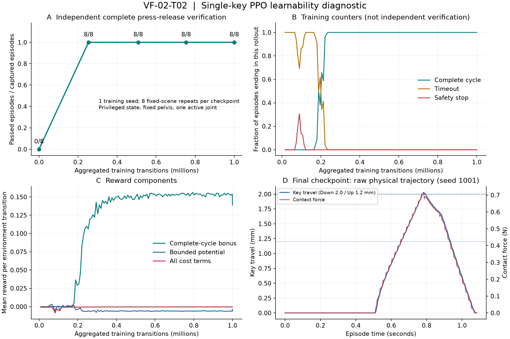

# VF-02-T02：单键可学性诊断

状态：`DONE`，2026-09-27，限下述单种子诊断范围。

本项在 PhysX 键帽接触仿真中训练直接关节 PPO，判断单键完整按下与释放是否出现学习进展。范围固定为 G1 + Dex5、固定骨盆、左食指、单 `a`、特权状态。它是诊断候选，不是已发布的 Runtime 技能；三种子重复验收、多键、视觉控制另行实施。

## 训练与独立复验

训练复用 VF-01-T04 的 `BatchPhysicsScene`，每个工位包含完整机器人与被动键盘；模型输出经环境持有的动作 Guard 和每物理子步安全监测后驱动 PD。模型只能获得数值观测，不能关闭保护、给键帽写目标或改变冻结关节。



| 模块（相对 `src/vskill_os/`） | 工程责任 |
|---|---|
| `learning/ppo_config.py` | 标准库配置、预算与评估种子、奖励系数、观测字段顺序 |
| `adapters/learning_torch/ppo.py` | Tanh 高斯策略、终态 GAE、PPO 更新；Torch 为可选依赖 |
| `adapters/learning_torch/checkpoint.py` | 严格加载候选权重，检查动作与观测 schema、来源声明及有限参数 |
| `adapters/isaac/learning/observations.py` | 固定物理单位归一化，不拟合评估数据 |
| `adapters/isaac/learning/rewards.py` | 每子步物理事件历史、一次完整周期、有限势函数与代价 |
| `adapters/isaac/learning/training_safety.py` | 与既有标量 Guard/安全监测规则对应的批量实现 |
| `adapters/isaac/learning/ppo_env.py` | GPU 张量采样、逐行终止/reset、保留真正终态 |
| `adapters/isaac/learning/ppo_worker.py` | 有界训练、逐次更新指标、权重与来源哈希 |
| `adapters/isaac/learning/ppo_evaluate.py` | 从保存的策略推理，在原始单环境采集完整物理轨迹 |
| `adapters/isaac/learning/ppo_verify.py` | 从原始物理样本重建观测、重算动作，调用既有独立物理 Verifier |
| `adapters/isaac/learning/ppo_runner.py` | 独立工作进程、超时/退出检查、断点复验与汇总 |

Agent 仍只调用技能；本项没有把训练器或关节动作端口挂到 Agent。旧 VF-01/T01 采集源文件不修改，已有证据继续使用原来源复核。

## 冻结协议

配置：[single_key_ppo_v1.json](../../configs/learning/verification_feedback/single_key_ppo_v1.json)。

| 项目 | 值与解释 |
|---|---|
| 训练种子 | `7`；一次正式训练，不挑选多次训练中最好的一次 |
| 预算 | **1,000,000 聚合环境转移**，64 个工位；不是每个工位 100 万步 |
| 频率 | 控制 60 Hz，物理 240 Hz，decimation = 4 |
| 时间上限 | 每回合 3 秒；按下与真实释放后可提前结束 |
| 动作 | 保留 23 维具名 schema，只开放 `left_hand_index_1_joint`；其他 22 维受掩码保护 |
| 网络 | Actor / Critic 各两层 64 单元 Tanh；Actor 只有一个活动输出，散射回完整 schema |
| 更新 | 每次 128 × 64 转移、4 轮、minibatch 2048；最后一轮仅 9 × 64，预算不超支 |
| 优化 | Adam 0.0003，gamma 0.99，GAE lambda 0.95，clip 0.2，梯度上限 0.5，KL 早停 0.03 |
| 检查点 | 0、253952、507904、753664、1000000；约 25 万的保存间隔向 rollout 边界取整 |
| 独立复验 | 每检查点固定种子 1001–1008，共 8 回合；用均值确定性动作，不继续更新 |

初态继承已经审计的直接关节姿态与稳定过程，不使用 IK、示范、旧 IK 轨迹或其导出标签。评估种子与训练种子不同，但**场景几何与起始姿态固定**：这些回合检验固定场景可重复性，不代表未见位姿的泛化测试，也不满足 T03 的三训练种子 × 100 回合门槛。

## 观测与奖励

102 维观测由 23 维关节位置、速度、最终执行目标、上一动作（共 92 维），指尖相对键帽位置（3 维），键程、力幅值、接触、已物理按下历史、净空时间、剩余时间和目标 `a` 标记构成。关节限位、8 rad/s、5 cm、4 mm、12 N 等明确物理尺度用于归一化；没有在线均值/方差拟合。

真值键位和接触是明确声明的特权传感器；Actor 不读文本缓冲区、Verifier 成功结果或未来事件。这一策略不称为视觉策略。

主奖励为 **+10 的单次完整物理周期**：目标键恰好一次有效按下，随后回弹，所有键无接触并保持净空至少 10 ms。错键、重复按下不能得到主奖励，管理层超时 KeyUp 不能补齐物理释放。

接近与键程使用有界势函数 `gamma × phi(next) − phi(current)`，真实终止的下一势能置零；同时记录耗时、动作变化、较大接触、误触及安全停止代价。保持压键不产生持续正向奖励。安全失败由环境强制终止，不依赖策略是否愿意承担惩罚。

GAE 对真实终止不自举；对时间截断使用 **reset 前实际终态** 的价值，且递归在 reset 边界断开。保存采样前的高斯隐变量计算 Tanh 修正后的概率，不从饱和动作反求隐变量。熵项使用高斯隐变量的熵，未将其误称为压缩后动作的精确熵。

## 证据与失败保留

训练每次更新保存分项奖励、完成/误触/超时/安全停止计数、优化指标与吞吐。训练计数仅作学习诊断，**没有为百万转移逐条保存原始物理样本**。完整的成功与失败原始轨迹由另一个复验进程采集。

独立复验逐条检查：权重与来源哈希、固定种子/时限、原始样本重建的 102 维输入、保存权重重新推理的 23 维动作、映射提议/限幅/最终目标，最后由原物理 Verifier 判定完整周期。文本正确但未物理释放依然失败；初始策略超时是有效失败证据，不等同于证据损坏。

启动器将配置和训练源码快照保存在 run 的同名 `.launch.json`、`.sources/`；每个检查点继续校验代码没有变化。权重包含优化器与随机数状态，但没有完整仿真环境状态，**不承诺从中精确续训**。复验可独立恢复，已经捕获的原始回合不会被覆盖。

首次正式运行先直接启动 worker，再在训练期间补存启动配置，`recorded_stage` 如实标记为 `during_training`；补存前后训练源码与检查点来源哈希一致。后续统一入口默认在启动 worker 前保存。

## 运行

```bash
# 数值、动作 Guard、安全监测和奖励边界测试；不启动 Isaac
make test-learning-ppo

# 一个种子、完整诊断预算、全部检查点复验
make isaac-learning-single-key-ppo

# 已有原始记录与候选权重的离线复核（需要 Torch，不启动 Isaac）
make verify-learning-single-key-ppo LEARNING_PPO_RUN=/absolute/path/to/run
```

也可在 Isaac 环境中运行 `python -m vskill_os.adapters.isaac.learning.ppo_runner --capture-available /absolute/path/to/run`，复验训练期间已经封存的检查点；不要对同一 run 同时启动多个采集器。`--evaluate-run` 补齐完成训练后的缺失复验，`--verify-run` 只重算已有证据。Kit 退出码、超时与 `failure.json` 均由父进程检查，单凭退出码零不算成功。

## 实测结果

正式运行：`artifacts/verification_feedback/vf02/ppo/run-20260927T050543-255757`。报告：[完整验收](../../reports/verification_feedback/vf02_t02_single_key_learnability.json)、[测试与预算记账](../../reports/verification_feedback/vf02_t02_validation.json)、[逐更新指标](../../reports/verification_feedback/vf02_t02_training_metrics.jsonl)。原始物理记录、五份权重和源码快照在上述本地目录保存，按仓库惯例不进入 Git；源码、配置、图表和小型报告随分支提交。

| 聚合训练转移 | 独立完整周期成功 | 每回合仿真时长 | 失败类型 |
|---|---|---|---|
| 0 | 0/8 | 3.000 秒 | 超时；未完成按下/释放，文本不匹配 |
| 253,952 | 8/8 | 1.083 秒 | 无 |
| 507,904 | 8/8 | 1.083 秒 | 无 |
| 753,664 | 8/8 | 1.083 秒 | 无 |
| 1,000,000 | 8/8 | 1.083 秒 | 无 |

所有 40 回合的证据完整性通过；8 个初始失败回合保持为失败，不作为损坏记录排除。策略输入与动作均可由保存的权重和原始物理记录重算一致。验收依据是初始与最终检查点的独立完整周期成功数改善，不以训练奖励或在线完成计数代替。



正式训练完成 123 次更新、15,625 个批控制步、62,500 个批物理步，共 1,000,000 环境转移。训练循环耗时 2,056.90 秒（约 34.3 分钟），父进程耗时 2,072.22 秒；中途并行进行了检查点复验，因此不是独占资源的吞吐基准。内存字段分别是 PyTorch 分配/保留峰值和进程 RSS，不能当成 PhysX 的全部 GPU 显存。

训练在线统计共 12,765 个结束回合：11,693 个完成周期、1,035 次超时、37 次安全停止、0 次误触。首次完成出现在 172,032 转移所在 rollout，最后一次安全停止在 114,688 转移所在 rollout。它们是探索期计数，未逐条保存原始训练轨迹，也未保存这 37 次停止的逐项故障码，不能用这些数字替代独立成功率或推断具体接触故障。

正式训练前另做 16,384 转移的吞吐预运行，配置仅预算不同，约 24.91 秒；其 64 个结束回合均超时，权重没有用于正式训练初始化。两次训练合计 **1,016,384** 转移；40 次独立复验另消耗 **3,520** 个环境转移，分别记账。

`make check`：270 项测试，269 通过，1 项因可选桌面依赖跳过；`make demo` 通过；Isaac/PyTorch 解释器下 13 项专项测试全部通过。还对原始证据副本注入输入、输出、缺失推理记录、来源哈希、非有限动作五类篡改，均被拒绝，见[拒绝报告](../../reports/verification_feedback/vf02_t02_evidence_rejection.json)。旧 VF-01/T01 的 13/8/26/22/16 份来源文件逐字节保持一致，见[来源审计](../../reports/verification_feedback/vf02_t02_prior_source_audit.json)；没有声称重跑旧物理实验。

结论限于一个训练种子、单活动关节和固定初态的可学性。8/8 不是泛化成功率或 95% 门槛验收；本轮未将学习策略接入真实终端、机器人相机或实体机器人。

返回[阶段 2](README.md)。下一项为 VF-02-T03：三个训练种子、每种子独立评估 100 回合，报告种子差异和失败类型。
