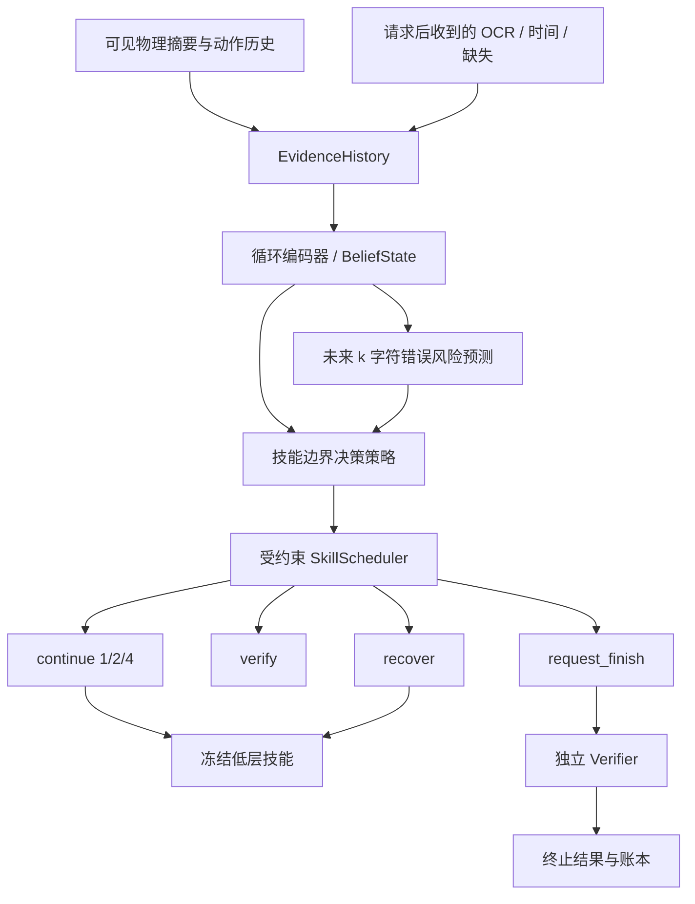

# 阶段 3：证据历史驱动的输入、验证与恢复

状态：待实现，是本课题的方法核心。前置：少量字符键、Backspace 和物理释放技能有稳定独立验收，随后冻结低层策略。所有比较使用相同低层包与观测权限。

## 研究假设与证据表示

仅有“最近一次读到的文本”无法表达动作发生后、屏幕尚未更新时的不确定性。拟建的历史状态同时保留：

- 已请求字符与低层动作完成顺序；物理接触、键程和释放的摘要及失败；
- 最近一次**实际收到**的屏幕识别、置信度、采集/到达时间和缺失标记；
- 自上次验证之后的动作数、实际经过时间、已消耗预算；
- 根据可见证据形成的文本/错误信念，不填写环境真值。

候选不一致表示包括“物理已触发但尚未看到文字”“数字文字变化但物理序列异常”“OCR 不确定”“反馈仍可能在途”。未知和在途应单独编码，不能过早把它们标为漏字。低层是否向高层提供原始键事件须在观测清单冻结；所有基线相同。

## 工程结构

| 拟建模块 | 建议位置（相对 `src/vskill_os/`） | 职责 |
|---|---|---|
| `EvidenceHistory / BeliefState` | `learning/history.py` | 缺失/年龄/冲突编码、按 env/episode 隔离的历史 |
| `RiskLabelBuilder` | `learning/risk_labels.py` | 用离线实际文本和事件生成漏字/重复/误字标签 |
| `RiskPredictor` | `adapters/learning_torch/risk.py` | 预测与校准；版本化观测 schema |
| `DecisionPolicy / SMDPTrainer` | `adapters/learning_torch/decision.py` | 循环策略、按技能实际持续时间更新 |
| `DecisionRequest / DecisionTransition` | `learning/decision.py` | 只描述技能目标、时长、成本与终止 |
| `SkillScheduler` | `learning/scheduler.py` | 合法动作掩码、预算、顺序和恢复建议；不生成关节命令 |
| 技能包装与 Registry 装配 | `skills/learned_typing.py` + 独立入口 | 复用 Runtime 契约、安全守卫、独立 Verifier 和 Ledger |

## 决策动作与执行

| 决策 | 执行语义 | 约束 |
|---|---|---|
| `continue(k)`，k=1/2/4 | 对接下来 k 个目标字符逐个调用闭环按键技能 | 每字符经过物理释放与安全门禁；不偷偷读屏，不开环播放长轨迹 |
| `verify()` | 请求新帧，等待或得到显式缺失/超时结果 | 消耗读屏成本；旧帧不得刷新证据时间 |
| `recover(kind)` | 有界物理释放、退格和重输；无法处理则终止/人工 | 先保证释放与稳定；只能根据当前可见证据操作，不能读真实文本后计算“完美纠错” |
| `request_finish()` | 请求终局独立判定 | 不能自行标记成功；所需最终读屏、稳定/释放窗口计入所有方法的成本 |

宏动作期间安全一直运行，低层物理失败可中止剩余字符。高层下一次决策必须知道已执行了哪些请求与停止原因，但不能从通用 `SkillOutcome` 获得免费的新文本真值。

初版编辑规则仅末尾追加/退格。恢复的 backspace_n 和重输字符串来自当前信念或 OCR；若焦点/光标未知且没有已验收的恢复技能，先验证或失败退出，不能隐藏地设置焦点、光标或文本。

## 风险预测与监督

拟建辅助目标：

\[
p_\phi(e\mid h_t,k),\quad k\in\{1,2,4\},\quad e\in\{漏字,重复字,误字\}.
\]

错误可以并存，按多标签或显式联合类别建模。标签在反馈延迟结算窗口结束后由独立记录生成，不把仍在途事件标成永久漏字。

普通轨迹只监督实际选择的 k；其他 k 是未观测反事实，必须 mask。需要比较不同 k 时使用冻结评测条件下的独立 rollout，不能为未执行分支编造标签。记录行为策略和 horizon 分布；在验证集检查校准、覆盖与分布偏移。

先训练和诊断预测器，再加入分层 RL。比较移除风险头、移除历史、仅事件或仅屏幕的消融；风险模型的输出只是信念，不可成为正式已验证事实。

## 持续时间与优化

每个决策记录开始/结束时间、真实持续时间 `Δt_i`、字符/验证/恢复成本和所有中断。采用统一参考时间 `τ0` 的折扣：

\[
\Gamma_i=\gamma^{\Delta t_i/\tau_0},\qquad
V(h_i)\leftarrow R_i+\Gamma_i V(h_{i+1}).
\]

`R_i` 汇总该技能内部按相对时间折扣的奖励；时间成本按持续时间积累。GAE 与截断 bootstrap 同样按此时间语义实现，不能把等待读屏与一次短按都当成等长步。

目标包含最终文本正确性、时间、验证与恢复开销；预算和安全约束由独立调度/控制层强制执行，不能只放在可被优化权衡掉的奖励中。拒绝无限恢复、无限请求验证或用提前退出选择容易样本。

## 工程任务和退出门槛

1. VF-03-T01：实现可见历史与信息隔离，用“物理 Down 但窗口丢输入”“旧 OCR 到达”“缺失帧”检查策略输入。
2. VF-03-T02：先训练风险预测器；报告不同 k 和错误类型的校准/区分能力、失败样例和未覆盖情况。
3. VF-03-T03：将规则策略跑在同一 Scheduler 上，验证 continue/verify/recover/finish 的预算与取消路径。
4. VF-03-T04：训练只学习验证时机的版本，再训练完整决策版本；低层权重保持冻结。
5. VF-03-T05：输出冻结候选、完整动作/成本记录，交给阶段 4 独立比较。

收益尚未成立时不增加双手或全身复杂度。若预测器准确但不能改善任务预算下的成功率，需分析其是否提供了规则策略无法利用的信息，而不是只报告预测分数。

规则纠错复用 [TypingPlanner.repair()](../../src/vskill_os/typing.py) 的公共前缀计算，对所有方法只输入相同的屏幕估计；其计划需要适配到冻结的学习技能，不直接沿用 Dex3/IK 执行路径。

返回[研究总览](../README.md)；下一阶段：[对照与消融评测](../04_benchmark_and_ablations/README.md)。
