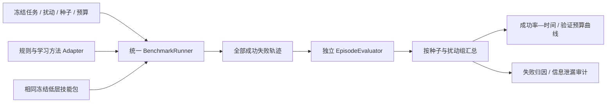

# 阶段 4：冻结任务集、强基线与机制消融

状态：评测架构设计。测试协议在 VF-01 时建立并冻结；阶段 3 产生候选后执行正式比较。目标是区分“有反馈就更好”和“学习证据机制带来额外收益”。

## 工程结构

| 拟建模块 | 建议位置 | 职责 |
|---|---|---|
| `BenchmarkSpec / DatasetSplit` | `src/vskill_os/learning/benchmark.py` | 字符串、扰动、种子、预算、测试版本与哈希 |
| `BaselinePolicy` 接口 | `src/vskill_os/learning/baselines.py` | 每个方法只接收相同可见历史，提交相同决策动作 |
| `BenchmarkRunner` | `src/vskill_os/learning/benchmark.py` | 冻结低层包、统一调度、完整运行与中断记录 |
| `EpisodeEvaluator / Metrics` | `src/vskill_os/learning/evaluation.py` | 不读取控制器自报成功，重算文本/释放/预算结果 |
| 冻结评测清单 | `configs/learning/verification_feedback/evaluation/` | 校验集与最终测试集隔离，禁止静默追加易样本 |
| 图表与失败索引 | `reports/verification_feedback/vf04/<run_id>/` | 成功率曲线、种子差异、置信区间与对应证据 |

上述路径均为建议。现有 [benchmark.py](../../src/vskill_os/benchmark.py) 可参考任务汇总方式，但其离散故障基线不能替代这里的真实按键/屏幕扰动评测。

## 必需的六组方法

| ID | 方法 | 目的 |
|---|---|---|
| B0 | PPO 输入，结束时统一验证 | 测量没有中途数字反馈的错误积累 |
| B1 | 每个字符验证 + 公共前缀规则纠错 | 测量充分验证的成功率与实际成本 |
| B2 | 固定每 2 / 4 字符验证 + 同一规则纠错 | 检验简单固定频率是否足够 |
| B3 | 置信度阈值触发验证 + 同一规则纠错 | 检验手工自适应是否足够；阈值在验证集调整 |
| B4 | 学习验证/继续时机 + 同一规则纠错 | 分离“何时验证”的价值 |
| B5 | 完整证据历史方法，联合选择继续/验证/恢复 | 检验学习恢复是否带来额外收益 |

各方法共用：低层模型、关节控制权限、字符/退格能力、可见物理摘要、OCR 接口、状态新鲜度、强制物理释放、安全停止与最终验证。规则纠错也只接收可见 OCR，不给它或学习方法额外真值。

B0 不得在低层悄悄逐字读屏。B1/B2/B3 调参给予事先声明的相同验证集机会，不为突出方法而选一个失调阈值。学习训练交互、风险标签、额外数据、人工与调参成本独立报告；共享低层训练成本单列，不能藏在基线之外。

## 扰动与数据切分

| 类别 | 具体条件 | 实现和统计要求 |
|---|---|---|
| 物理定位 | 键盘位置/角度偏移、允许范围内的初始手姿变化 | 通过实际物理场景改变，不注入伪 KeyDown |
| 物理接触 | 键程、摩擦和允许范围内的弹簧/阻尼差异 | 保留真值参数与键程/接触轨迹；不得改变安全门槛 |
| 数字传输 | 应用侧明确丢失输入、消费延迟 | 标记为软件扰动，分别记录物理事件和应用消费事件 |
| 屏幕反馈 | 采集/到达延迟、丢帧、OCR 缺失/噪声 | 人工损坏 OCR 输出标为合成反馈扰动，真实相机识别错误另统计 |
| 组合条件 | 未见的物理 × 数字/反馈组合 | 先分项定位，再组合；比较相同物理任务分布 |

键盘位姿、动力学参数、OCR 错误分布及预算范围先用训练/验证集确定，再冻结。测试字符串与扰动组合不能被训练或规则调参使用；整条 episode 分组，不拆相邻帧。长度 4–8 内要包含重复字符和相邻键切换。

焦点丢失可作为单列失效压力测试。若尚未有符合实体操作要求的焦点恢复技能，期望行为是检测并安全失败，而非用隐藏接口修复；不把无法恢复任务混入主恢复能力结论。

物理仿真不同动作会自然走向不同轨迹。跨方法固定初始条件、随机化样本和外生扰动的生成规则，不强求动作依赖事件在不同策略下逐项相同；软件扰动按明确的时钟/消费规则定义，避免偏向某种验证频率。

## 指标定义

**主指标**：给定截止时间和验证预算内，最终文本与目标完全一致、全部键物理释放、无安全失败、证据有效的回合比例。所有超时、提前中止和恢复失败进入分母。

| 指标 | 定义与解释 |
|---|---|
| 成功率—验证次数 / 时间曲线 | 冻结多档预算分别运行；最终必要验证也计入 |
| 首次无误输入率 | 首次完整尝试即正确、没有纠错的回合比例；提前进入恢复不记作首次无误 |
| 初次输入错误与最终 CER | 分别依据带初次/修复标记的轨迹和最终文本统计；不把修复后的正确性冒充首次正确 |
| 恢复时间与次数 | 从首次检测到错误到恢复后重新验证的时间；同时报告未恢复回合 |
| 额外按键 / 人工干预 | 目标之外的退格、重输及误触全部计数，人工触发单列 |
| 误判结束率 | 策略请求结束时实际不正确的比例；系统最终误报成功率另外统计 |
| 安全与证据失败 | 过力、卡键、姿态、过期反馈、缺样和拒绝结果分别报告 |

时间同时区分仿真任务时间与真实执行墙钟；真实桌面等待纳入端到端开销。成功耗时之外报告所有回合的时间/预算占用，避免只看幸存成功样本。按训练种子报告独立结果与区间，不把大量同种子帧数当作独立样本量。

## 机制消融与继续条件

依次比较去掉证据历史、去掉物理—数字冲突编码、去掉风险预测头、固定输入长度、固定恢复规则；尽量控制网络容量和数据预算。预测校准提升不能替代任务收益。

最小交付是冻结配置、每种方法的运行清单、全部轨迹索引、指标与失败样例，并在真实桌面链路和机器人相机上复验具有代表性的成功与失败。物理相机证据与文本状态机成绩分别汇报。

若完整方法无法稳定胜过 B2 或 B3，保留负结果，分析收益是否只来自更多读屏、更多训练或更强低层策略。此时先调整表示/假设与适用范围，不以增加双手或换更大网络替代机制验证。

返回[研究总览](../README.md)；机制成立后进入[视觉与多指扩展](../05_visual_policy_and_bimanual/README.md)。
