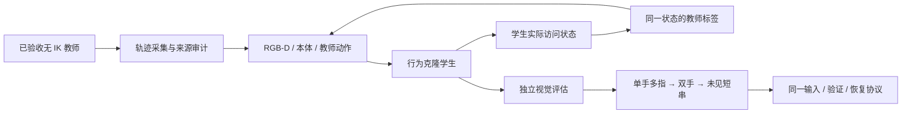

# 阶段 5：视觉策略与多指、双手扩展

状态：后续设计。前置：阶段 4 在特权状态条件下完成机制对照，并有独立的真实桌面/机器人相机复验。此阶段检验部署观察条件下的可用性，不能用学生成绩改写前一阶段的观察权限。

## 工程结构

| 拟建模块 | 建议位置（相对 `src/vskill_os/`） | 职责 |
|---|---|---|
| `SensorManifest / DatasetProvenance` | `learning/policy_manifest.py`、`learning/datasets.py` | 相机、本体、来源与数据划分；禁止混入旧 IK 标签 |
| `CameraObservationAdapter` | `adapters/isaac/learning/vision.py` | 机器人固定安装相机、图像时间、裁剪/遮挡、缺失 |
| `TeacherDatasetCollector` | `adapters/isaac/learning/collect.py` | 采集自身无 IK 教师的完整/失败轨迹 |
| `VisualStudent / BCTrainer` | `adapters/learning_torch/vision.py` | RGB-D 与本体历史到有界关节动作 |
| `DAggerCollector` | `adapters/isaac/learning/dagger.py` | 在学生访问的同一状态请求教师标签，记录接管与失败 |
| `HandAssignment / ControlOwnership` | `learning/coordination.py` + 低层 Adapter | 单手多指和双手的控制分区、动作空间版本、互斥与同步 |
| `SensorRestrictedEvaluator` | `learning/evaluation.py` | 检查输入字段和同任务成绩，拒绝真值泄漏 |

## 训练数据与观察限制

只使用阶段 2/3 自身无 IK 路径生成的状态、动作与标签。旧 IK 轨迹、IK 姿态种子及其蒸馏结果不进入严格无 IK 数据集；训练初态也要审计来源。冻结身体策略来源不明时，继续限定“手部路径无 IK”，不扩展成全身声明。

BC 先验证数据对齐与动作尺度；DAgger 在学生实际访问状态上调用教师，不能拿教师另一条轨迹的相邻帧替代。记录 teacher_query、干预和不可恢复状态；教师超出自己验证范围时标注不可用，不强迫学生模仿无效标签。必要的 RL 微调仍走独立安全与评估链。

学生仅接收声明可获得的 RGB-D 与本体字段。精确键位、仿真触力、实际文本缓冲和未来帧只留作训练标签/评估 Oracle。若将来有真实触觉传感器，需另建 schema 并单独比较，不沿用特权接触字段伪装传感器。

**避免免费验证**：低层键盘视觉流只包含手/键盘工作区，屏幕 ROI 要隔离；高层只能在 `verify()` 后获得新 OCR。若选择允许全视野视频持续读屏，则必须把持续读屏成本算入新的协议，并让所有基线获得相同权限，不能与“按需验证”成绩直接混合。

## 扩展课程与控制权

| 子阶段 | 新增复杂度 | 必须单独验收 |
|---|---|---|
| VF-05A 单指视觉 | 去掉精确指尖/键位等特权输入 | 单键、真实释放、遮挡/延迟与相对教师的下降 |
| VF-05B 单手多指 | 目标键与执行手指条件、手内干扰 | 逐指覆盖、误触、相邻键、短串恢复 |
| VF-05C 双手 | 两组 23 维上肢/手动作，手间碰撞与资源 | 同时接近但按序提交事件；原始低层任务逐一回归 |
| VF-05D 未见字符串 | 长度/组合泛化与验证决策迁移 | 冻结未见集，重新对照规则与学习验证策略 |

双手 46 维与身体 29 维策略在手臂上重叠。采用明确分区或原子交接，不直接叠加；姿态保持依旧独立监控。十指覆盖只在明确定义的十指任务中统计，报告每指参与次数、成功率和误触，不能仅凭总字符数声称十指能力。

## 交付与退出门槛

交付经来源审核的数据清单、视觉策略包、冻结归一化与传感器 schema、BC/DAgger 曲线、全部干预成本、机器人相机原帧和独立评估结果。Teacher/Student、单指/多指/双手分别报告，同预算比较。

关注未见键盘条件、图像缺失、遮挡和反馈时延。若视觉学生下降明显，先定位观测延迟、标注错位和访问状态偏移，再决定采集或微调；不能重新开放隐藏真值来补分。

现有[虚拟屏幕相机](../../src/vskill_os/adapters/isaac/virtual_screen.py)可作为真实图像来源，当前代码的示范采集/渲染频率不等于训练吞吐；需要在 VF-01 的可用规模内重新测量。

返回[研究总览](../README.md)；下一阶段：[自由坐姿技能交接](../06_seated_skill_handoff/README.md)。
