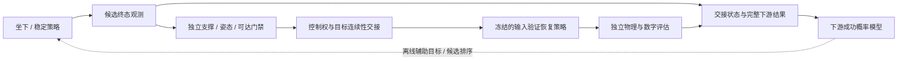

# 阶段 6：面向下游输入成功的自由坐姿技能交接

状态：后续设计。前置：单手闭环及其机制比较稳定，视觉/多指扩展按所声明的传感器范围验收。本阶段研究坐下或稳定技能应该在哪种状态结束，才利于后续精细触键与数字任务。

## 研究问题与假设

“坐稳”不保证“适合打字”。拟学习一个下游成功概率模型，用实际打字 rollout 监督，预测候选交接状态下的任务成功率；再辅助优化坐下/稳定策略的终态或停止时机。

模型只能在独立验证允许的稳定、支撑、可达和安全范围内给候选状态排序。预测分数不替代 `work_pose_ready`，也不能以提高打字成绩为理由放宽支撑判据。若模型只能在训练姿态上拟合，不能据此改变全身控制。

## 工程结构

| 拟建模块 | 建议位置（相对 `src/vskill_os/`） | 职责 |
|---|---|---|
| `HandoffObservation / HandoffRecord` | `learning/handoff.py` | 支撑、摆动、手臂状态、可见性、技能/资产版本与下游结果 |
| `DownstreamSuccessModel` | `adapters/learning_torch/handoff.py` | 预测完整输入成功概率，校准并检测训练范围外状态 |
| `TerminalStateObjective` | `adapters/isaac/learning/seated_task.py` | 在安全可行域内优化坐下/稳定终态或持续时间 |
| `ControlOwnershipManager` | 低层控制 Adapter | 身体策略到上肢策略的显式关节权限、目标连续性、超时接管 |
| `HandoffVerifier` | `learning/evaluation.py` / 现有 Verifier 扩展 | 从实测轨迹验证支撑、稳定、可达、释放与交接 |
| `ContinuousMissionRunner` | 独立实验入口 | 站姿→坐下→稳定→输入，同一物理时间线，无中途 reset |

## 数据与监督

先冻结已经验收的下游低层按键与高层验证/恢复策略，对不同合理的坐下/稳定终态执行真实下游任务。记录目标串、传感器条件、扰动、身体/手策略版本、支撑方式和失败类别；下游模型不得把目标任务差异误当姿态价值。

训练标签是固定时间/预算下的真实下游结果，不使用“手臂看起来可达”或策略自评分代替。相同坐下轨迹邻帧不可跨集合，按 episode/座椅/目标串/扰动组划分。对未见终态同时测量概率校准与最终任务收益；对不确定或分布外状态拒绝自动交接。

可先用安全终态采样研究模型，再优化姿态策略；终态采样 reset 仅是训练分析工具，最终联合验收必须从站姿连续执行，不将离散样本拼接为视频或成功轨迹。

## 对照实验

| 对照 | 坐下/稳定终止条件 | 说明 |
|---|---|---|
| H0 | 固定时长或既有稳定守卫 | 下游策略相同，基础参考 |
| H1 | 稳定 + 手工可达/摆动阈值 | 检验简单任务约束是否已经足够 |
| H2 | 安全守卫 + 学习的下游概率辅助 | 检验成功模型是否有额外收益 |
| H3 消融 | 相同模型移除数字结果标签或历史摆动信息 | 检验跨物理—数字联合目标的作用 |

保持下游策略、坐下训练预算、允许状态范围及传感器权限一致，按真实时间计入额外稳定等待。报告坐下成功、交接成功、条件打字成功和整段成功；同时给出各分母，不能只在坐下成功样本中报告整段成绩。

## 运行门禁与故障

- 自由根、真实座面支持、椅子速度/倾角、躯干摆动与足底状态有完整记录。
- 交接前双手与键盘脱离，坐姿及键盘标定仍有效；椅子位移使旧标定和就绪事实失效。
- 身体控制器若输出手臂目标，先完成控制权交接；策略推理超时不能持续重发过期动作。
- 下游失败保留是坐姿、交接、触键、反馈还是恢复原因，不用中途 reset 掩盖失败。
- 严格全身无 IK 要审计坐下/平衡策略的训练来源；旧冻结模型只可按已知范围作为对照。

现有 [free_sitting_scene.py](../../src/vskill_os/adapters/isaac/free_sitting_scene.py)、[sitting.py](../../src/vskill_os/control/sitting.py)及[连续演示](../../docs/experiments/dex5/CONTINUOUS_COMPUTER_DEMO.md)提供已有控制与记录参考，仍需建立新的学习任务和交接接口，不能直接宣称已有终态优化策略。

## 交付与后续范围

交付下游监督数据、成功模型与校准报告、姿态/终止策略候选、控制权协议、连续物理录像和独立三域结果。只有经过固定预算与未见条件对照，才讨论“终态优化改善实体计算机操作”。

主动滑椅、导航和真实软件任务随后各自立项。软件任务最终仍需独立测试执行器；屏幕出现成功文字不能代替软件测试。第一轮论文优先解释阶段 1–4 的因果关系，不同时承诺所有扩展。

用户提到的技能终态匹配相关工作在正式研究写作前需逐篇核对；本架构只给出候选工程机制，不声明已证明新颖性。

返回[研究总览](../README.md)。
