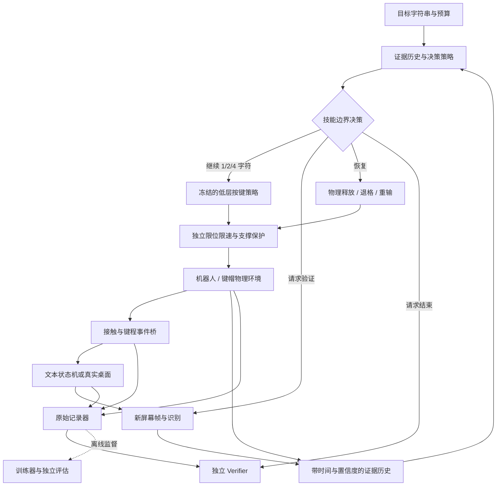

# 面向实体计算机操作的验证反馈驱动技能学习

状态：`PARTIAL`，2026-09-26。VF-01-T01 的离线契约、T02 单键物理闭环、T03 文本反馈隔离及 [T04 的 1/16/64 工位隔离与吞吐](01_environment_and_evidence/BATCH_ENVIRONMENT.md) 已交付。[T05 真实终端与机器人相机](01_environment_and_evidence/DESKTOP_CAMERA.md) 的单 `a` 六案例复验也已通过；学习模块仍待交付。本目录是研究实施说明，运行代码按仓库统一架构放入 `src/vskill_os/`，不建立第二套运行时。

## 研究主线

利用物理接触与屏幕反馈，让机器人学会何时继续输入、何时获取新证据，以及如何从错误中恢复。

目标是单臂单手在固定工位输入少量可达字符组成的 4–8 字符短串，并能纠正漏字、重复字和误字。第一个工程任务进一步缩小为一个键的“接近—按下—真实释放”。第一轮结果覆盖阶段 1–4；视觉策略、双手和自由坐姿在机制证据成立后推进。

核心问题：**物理动作成功和数字结果成功并不等价，在反馈不完整、存在延迟且验证有成本时，如何联合选择输入长度、验证时机与恢复动作？**

候选假设：保留物理—数字证据不一致及其时间历史，能比固定频率或简单置信度阈值更好地选择继续输入、验证和恢复，在同等时间或验证预算下提高整串成功率。若只胜过“末尾验证”，不能证明学习机制必要。

## 六个阶段

| 阶段 | 工程架构 | 回答的问题 | 进入下一阶段的主要依据 |
|---|---|---|---|
| VF-01 环境与证据 | [01_environment_and_evidence](01_environment_and_evidence/README.md) | 一次物理按下、事件和文本变化是否能独立追溯？ | 可重复 reset/step、独立评估、物理释放负例、1/16/64 环境隔离检查 |
| VF-02 直接关节 PPO | [02_joint_ppo_baseline](02_joint_ppo_baseline/README.md) | 单键及少量键的无 IK 控制是否可学？ | 单键三训练种子，各独立评估 100 回合，完整成功率目标约 95%；短串所需技能另验收 |
| VF-03 输入—验证—恢复 | [03_verification_and_recovery](03_verification_and_recovery/README.md) | 证据历史能否改善操作长度和恢复决策？ | 冻结低层技能，完成风险预测器与有持续时间的决策学习；通过观察权限审计 |
| VF-04 严格对照评测 | [04_benchmark_and_ablations](04_benchmark_and_ablations/README.md) | 学习机制是否优于强规则基线？ | 冻结任务/扰动/种子；与逐字、固定频率、阈值等基线公平比较；保留负结果 |
| VF-05 视觉与多指扩展 | [05_visual_policy_and_bimanual](05_visual_policy_and_bimanual/README.md) | 去掉特权观测后，机制是否仍有效？ | 无 IK 教师 → RGB-D 学生；单手多指、双手与未见短串逐级复验 |
| VF-06 自由坐姿交接 | [06_seated_skill_handoff](06_seated_skill_handoff/README.md) | 坐下终态能否使后续触键更可靠？ | 从站姿连续执行、无中途 reset，分别验证支撑、交接、输入和数字结果 |

上表门槛是待检验的实验目标，不是已有结果。VF-04 的测试集与预算协议在 VF-01 时就先建立；正式方法比较在 VF-03 后执行，避免用最终测试集调方法。

## 整体工程架构



“文本状态机 → 策略”没有直接真值通道；新屏幕证据需经请求验证接口。安全检查和真实释放守卫始终运行，不由策略选择是否执行。训练记录器可以读取仿真真值，但策略输入由单独的可见性过滤器构造。

## 共同设计与代码位置

先读 [COMMON_CONTRACTS.md](COMMON_CONTRACTS.md)：它统一消息、时间、观察权限、物理释放、结果和版本定义。每个阶段都说明已有实现与拟建模块；已有单环境与反馈诊断入口，尚无本课题的策略训练入口。

```text
src/vskill_os/learning/                    已有：记录、文本状态、反馈队列、观察过滤和独立评估
src/vskill_os/skills/                      现有技能；学习按键、观察与恢复包装待建
src/vskill_os/adapters/isaac/learning/      已有：单/批环境、物理/反馈诊断、真实终端与机器人相机适配
src/vskill_os/adapters/learning_torch/     拟建：PPO、风险预测器、循环决策与视觉训练
configs/learning/verification_feedback/   已有：契约、单/批物理、文本与相机反馈配置；训练配置待建
artifacts/verification_feedback/          已有：合成回放和原始物理记录；权重待训练
reports/verification_feedback/            已有：契约、物理和反馈验收；学习结果待采集
```

Isaac/Torch 只进入可选 Adapter；Agent/SkillGraph 不接收或输出关节向量。部署策略仍使用现有 Runtime、资源契约、独立 Verifier 和 Ledger。研究决策器提交的技能请求也必须经过相同门禁。

## 初始范围与假设

- 默认基于主工作树的 G1 + Dex5 资产，单臂/腕 7 维 + 单手独立驱动 16 维；站姿 Dex3 是单独对照路线，不复用这组动作维度。
- 实际字符集合和 Backspace 必须先经过同一手臂的无 IK 可达性与物理接触检查；不预先假定 `asdf` 与退格都可在相同小工作区完成。
- 保持既有坐姿稳定模块的策略和控制范围固定，首先声明“手部无 IK”。全身严格无 IK 还需审计冻结身体模块的数据来源；支持方式、关节控制权和失败均记录。
- 先锁定当前已验证的 Isaac 5.1 / Lab 2.3.2 资产基线，新建环境是否兼容以及可运行规模需实测；不自动迁移到 6.0.1。
- 初始焦点正确、光标在末尾；T03 状态机已定义插入、退格、删除和光标移动，默认物理任务仍只执行单 `a`。焦点/软件丢失是明确记录的扰动；物理编辑与焦点恢复需先有真实可执行的技能，不能用隐藏 API 自动修复。
- 暂不把导航、主动滑椅、真实编程任务、十指覆盖作为第一轮论文的必要条件。

## 当前仓库可复用的部分

| 已有内容 | 代码 | 复用边界 |
|---|---|---|
| 键程—事件桥 | [keyboard_bridge.py](../src/vskill_os/simulation/keyboard_bridge.py) | 迟滞、防抖、事件与 reason；超时 KeyUp 不等于物理释放 |
| 规则纠错 | [TypingPlanner.repair](../src/vskill_os/typing.py) | 最长公共前缀的退格/重输计划；需消费同一屏幕估计，不读隐藏真值；Dex5 执行映射另建 |
| 物理观测验证 | [dex5_typing.py](../src/vskill_os/simulation/dex5_typing.py)、[动作验证](../src/vskill_os/action_graph/runtime.py) | 复用验证语义；适配少量键、恢复与学习执行器，不能直接宣称现有脚本就是学习环境 |
| 桌面、屏幕、相机 | [virtual_computer.py](../src/vskill_os/adapters/virtual_computer.py)、[virtual_screen.py](../src/vskill_os/adapters/isaac/virtual_screen.py) | 现有特定任务闭环；本课题单 `a` PTY/机器人相机已复验；固定 ROI 与字体，非任意桌面视觉控制 |
| 姿态与安全领域 | [control/](../src/vskill_os/control)、[Runtime](../src/vskill_os/runtime.py) | 原守卫可复用；锁内状态重检、持续撤销和统一控制权仍是待加固项 |

研究想法与相关工作名称来自用户提供的方案；本次未重新检索或逐篇核验 RoboPianist、OmniPianist、Reward Machines、主动感知或 T-STAR，不据此声称发表级新颖性。正式写作前应逐篇建立“问题、证据表示、动作、验证成本、恢复、传感器权限”的对照表。

## 当前实现与下一项任务

**VF-01-T01 已完成契约范围交付**：`make demo-learning-evidence` 导出 10 个案例并独立复核，覆盖正确按下、持续物理释放、管理释放、重复/漏事件、反馈延迟、错误文本及有记录的修复。

**VF-01-T02 已完成固定工位单键物理范围交付**：23 维直接关节接口、本次开放单食指，3 个完整触键正例、7 个按预期拒绝的失败/截断回合及同种子重置复现通过。见[物理实现说明](01_environment_and_evidence/PHYSICAL_ENVIRONMENT.md)。

**VF-01-T03 已完成文本状态与反馈隔离范围交付**：事件消费、焦点/软件丢失、请求预算、延迟/缺失/过期、策略白名单和独立回放已接入单手物理环境。见[反馈实现说明](01_environment_and_evidence/TEXT_FEEDBACK.md)。

**VF-01-T04 已完成固定负载下的批环境验收**：1/16/64 工位动作、事件、反馈、随机数与局部 reset 隔离通过；吞吐约 11.02 / 61.57 / 84.66 环境转移每秒。见[批环境说明](01_environment_and_evidence/BATCH_ENVIRONMENT.md)。

**VF-01-T05 已完成单键真实终端与仿真机器人相机范围的复验**：两次正常输入通过，失焦、纹理冻结、相机缺失和提前结束四类负例正确拒绝；保留原始 RGB-D 并独立重跑 OCR。见[桌面与相机说明](01_environment_and_evidence/DESKTOP_CAMERA.md)。

下一项为 **VF-02-T01：动作映射健康检查**。当前仍是固定骨盆、人工直接关节诊断；多键、真实退格、PPO 和视觉策略尚未交付。

项目共同约束：[AGENTS.md](../AGENTS.md)、[统一架构](../docs/ARCHITECTURE.md)、[子项目状态](../docs/WORKSTREAMS.md)、[统一路线图](../docs/ROADMAP.md)。
